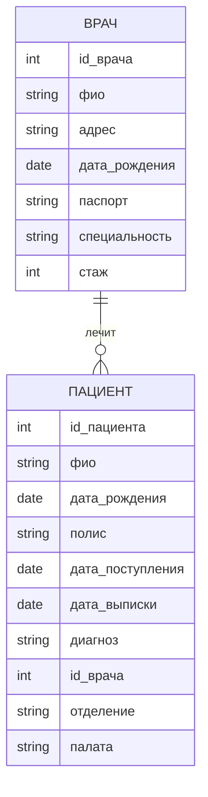
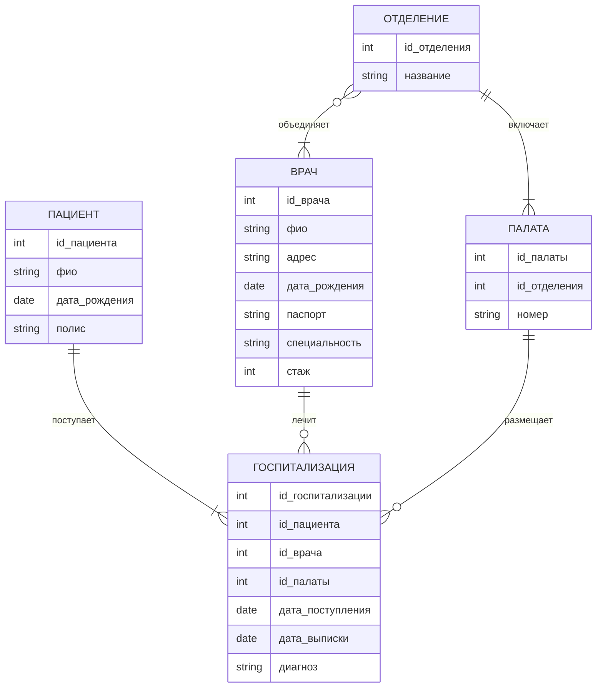
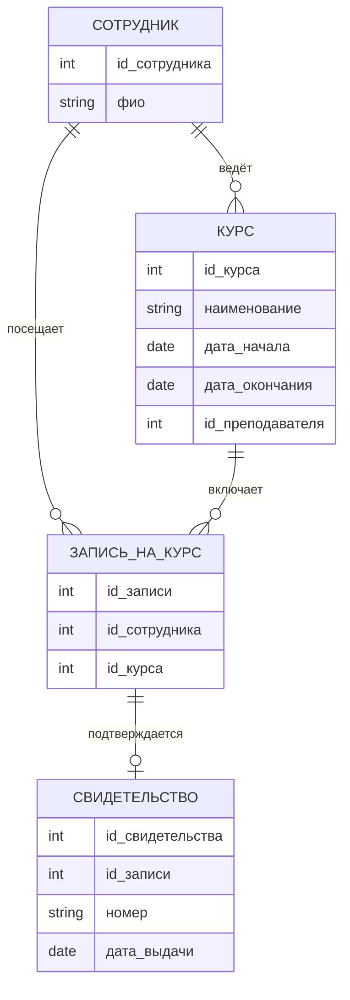
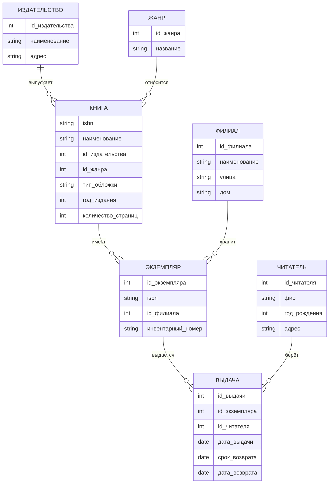
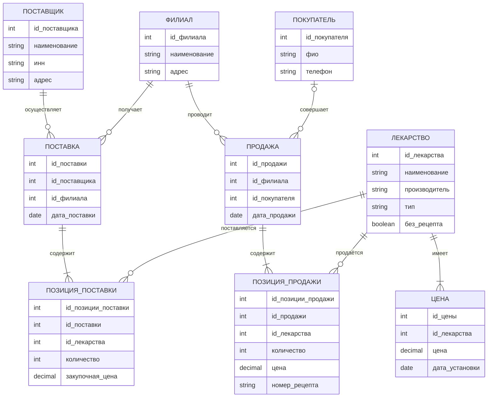
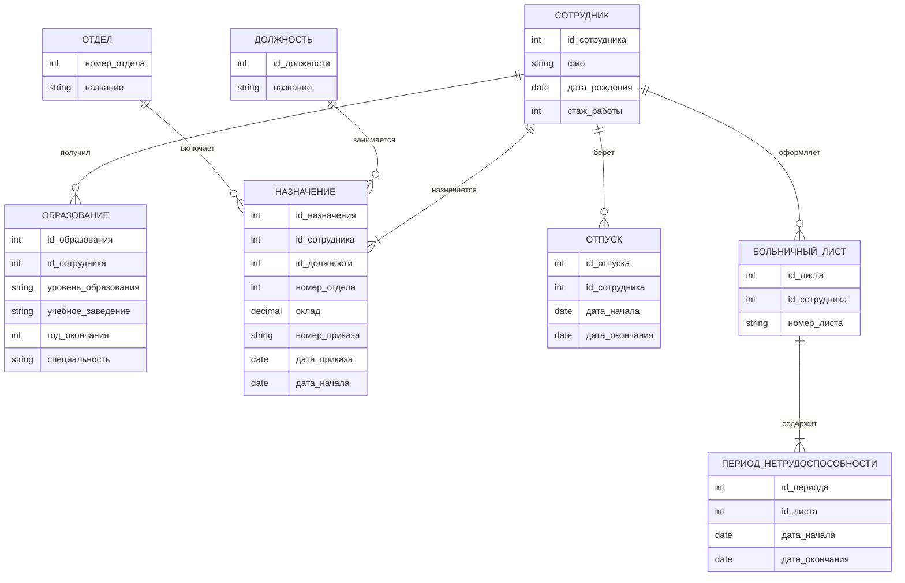

# Занятие 6: ER-диаграммы

## 1. Больница

В задании описаны две сущности: врач и пациент. Ниже две реализации: по заданию и расширенная.

### 1.1. Вариант 1: строго по заданию

Обоснование связей:

1. ВРАЧ ||--o{ ПАЦИЕНТ : "лечит" - так как у пациента один врач; врач ведёт многих

Пояснения:

1. Состав атрибутов соответствует заданию; добавлены только id_врача и id_пациента как идентификаторы.

### 1.2. Вариант 2: дополнительный

Отделение, палата и госпитализация вынесены в отдельные сущности. Теперь пациент может поступать несколько раз.

Обоснование связей:

1. ОТДЕЛЕНИЕ ||--|{ ПАЛАТА : "включает" - так как в отделении минимум одна палата
2. ОТДЕЛЕНИЕ }o--|{ ВРАЧ : "объединяет" - так как в отделении много врачей, врач в нескольких
3. ПАЦИЕНТ ||--|{ ГОСПИТАЛИЗАЦИЯ : "поступает" - так как пациент попадает в базу при поступлении
4. ВРАЧ ||--o{ ГОСПИТАЛИЗАЦИЯ : "лечит" - так как у госпитализации один врач, у врача много
5. ПАЛАТА ||--o{ ГОСПИТАЛИЗАЦИЯ : "размещает" - так как в палате лежат разные пациенты со временем

Пояснения:

1. Отделение госпитализации определяется через палату, отдельного атрибута не требуется.
2. У пациента одна или много госпитализаций (запись о пациенте создаётся при поступлении); у госпитализации ровно один пациент, один лечащий врач и одна палата; у врача и у палаты ноль или много госпитализаций.
3. В отделении работает один или много врачей, а врач может работать в нескольких отделениях или ни в одном.

---

## 2. Повышение квалификации

Обоснование связей:

1. СОТРУДНИК ||--o{ КУРС : "ведёт" - так как курс ведёт один сотрудник, сотрудник много курсов
2. СОТРУДНИК ||--o{ ЗАПИСЬ_НА_КУРС : "посещает" - так как сотрудник может посещать несколько курсов
3. КУРС ||--o{ ЗАПИСЬ_НА_КУРС : "включает" - так как на курс записывается много сотрудников
4. ЗАПИСЬ_НА_КУРС ||--o| СВИДЕТЕЛЬСТВО : "подтверждается" - так как свидетельство выдаётся только после окончания курса

Пояснения:

1. Курс ведёт сотрудник университета: id_преподавателя ссылается на СОТРУДНИК.
2. Каждый сотрудник может посещать несколько курсов, на курс могут записаться несколько сотрудников. Связь M:N через ЗАПИСЬ_НА_КУРС.
3. Свидетельство выдаётся по окончании курса: ноль или одно на запись (до окончания курса оно ещё не выдано).

---

## 3. Библиотека

Обоснование связей:

1. ИЗДАТЕЛЬСТВО ||--o{ КНИГА : "выпускает" - так как издательство выпускает много книг, у книги одно
2. ЖАНР ||--o{ КНИГА : "относится" - так как у книги один жанр по заданию
3. КНИГА ||--o{ ЭКЗЕМПЛЯР : "имеет" - так как у книги может быть несколько экземпляров
4. ФИЛИАЛ ||--o{ ЭКЗЕМПЛЯР : "хранит" - так как экземпляр хранится в одном филиале
5. ЭКЗЕМПЛЯР ||--o{ ВЫДАЧА : "выдаётся" - так как экземпляр выдаётся читателям много раз
6. ЧИТАТЕЛЬ ||--o{ ВЫДАЧА : "берёт" - так как читатель может брать много книг

Пояснения:

1. Два филиала представлены сущностью ФИЛИАЛ (наименование, улица, дом).
2. Пустая дата_возврата означает «книга на руках».
3. Издательство вынесено в отдельную сущность, так как для него хранятся наименование и адрес.
4. Экземпляры одной книги могут храниться в любом филиале или в обоих: ЭКЗЕМПЛЯР связан с КНИГА и ФИЛИАЛ.
5. тип_обложки: мягкая, твёрдая, суперобложка.

Поддержка запросов:

| Запрос                                                                      | Откуда берутся данные                                                    |
| --------------------------------------------------------------------------------- | ------------------------------------------------------------------------------------------- |
| Список книг (наименование, жанр, год издания) | КНИГА + ЖАНР                                                                       |
| Список филиалов                                                     | ФИЛИАЛ                                                                                |
| Список читателей                                                   | ЧИТАТЕЛЬ                                                                            |
| Читатели, у которых есть книги на руках           | ЧИТАТЕЛЬ + ВЫДАЧА, где дата_возврата пуста                |
| Книги у конкретного читателя                             | ВЫДАЧА + ЭКЗЕМПЛЯР + КНИГА, где дата_возврата пуста |

---

## 4. Аптека

Обоснование связей:

1. ЛЕКАРСТВО ||--|{ ЦЕНА : "имеет" - так как цена лекарства меняется, нужна история
2. ПОСТАВЩИК ||--o{ ПОСТАВКА : "осуществляет" - так как поставку выполняет один поставщик, поставок много
3. ФИЛИАЛ ||--o{ ПОСТАВКА : "получает" - так как филиал получает много поставок от поставщиков
4. ПОСТАВКА ||--|{ ПОЗИЦИЯ_ПОСТАВКИ : "содержит" - так как поставка содержит минимум одну позицию
5. ЛЕКАРСТВО ||--o{ ПОЗИЦИЯ_ПОСТАВКИ : "поставляется" - так как лекарство может поставляться много раз
6. ФИЛИАЛ ||--o{ ПРОДАЖА : "проводит" - так как каждая продажа проходит в одном филиале
7. ПОКУПАТЕЛЬ |o--o{ ПРОДАЖА : "совершает" - так как покупатель может быть не указан
8. ПРОДАЖА ||--|{ ПОЗИЦИЯ_ПРОДАЖИ : "содержит" - так как продажа содержит минимум одну позицию
9. ЛЕКАРСТВО ||--o{ ПОЗИЦИЯ_ПРОДАЖИ : "продаётся" - так как лекарство может продаваться много раз

Пояснения:

1. Атрибуты лекарства соответствуют заданию: наименование, производитель, тип, признак возможности продажи без рецепта. Поставщик связан с лекарством через поставки (ПОСТАВКА и ПОЗИЦИЯ_ПОСТАВКИ).
2. Цена может изменяться, поэтому хранится историей в ЦЕНА (значение и дата установки); в позиции продажи фиксируется цена на момент продажи.
3. Поставщик описан атрибутами из задания: наименование, ИНН, адрес. Покупатель: ФИО, телефон.
4. Покупатель в продаже необязателен (ноль или один).
5. Если без_рецепта ложно, в позиции продажи указывается номер_рецепта.
6. Остаток лекарства в филиале отдельной сущностью не хранится: он вычисляется как сумма поставок минус сумма продаж.

---

## 5. Предприятие

Обоснование связей:

1. СОТРУДНИК ||--o{ ОБРАЗОВАНИЕ : "получил" - так как у сотрудника может быть несколько образований
2. СОТРУДНИК ||--|{ НАЗНАЧЕНИЕ : "назначается" - так как у сотрудника минимум одно назначение
3. ДОЛЖНОСТЬ ||--o{ НАЗНАЧЕНИЕ : "занимается" - так как одну должность занимают многие сотрудники
4. ОТДЕЛ ||--o{ НАЗНАЧЕНИЕ : "включает" - так как в отделе работают многие сотрудники
5. СОТРУДНИК ||--o{ ОТПУСК : "берёт" - так как сотрудник может иметь много отпусков
6. СОТРУДНИК ||--o{ БОЛЬНИЧНЫЙ_ЛИСТ : "оформляет" - так как сотрудник может болеть много раз
7. БОЛЬНИЧНЫЙ_ЛИСТ ||--|{ ПЕРИОД_НЕТРУДОСПОСОБНОСТИ : "содержит" - так как лист содержит минимум один период

Пояснения:

1. Сотрудник: ФИО, дата рождения, стаж работы. Образование вынесено в отдельную сущность, так как у сотрудника может быть несколько записей (уровень образования, образовательное учреждение, год окончания, специальность).
2. Назначение фиксирует должность, оклад, номер и дату приказа, номер отдела. Каждый перевод создаёт новое назначение, поэтому история переводов хранится полностью; дата_начала показывает, с какого дня назначение действует, текущее назначение — последнее по дате.
3. Отпуска учитываются отдельной сущностью с периодом (дата начала и дата окончания).
4. Больничный лист содержит один или несколько периодов временной нетрудоспособности (ПЕРИОД_НЕТРУДОСПОСОБНОСТИ), так как лист может продлеваться.
