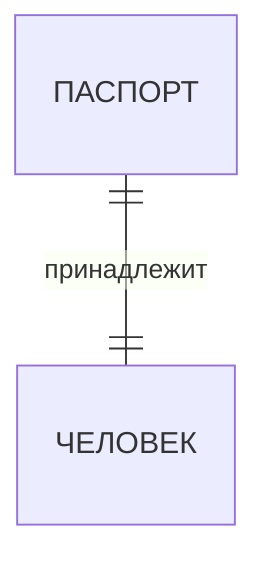
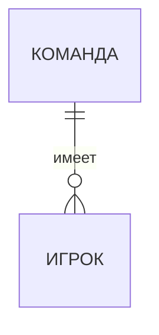
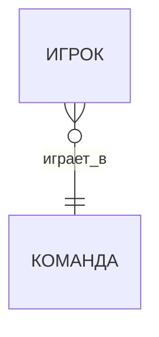
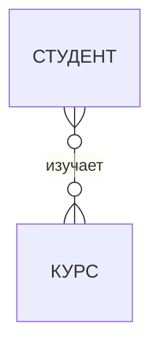
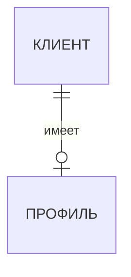
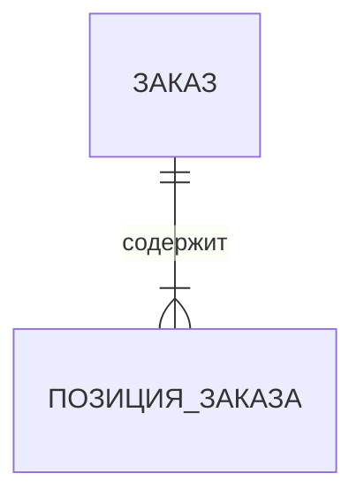
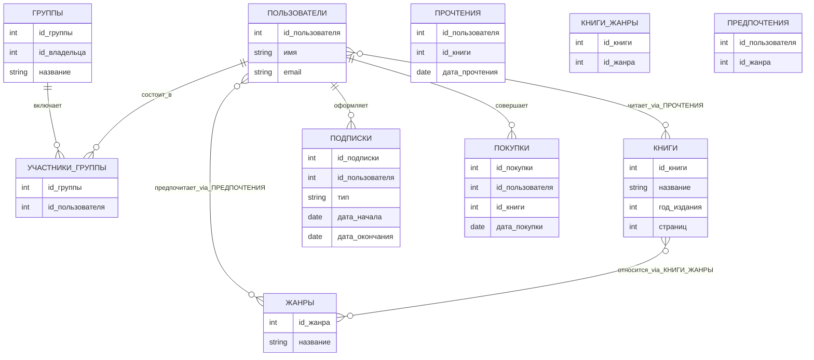

**Занятие 6: составление ER-диаграмм**
Знакомство с  ER-моделированием предполагается путём подготовки диаграмм в нотации Чена, "вороньей лапки" (Crow's Foot), Мартина:  

**Нотация Чена**  

1. Тип Сущности изображается прямоугольником с названием типа внутри.  
2. Тип Связи изображается ромбом с названием типа связи внутри. В большинстве случаев в названии связи участвует глагол.  
3. Роли в связи изображаются линиями (без стрелок и каких-либо декораций), соединяющими тип связи с типами сущностей.  
Кардинальность роли (минимальное и максимальное количество участников данной роли в связи) обозначается возле линии, ближе к типу сущности.  
4. Если название роли не очевидно из типа сущности, то ее тоже обозначают названием возле линии.  
5. Атрибуты изображаются овалами или скругленными прямоугольниками с названием атрибута. Принадлежность атрибута тому или иному типу связи изображается линией  
Примечание: в целях экономии места, одноименные атрибуты, характерные для разных типов сущностей, можно изображать в одном экземпляре, и связывать их с несколькими фигурами сущностей.  
6. Ключевой атрибут для каждой сущности изображается подчёркнутым текстом  
7. Слабые сущности (зависящие от других сущностей) изображаются прямоугольником с двойным (или утолщённым) контуром; владеющая связь также выделяется контуром.  
8. Связь вида “is-a”, или “являться подтипом” изображается равносторонним треугольником; базовый тип связывается с углом треугольника, подтип - с серединой противоположной стороны.  
9. Помните о том, что в связи могут участовать две или более ролей. В некоторых случаях у типа связи могут быть и свои атрибуты - если атрибут относится не к какой-то из сущностей, участвующей в связи, а описывает свойства самой связи. Например: Товар Входит в Заказ в определённом Количестве и по определённой Цене.  

**Обозначения кратностей и связей в Mermaid (ER-диаграммы)**  

**Основные правила**  

Mermaid использует нотацию "вороньей лапки" (Crow's Foot), где кратность связи кодируется парой символов на каждом конце линии.  
Символы кратности:  

`||`  = ровно один (обязательно)  
`o|`  = ноль или один (необязательно)  
`}o`  = ноль или много  
`}|`  = один или много  
`o{`  = ноль или много (с другой стороны)  
`|{`  = один или много (с другой стороны)  
`--`  = линия связи  
`via` = указание связующей таблицы для M:N  

Как читать символы кратности:  

Связь в Mermaid записывается так: `СУЩНОСТЬ1 <символы>--<символы> СУЩНОСТЬ2`  

Символы читаются "изнутри наружу" ‒ от линии к сущности:

| Символ у сущности | Значение                       |
|-------------------|--------------------------------|
| `||`                | Ровно один (обязательно)       |
| `o|`                | Ноль или один (необязательно)  |
| `}o`                | Ноль или много                 |
| `}|`                | Один или много                 |
| `o{`                | Ноль или много (зеркально)     |
| `|{`                | Один или много (зеркально)     |

**Примеры связей**  

**1:1 ‒ Один к одному**  
`ПАСПОРТ ||--|| ЧЕЛОВЕК : "принадлежит"`

Каждый паспорт принадлежит ровно одному человеку, и каждый человек имеет ровно один паспорт.

**1:N ‒ Один ко многим**  

`КОМАНДА ||--o{ ИГРОК : "имеет"`

Одна команда имеет ноль или много игроков; каждый игрок принадлежит ровно одной команде.

**N:1 ‒ Многие к одному**  
`ИГРОК }o--|| КОМАНДА : "играет_в"`  

Много игроков (ноль или более) играют в одной команде; каждый игрок ‒ ровно в одной.

**M:N ‒ Многие ко многим**  
`СТУДЕНТ }o--o{ КУРС : "изучает"`  

Студент изучает ноль или много курсов; курс изучают ноль или много студентов.

**С необязательной связью (0..1)**  
`КЛИЕНТ ||--o| ПРОФИЛЬ : "имеет"`  

Клиент имеет ноль или один профиль; профиль принадлежит ровно одному клиенту.

**Обязательная связь "один или много" (1..N)**  
`ЗАКАЗ ||--|{ ПОЗИЦИЯ_ЗАКАЗА : "содержит"`  

Заказ содержит одну или более позиций; каждая позиция принадлежит ровно одному заказу.

**Практический пример: "Онлайн-библиотека"**  

Условие задачи:
В онлайн-библиотеке пользователи читают книги по подписке или покупают их навсегда. Подписка бывает личной или групповой (до 4 человек, один ‒ "владелец" группы). У каждого пользователя есть любимые жанры. Система ведёт учёт пользователей, подписок, покупок, прочитанных книг и жанровых предпочтений.

**ER-диаграмма**  

**Задания** 
Подготовьте ER-диаграммы для каждой из предметных областей.  

1. Больница  (1 балл)
Информационная система больницы (стационара) содержит информацию о врачах больницы и о пациентах. Запись о каждом враче содержит:  
- ФИО  
- адрес  
- дату рождения  
- паспортные данные  
- специальность  
- стаж  
Информация о пациенте  
- ФИО  
- Дата рождения  
- Полис  
- Дата поступления  
- Дата выписки  
- Диагноз  
- Лечащий врач  
- Отделение  
- Палата  
2. Повышение квалификации  (1 балл)
Для сотрудников университета организованы курсы по повышению квалификации. Курс ведёт также сотрудник университета. Курс характеризуется датой начала, датой окончания, наименованием. Каждый сотрудник университета может посещать несколько курсов. По окончании курса выдается свидетельство.  
3. Библиотека  (2 балла)
Информационная система библиотеки, состоящей из двух филиалов, предназначена для учета книг, передаваемых читателям. Каждый филиал библиотеки имеет адрес (улица, дом) и наименование (минимальный набор атрибутов). При записи в библиотеку читатель предоставляет следующую информацию: ФИО, год рождения и адрес. Экземпляры одной и той же книги могут хранится в любом филиале или в обоих филиалах. Минимальный набор атрибутов книги:  
- ISBN  
- наименование  
- наименование и адрес издательства  
- тип обложки (мягкая, твердая, суперобложка)  
- год издания  
- жанр / тип  
- количество страниц  
Набор остальных типов сущностей и их атрибутов нужно спроектировать самостоятельно, предполагая реализацию в будущем следующих функций:  
Простые запросы:  
- Список книг в библиотеке (наименование, жанр, год издания)  
- Список филиалов  
- Список читателей  
Сложные запросы:  
- Читатели, у которых есть книги на руках  
- Книги у конкретного читателя  
4. Аптека  (3 балла)
Информационная система предназначена для учета движения товаров от поставщиков в несколько филиалов аптечной сети, продажи товаров покупателям.  
Лекарство  
- Наименование  
- Производитель  
- Поставщик  
- Тип  
- Цена (может изменяться)  
- Возможна ли продажа без рецепта  
Покупатель  
- ФИО  
- Телефон  
Поставщик  
- Наименование  
- ИНН  
- Адрес  
Набор остальных типов сущностей и их атрибутов нужно спроектировать самостоятельно  
5. Предприятие (3 балла)  
Малое предприятие разрабатывает информационную систему, частью которой является информационная система учета персонала. В информационной системе хранится следующая информация о сотруднике:  
- ФИО  
- Дата рождения  
- Образование  
- Образовательное учреждение, год окончания, специальность  
- Стаж работы  
А также информация о его назначениях, включая информацию о должности, окладе, номере и дате приказа, по которому он переводится на другую должность, номер отдела. В информационной системе учитываются отпуска сотрудников и больничные листы, с указанием периодов временной нетрудоспособности сотрудников.  