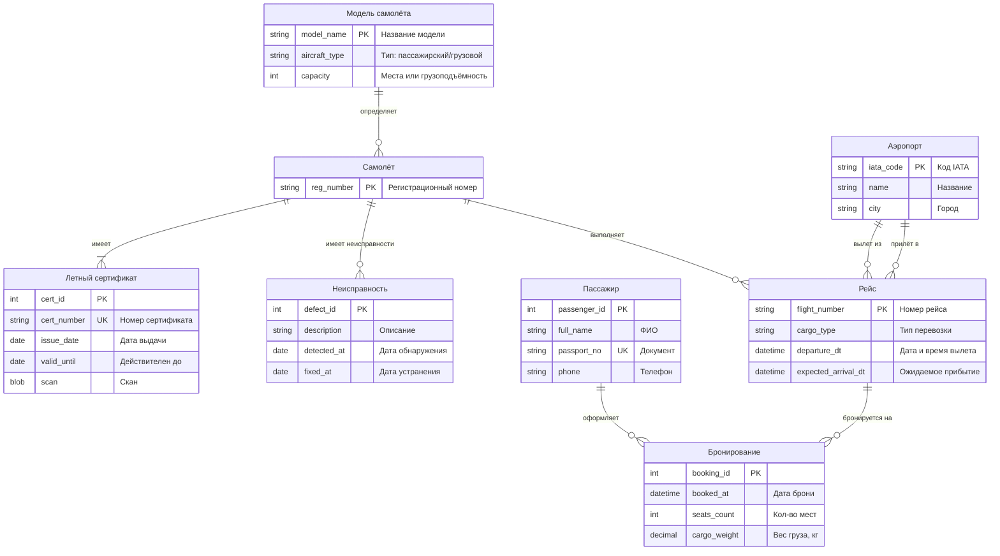
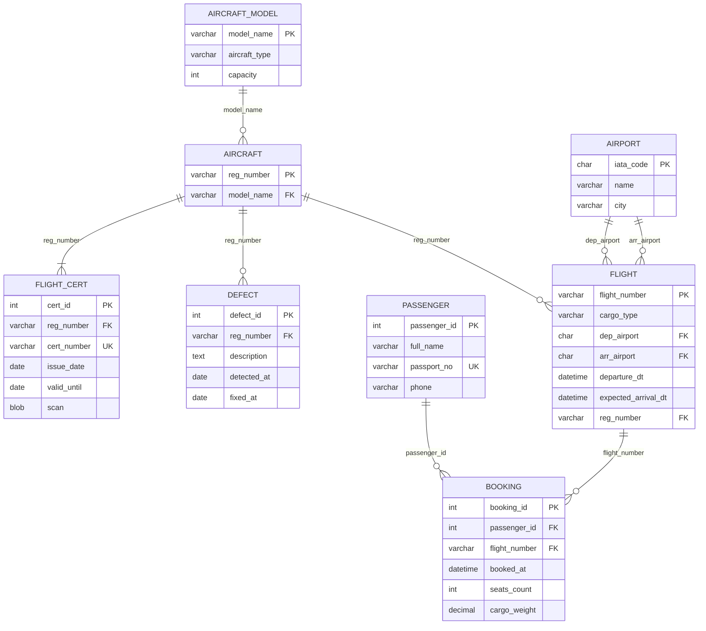
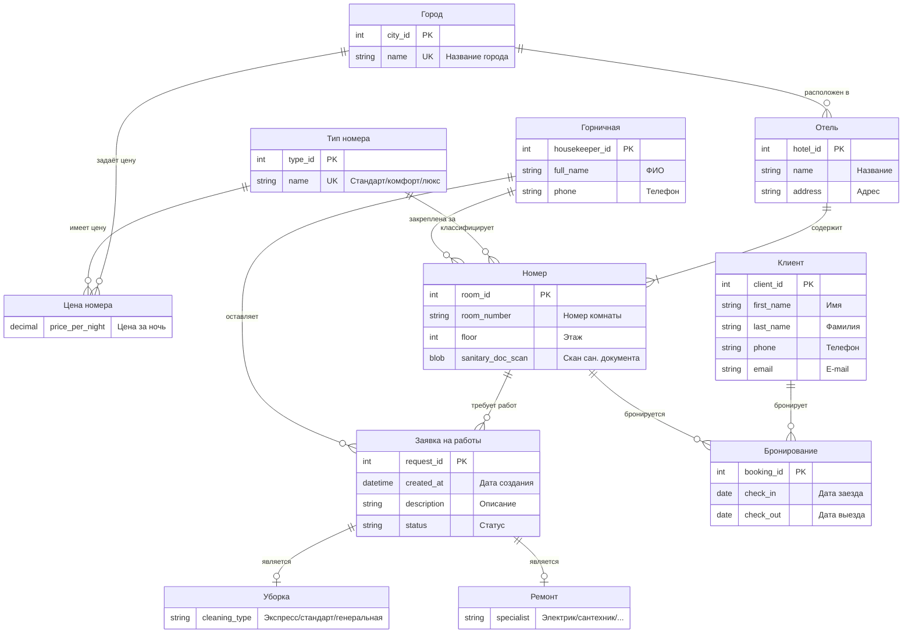
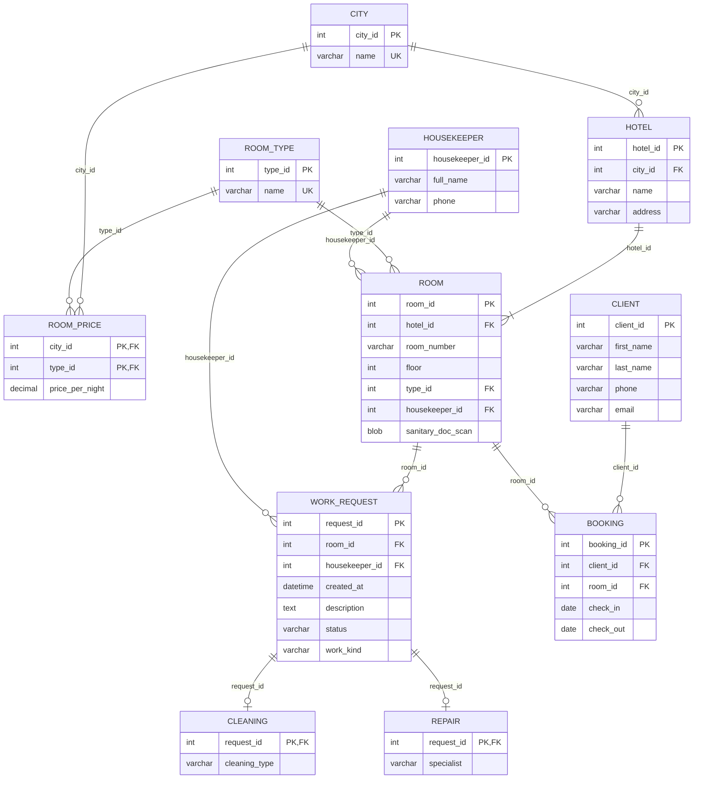
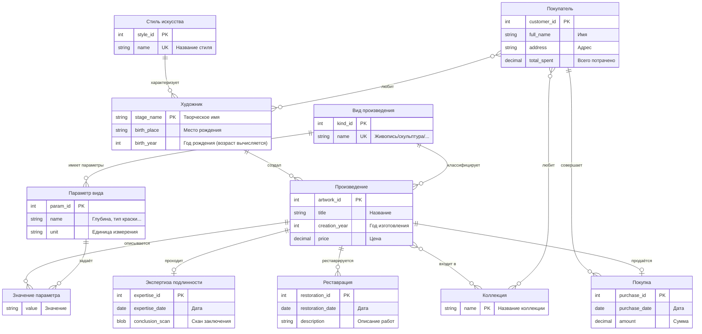
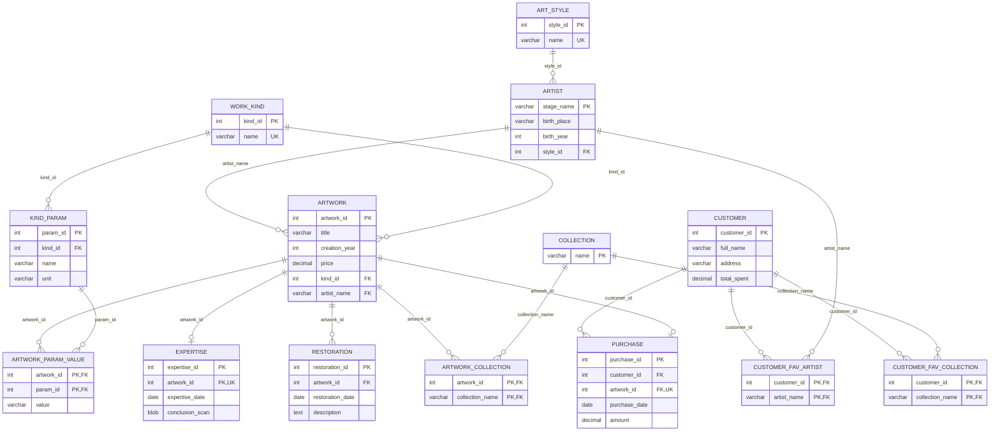

# Контрольная работа №2 по курсу «Базы данных»

# Вариант 1. Авиакомпания

## 1.1 Допущения

- Модель самолёта — отдельная сущность: тип (пассажирский/грузовой) и вместимость определяются моделью. Вместимость — число мест для пассажирского типа, грузоподъёмность (кг) для грузового.
- У самолёта может быть несколько сертификатов (история продлений); «действительный» определяется по сроку действия. Должен быть минимум один сертификат.
- Неисправности — отдельная сущность, у самолёта их 0..N; исправленная неисправность получает дату устранения.
- Аэропорты вынесены в справочник и идентифицируются кодом IATA.
- Тип перевозки рейса должен совпадать с типом самолёта, выполняющего рейс (проверяется триггером/приложением).
- Бронирование — ассоциативная сущность между пассажиром и рейсом. Для пассажирского рейса заполняется `seats_count`, для грузового — `cargo_weight`; ровно одно из двух (CHECK).
- Рейс идентифицируется уникальным номером `flight_number`.

## 1.2 ER-диаграмма (Crow's Foot)

## 1.3 Логическая схема (нотация Мартина)

## 1.4 Описание таблиц

**AIRCRAFT_MODEL** (модели самолётов)

| Атрибут | ПК | Обяз. | Уник. | Вн. ключ |
|---|---|---|---|---|
| model_name | + | + | + | |
| aircraft_type | | + | | |
| capacity | | + | | |

*Ограничения:* `aircraft_type IN ('пассажирский','грузовой')`, `capacity > 0`.

**AIRCRAFT** (самолёты)

| Атрибут | ПК | Обяз. | Уник. | Вн. ключ |
|---|---|---|---|---|
| reg_number | + | + | + | |
| model_name | | + | | AIRCRAFT_MODEL(model_name) |

**FLIGHT_CERT** (лётные сертификаты)

| Атрибут | ПК | Обяз. | Уник. | Вн. ключ |
|---|---|---|---|---|
| cert_id | + | + | + | |
| reg_number | | + | | AIRCRAFT(reg_number) |
| cert_number | | + | + | |
| issue_date | | + | | |
| valid_until | | + | | |
| scan | | + | | |

*Ограничение:* `valid_until > issue_date`. Самолёт допускается к рейсу, если есть сертификат с `valid_until >= дата вылета`.

**DEFECT** (некритические неисправности)

| Атрибут | ПК | Обяз. | Уник. | Вн. ключ |
|---|---|---|---|---|
| defect_id | + | + | + | |
| reg_number | | + | | AIRCRAFT(reg_number) |
| description | | + | | |
| detected_at | | + | | |
| fixed_at | | | | |

*`fixed_at IS NULL` — неисправность ещё ждёт ближайшего ТО.*

**AIRPORT** (аэропорты)

| Атрибут | ПК | Обяз. | Уник. | Вн. ключ |
|---|---|---|---|---|
| iata_code | + | + | + | |
| name | | + | | |
| city | | + | | |

**FLIGHT** (рейсы)

| Атрибут | ПК | Обяз. | Уник. | Вн. ключ |
|---|---|---|---|---|
| flight_number | + | + | + | |
| cargo_type | | + | | |
| dep_airport | | + | | AIRPORT(iata_code) |
| arr_airport | | + | | AIRPORT(iata_code) |
| departure_dt | | + | | |
| expected_arrival_dt | | + | | |
| reg_number | | + | | AIRCRAFT(reg_number) |

*Ограничения:* `dep_airport <> arr_airport`, `expected_arrival_dt > departure_dt`, `cargo_type IN ('пассажирская','грузовая')`.

**PASSENGER** (пассажиры)

| Атрибут | ПК | Обяз. | Уник. | Вн. ключ |
|---|---|---|---|---|
| passenger_id | + | + | + | |
| full_name | | + | | |
| passport_no | | + | + | |
| phone | | | | |

**BOOKING** (бронирования)

| Атрибут | ПК | Обяз. | Уник. | Вн. ключ |
|---|---|---|---|---|
| booking_id | + | + | + | |
| passenger_id | | + | | PASSENGER(passenger_id) |
| flight_number | | + | | FLIGHT(flight_number) |
| booked_at | | + | | |
| seats_count | | | | |
| cargo_weight | | | | |

*Ограничение:* ровно одно из `seats_count` / `cargo_weight` не NULL и > 0; какое именно — определяется типом рейса.

---

# Вариант 2. Сеть отелей

## 2.1 Допущения

- Название отеля уникально только в пределах города: уникальность составная `(city_id, name)`.
- Номер идентифицируется суррогатным `room_id`; уникальна пара `(hotel_id, room_number)`.
- Горничная закреплена за несколькими номерами (1:N); заявки на работы оставляет горничная, закреплённая за номером.
- Заявка на работы — супертип с двумя подтипами: **уборка** (тип: экспресс/стандарт/генеральная) и **ремонт** (специалист: электрик/сантехник/…). Подтип связан с супертипом 1:0..1.
- Санитарный документ — один на номер, хранится как скан в атрибуте номера.
- Цена номера зависит от пары (тип номера, город): отдельная таблица цен.
- Бронь — на один номер на период дат; пересечение периодов для одного номера запрещено.
- Контактные данные клиента: телефон и e-mail.

## 2.2 ER-диаграмма (Crow's Foot)

## 2.3 Логическая схема (нотация Мартина)

## 2.4 Описание таблиц

**CITY**

| Атрибут | ПК | Обяз. | Уник. | Вн. ключ |
|---|---|---|---|---|
| city_id | + | + | + | |
| name | | + | + | |

**HOTEL**

| Атрибут | ПК | Обяз. | Уник. | Вн. ключ |
|---|---|---|---|---|
| hotel_id | + | + | + | |
| city_id | | + | | CITY(city_id) |
| name | | + | | |
| address | | + | | |

*Составное ограничение уникальности: `UNIQUE (city_id, name)`.*

**ROOM_TYPE**

| Атрибут | ПК | Обяз. | Уник. | Вн. ключ |
|---|---|---|---|---|
| type_id | + | + | + | |
| name | | + | + | |

**ROOM_PRICE** (составной ПК `(city_id, type_id)`)

| Атрибут | ПК | Обяз. | Уник. | Вн. ключ |
|---|---|---|---|---|
| city_id | + | + | | CITY(city_id) |
| type_id | + | + | | ROOM_TYPE(type_id) |
| price_per_night | | + | | |

*Ограничение:* `price_per_night > 0`.

**HOUSEKEEPER**

| Атрибут | ПК | Обяз. | Уник. | Вн. ключ |
|---|---|---|---|---|
| housekeeper_id | + | + | + | |
| full_name | | + | | |
| phone | | | | |

**ROOM**

| Атрибут | ПК | Обяз. | Уник. | Вн. ключ |
|---|---|---|---|---|
| room_id | + | + | + | |
| hotel_id | | + | | HOTEL(hotel_id) |
| room_number | | + | | |
| floor | | + | | |
| type_id | | + | | ROOM_TYPE(type_id) |
| housekeeper_id | | + | | HOUSEKEEPER(housekeeper_id) |
| sanitary_doc_scan | | + | | |

*Составное ограничение уникальности: `UNIQUE (hotel_id, room_number)`.*

**WORK_REQUEST**

| Атрибут | ПК | Обяз. | Уник. | Вн. ключ |
|---|---|---|---|---|
| request_id | + | + | + | |
| room_id | | + | | ROOM(room_id) |
| housekeeper_id | | + | | HOUSEKEEPER(housekeeper_id) |
| created_at | | + | | |
| description | | | | |
| status | | + | | |
| work_kind | | + | | |

*`work_kind IN ('уборка','ремонт')` — дискриминатор подтипов.*

**CLEANING**

| Атрибут | ПК | Обяз. | Уник. | Вн. ключ |
|---|---|---|---|---|
| request_id | + | + | + | WORK_REQUEST(request_id) |
| cleaning_type | | + | | |

*`cleaning_type IN ('экспресс','стандарт','генеральная')`.*

**REPAIR**

| Атрибут | ПК | Обяз. | Уник. | Вн. ключ |
|---|---|---|---|---|
| request_id | + | + | + | WORK_REQUEST(request_id) |
| specialist | | + | | |

*`specialist IN ('электрик','сантехник', ...)`.*

**CLIENT**

| Атрибут | ПК | Обяз. | Уник. | Вн. ключ |
|---|---|---|---|---|
| client_id | + | + | + | |
| first_name | | + | | |
| last_name | | + | | |
| phone | | + | | |
| email | | | | |

**BOOKING**

| Атрибут | ПК | Обяз. | Уник. | Вн. ключ |
|---|---|---|---|---|
| booking_id | + | + | + | |
| client_id | | + | | CLIENT(client_id) |
| room_id | | + | | ROOM(room_id) |
| check_in | | + | | |
| check_out | | + | | |

*Ограничения:* `check_out > check_in`; периоды для одного `room_id` не пересекаются.

---

# Вариант 3. Галерея

## 3.1 Допущения

- Творческое имя художника уникально, поэтому является естественным первичным ключом. Вместо «возраста» хранится год рождения (возраст — вычисляемое значение, иначе устаревает).
- У художника один основной стиль (N:1 к справочнику стилей).
- Параметры, специфичные для вида произведения, хранятся по схеме «параметр вида → значение параметра произведения»: у каждого вида свой набор параметров (глубина для скульптуры, тип краски для живописи и т. д.), и новый вид добавляется без изменения схемы.
- Экспертиза подлинности — не более одной на произведение (1:0..1); реставраций — 0..N.
- Коллекции идентифицируются названием; связь произведение–коллекция M:N.
- Покупка — отдельная сущность; произведение продаётся не более одного раза. Атрибут `total_spent` покупателя хранится по условию задачи и поддерживается как сумма его покупок (триггер).
- Предпочтения покупателя (любимые художники и коллекции) — две связи M:N.

## 3.2 ER-диаграмма (Crow's Foot)

## 3.3 Логическая схема (нотация Мартина)

## 3.4 Описание таблиц

**ART_STYLE**

| Атрибут | ПК | Обяз. | Уник. | Вн. ключ |
|---|---|---|---|---|
| style_id | + | + | + | |
| name | | + | + | |

**ARTIST**

| Атрибут | ПК | Обяз. | Уник. | Вн. ключ |
|---|---|---|---|---|
| stage_name | + | + | + | |
| birth_place | | + | | |
| birth_year | | + | | |
| style_id | | + | | ART_STYLE(style_id) |

**WORK_KIND**

| Атрибут | ПК | Обяз. | Уник. | Вн. ключ |
|---|---|---|---|---|
| kind_id | + | + | + | |
| name | | + | + | |

**KIND_PARAM**

| Атрибут | ПК | Обяз. | Уник. | Вн. ключ |
|---|---|---|---|---|
| param_id | + | + | + | |
| kind_id | | + | | WORK_KIND(kind_id) |
| name | | + | | |
| unit | | | | |

*Составное ограничение уникальности: `UNIQUE (kind_id, name)`.*

**ARTWORK**

| Атрибут | ПК | Обяз. | Уник. | Вн. ключ |
|---|---|---|---|---|
| artwork_id | + | + | + | |
| title | | + | | |
| creation_year | | + | | |
| price | | + | | |
| kind_id | | + | | WORK_KIND(kind_id) |
| artist_name | | + | | ARTIST(stage_name) |

*Ограничение:* `price >= 0`.

**ARTWORK_PARAM_VALUE** (составной ПК `(artwork_id, param_id)`)

| Атрибут | ПК | Обяз. | Уник. | Вн. ключ |
|---|---|---|---|---|
| artwork_id | + | + | | ARTWORK(artwork_id) |
| param_id | + | + | | KIND_PARAM(param_id) |
| value | | + | | |

*Параметр должен относиться к виду данного произведения (`KIND_PARAM.kind_id = ARTWORK.kind_id`) — контролируется триггером.*

**EXPERTISE**

| Атрибут | ПК | Обяз. | Уник. | Вн. ключ |
|---|---|---|---|---|
| expertise_id | + | + | + | |
| artwork_id | | + | + | ARTWORK(artwork_id) |
| expertise_date | | + | | |
| conclusion_scan | | + | | |

**RESTORATION**

| Атрибут | ПК | Обяз. | Уник. | Вн. ключ |
|---|---|---|---|---|
| restoration_id | + | + | + | |
| artwork_id | | + | | ARTWORK(artwork_id) |
| restoration_date | | + | | |
| description | | + | | |

**COLLECTION**

| Атрибут | ПК | Обяз. | Уник. | Вн. ключ |
|---|---|---|---|---|
| name | + | + | + | |

**ARTWORK_COLLECTION** (составной ПК)

| Атрибут | ПК | Обяз. | Уник. | Вн. ключ |
|---|---|---|---|---|
| artwork_id | + | + | | ARTWORK(artwork_id) |
| collection_name | + | + | | COLLECTION(name) |

**CUSTOMER**

| Атрибут | ПК | Обяз. | Уник. | Вн. ключ |
|---|---|---|---|---|
| customer_id | + | + | + | |
| full_name | | + | | |
| address | | + | | |
| total_spent | | + | | |

*`total_spent DEFAULT 0`, `total_spent >= 0`; значение = сумма `PURCHASE.amount` покупателя.*

**PURCHASE**

| Атрибут | ПК | Обяз. | Уник. | Вн. ключ |
|---|---|---|---|---|
| purchase_id | + | + | + | |
| customer_id | | + | | CUSTOMER(customer_id) |
| artwork_id | | + | + | ARTWORK(artwork_id) |
| purchase_date | | + | | |
| amount | | + | | |

**CUSTOMER_FAV_ARTIST** (составной ПК)

| Атрибут | ПК | Обяз. | Уник. | Вн. ключ |
|---|---|---|---|---|
| customer_id | + | + | | CUSTOMER(customer_id) |
| artist_name | + | + | | ARTIST(stage_name) |

**CUSTOMER_FAV_COLLECTION** (составной ПК)

| Атрибут | ПК | Обяз. | Уник. | Вн. ключ |
|---|---|---|---|---|
| customer_id | + | + | | CUSTOMER(customer_id) |
| collection_name | + | + | | COLLECTION(name) |