## 9. Футбольный турнир (РФПЛ)

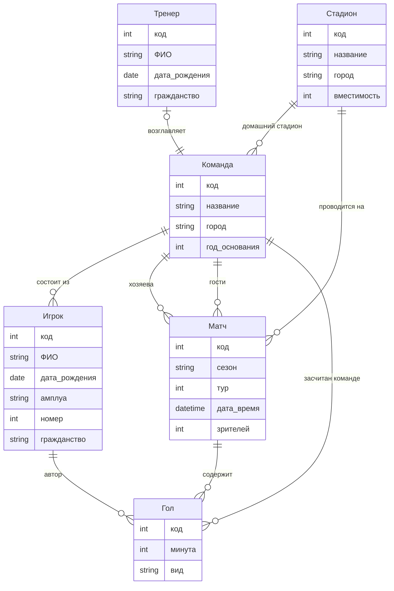

| Таблица / Атрибут | ПК  | Обяз. | Уник. | Вн. ключ     |
| ----------------- | --- | ----- | ----- | ------------ |
| **тренер**        |     |       |       |              |
| код               | +   | +     | +     |              |
| ФИО               |     | +     |       |              |
| дата_рождения     |     | +     |       |              |
| гражданство       |     | +     |       |              |
| **стадион**       |     |       |       |              |
| код               | +   | +     | +     |              |
| название          |     | +     | +     |              |
| город             |     | +     |       |              |
| вместимость       |     | +     |       |              |
| **команда**       |     |       |       |              |
| код               | +   | +     | +     |              |
| название          |     | +     | +     |              |
| город             |     | +     |       |              |
| год_основания     |     |       |       |              |
| тренер_код        |     | +     | +     | тренер(код)  |
| стадион_код       |     | +     |       | стадион(код) |
| **игрок**         |     |       |       |              |
| код               | +   | +     | +     |              |
| ФИО               |     | +     |       |              |
| дата_рождения     |     | +     |       |              |
| амплуа            |     | +     |       |              |
| номер             |     | +     |       |              |
| гражданство       |     | +     |       |              |
| команда_код       |     | +     |       | команда(код) |
| **матч**          |     |       |       |              |
| код               | +   | +     | +     |              |
| сезон             |     | +     |       |              |
| тур               |     | +     |       |              |
| дата_время        |     | +     |       |              |
| хозяева_код       |     | +     |       | команда(код) |
| гости_код         |     | +     |       | команда(код) |
| стадион_код       |     | +     |       | стадион(код) |
| зрителей          |     |       |       |              |
| **гол**           |     |       |       |              |
| код               | +   | +     | +     |              |
| матч_код          |     | +     |       | матч(код)    |
| автор_код         |     | +     |       | игрок(код)   |
| команда_код       |     | +     |       | команда(код) |
| минута            |     | +     |       |              |
| вид               |     | +     |       |              |

_`хозяева_код <> гости_код`; `вид IN ('с игры','пенальти','штрафной','автогол')`; счёт матча вычисляется по голам; `UNIQUE(команда_код, номер)` в «игрок»; `зрителей <= вместимость`._

---

## 11. Кулинарная книга

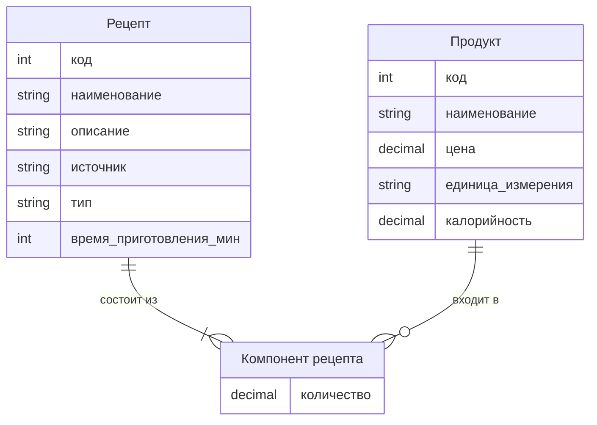

| Таблица / Атрибут       | ПК  | Обяз. | Уник. | Вн. ключ     |
| ----------------------- | --- | ----- | ----- | ------------ |
| **рецепт**              |     |       |       |              |
| код                     | +   | +     | +     |              |
| наименование            |     | +     |       |              |
| описание                |     |       |       |              |
| источник                |     |       |       |              |
| тип                     |     | +     |       |              |
| время*приготовления*мин |     | +     |       |              |
| **продукт**             |     |       |       |              |
| код                     | +   | +     | +     |              |
| наименование            |     | +     | +     |              |
| цена                    |     | +     |       |              |
| единица_измерения       |     | +     |       |              |
| калорийность            |     | +     |       |              |
| **компонент_рецепта**   |     |       |       |              |
| рецепт_код              | +   | +     |       | рецепт(код)  |
| продукт_код             | +   | +     |       | продукт(код) |
| количество              |     | +     |       |              |

---

## 12. Поликлиника

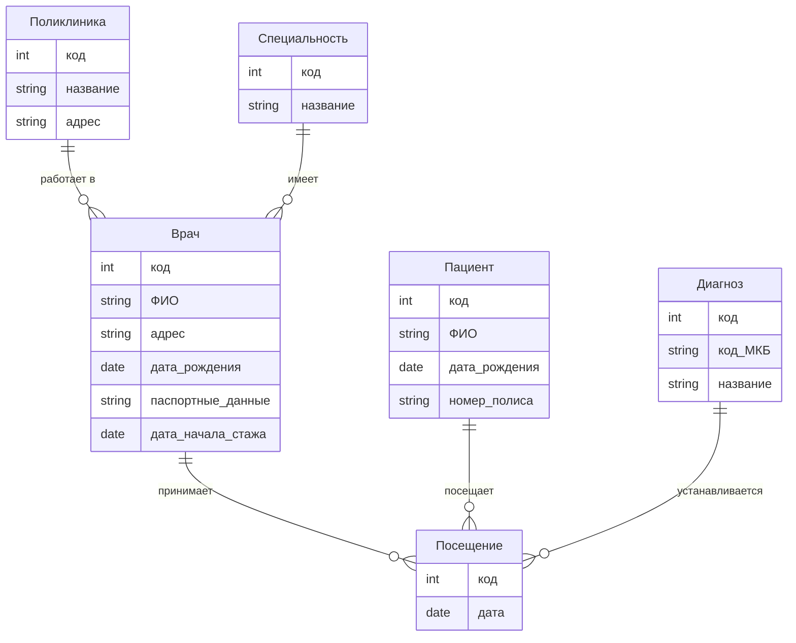

| Таблица / Атрибут | ПК  | Обяз. | Уник. | Вн. ключ           |
| ----------------- | --- | ----- | ----- | ------------------ |
| **поликлиника**   |     |       |       |                    |
| код               | +   | +     | +     |                    |
| название          |     | +     |       |                    |
| адрес             |     | +     |       |                    |
| **специальность** |     |       |       |                    |
| код               | +   | +     | +     |                    |
| название          |     | +     | +     |                    |
| **врач**          |     |       |       |                    |
| код               | +   | +     | +     |                    |
| ФИО               |     | +     |       |                    |
| адрес             |     | +     |       |                    |
| дата_рождения     |     | +     |       |                    |
| паспортные_данные |     | +     | +     |                    |
| дата*начала*стажа |     | +     |       |                    |
| поликлиника_код   |     | +     |       | поликлиника(код)   |
| специальность_код |     | +     |       | специальность(код) |
| **пациент**       |     |       |       |                    |
| код               | +   | +     | +     |                    |
| ФИО               |     | +     |       |                    |
| дата_рождения     |     | +     |       |                    |
| номер_полиса      |     | +     | +     |                    |
| **диагноз**       |     |       |       |                    |
| код               | +   | +     | +     |                    |
| код_МКБ           |     | +     | +     |                    |
| название          |     | +     |       |                    |
| **посещение**     |     |       |       |                    |
| код               | +   | +     | +     |                    |
| дата              |     | +     |       |                    |
| врач_код          |     | +     |       | врач(код)          |
| пациент_код       |     | +     |       | пациент(код)       |
| диагноз_код       |     |       |       | диагноз(код)       |

---

## 13. Сессия

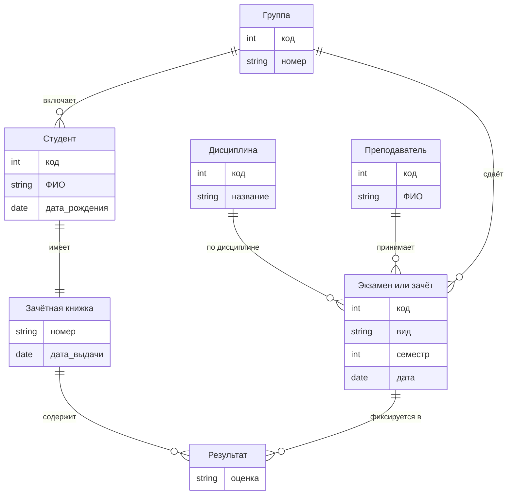

| Таблица / Атрибут     | ПК  | Обяз. | Уник. | Вн. ключ               |
| --------------------- | --- | ----- | ----- | ---------------------- |
| **группа**            |     |       |       |                        |
| код                   | +   | +     | +     |                        |
| номер                 |     | +     | +     |                        |
| **студент**           |     |       |       |                        |
| код                   | +   | +     | +     |                        |
| ФИО                   |     | +     |       |                        |
| дата_рождения         |     | +     |       |                        |
| группа_код            |     | +     |       | группа(код)            |
| **зачётная_книжка**   |     |       |       |                        |
| номер                 | +   | +     | +     |                        |
| студент_код           |     | +     | +     | студент(код)           |
| дата_выдачи           |     | +     |       |                        |
| **преподаватель**     |     |       |       |                        |
| код                   | +   | +     | +     |                        |
| ФИО                   |     | +     |       |                        |
| **дисциплина**        |     |       |       |                        |
| код                   | +   | +     | +     |                        |
| название              |     | +     | +     |                        |
| **экзамен*или*зачёт** |     |       |       |                        |
| код                   | +   | +     | +     |                        |
| вид                   |     | +     |       |                        |
| семестр               |     | +     |       |                        |
| дата                  |     | +     |       |                        |
| дисциплина_код        |     | +     |       | дисциплина(код)        |
| преподаватель_код     |     | +     |       | преподаватель(код)     |
| группа_код            |     | +     |       | группа(код)            |
| **результат**         |     |       |       |                        |
| зачётка_номер         | +   | +     |       | зачётная_книжка(номер) |
| мероприятие_код       | +   | +     |       | экзамен*или*зачёт(код) |
| оценка                |     | +     |       |                        |

_`вид IN ('экзамен','зачёт')`._

---

## 14. Расписание занятий

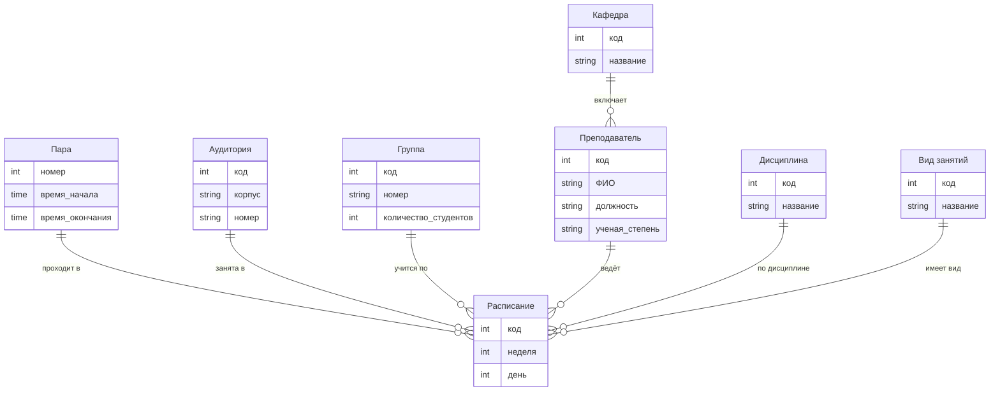

| Таблица / Атрибут    | ПК  | Обяз. | Уник. | Вн. ключ           |
| -------------------- | --- | ----- | ----- | ------------------ |
| **кафедра**          |     |       |       |                    |
| код                  | +   | +     | +     |                    |
| название             |     | +     | +     |                    |
| **преподаватель**    |     |       |       |                    |
| код                  | +   | +     | +     |                    |
| ФИО                  |     | +     |       |                    |
| должность            |     | +     |       |                    |
| ученая_степень       |     |       |       |                    |
| кафедра_код          |     | +     |       | кафедра(код)       |
| **пара**             |     |       |       |                    |
| номер                | +   | +     | +     |                    |
| время_начала         |     | +     |       |                    |
| время_окончания      |     | +     |       |                    |
| **аудитория**        |     |       |       |                    |
| код                  | +   | +     | +     |                    |
| корпус               |     | +     |       |                    |
| номер                |     | +     |       |                    |
| **группа**           |     |       |       |                    |
| код                  | +   | +     | +     |                    |
| номер                |     | +     | +     |                    |
| количество_студентов |     | +     |       |                    |
| **дисциплина**       |     |       |       |                    |
| код                  | +   | +     | +     |                    |
| название             |     | +     | +     |                    |
| **вид_занятий**      |     |       |       |                    |
| код                  | +   | +     | +     |                    |
| название             |     | +     | +     |                    |
| **расписание**       |     |       |       |                    |
| код                  | +   | +     | +     |                    |
| неделя               |     | +     |       |                    |
| день                 |     | +     |       |                    |
| пара_номер           |     | +     |       | пара(номер)        |
| аудитория_код        |     | +     |       | аудитория(код)     |
| группа_код           |     | +     |       | группа(код)        |
| преподаватель_код    |     | +     |       | преподаватель(код) |
| дисциплина_код       |     | +     |       | дисциплина(код)    |
| вид*занятий*код      |     | +     |       | вид_занятий(код)   |

_Составные ограничения уникальности: `UNIQUE(неделя, день, пара_номер, группа_код)`, `UNIQUE(неделя, день, пара_номер, преподаватель_код)`, `UNIQUE(неделя, день, пара_номер, аудитория_код)`; в аудитории `UNIQUE(корпус, номер)`._

---

## 15. Социальная сеть (ВКонтакте)

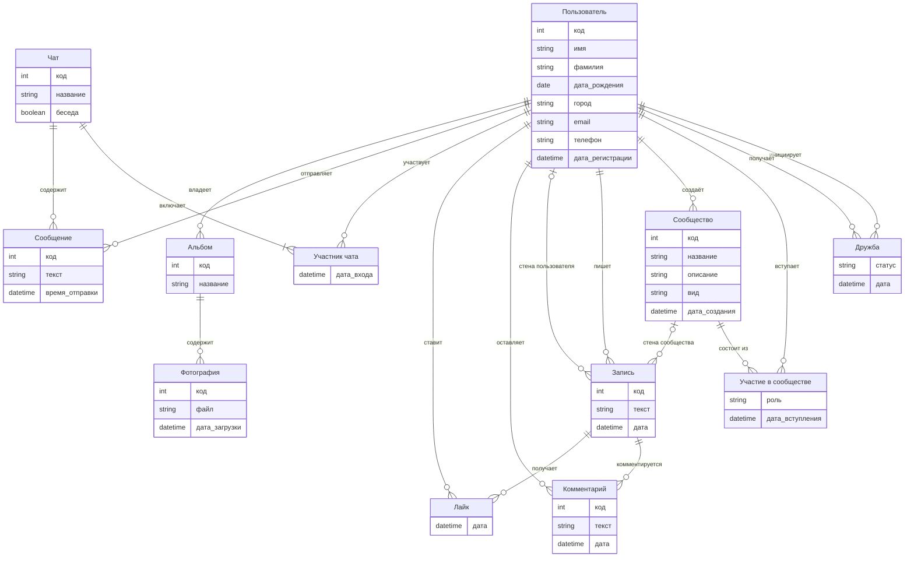

| Таблица / Атрибут        | ПК  | Обяз. | Уник. | Вн. ключ          |
| ------------------------ | --- | ----- | ----- | ----------------- |
| **пользователь**         |     |       |       |                   |
| код                      | +   | +     | +     |                   |
| имя                      |     | +     |       |                   |
| фамилия                  |     | +     |       |                   |
| дата_рождения            |     |       |       |                   |
| город                    |     |       |       |                   |
| email                    |     |       | +     |                   |
| телефон                  |     |       | +     |                   |
| дата_регистрации         |     | +     |       |                   |
| **дружба**               |     |       |       |                   |
| инициатор_код            | +   | +     |       | пользователь(код) |
| адресат_код              | +   | +     |       | пользователь(код) |
| статус                   |     | +     |       |                   |
| дата                     |     | +     |       |                   |
| **сообщество**           |     |       |       |                   |
| код                      | +   | +     | +     |                   |
| название                 |     | +     |       |                   |
| описание                 |     |       |       |                   |
| вид                      |     | +     |       |                   |
| дата_создания            |     | +     |       |                   |
| создатель_код            |     | +     |       | пользователь(код) |
| **участие*в*сообществе** |     |       |       |                   |
| сообщество_код           | +   | +     |       | сообщество(код)   |
| пользователь_код         | +   | +     |       | пользователь(код) |
| роль                     |     | +     |       |                   |
| дата_вступления          |     | +     |       |                   |
| **запись**               |     |       |       |                   |
| код                      | +   | +     | +     |                   |
| автор_код                |     | +     |       | пользователь(код) |
| стена*пользователя*код   |     |       |       | пользователь(код) |
| стена*сообщества*код     |     |       |       | сообщество(код)   |
| текст                    |     | +     |       |                   |
| дата                     |     | +     |       |                   |
| **комментарий**          |     |       |       |                   |
| код                      | +   | +     | +     |                   |
| запись_код               |     | +     |       | запись(код)       |
| автор_код                |     | +     |       | пользователь(код) |
| текст                    |     | +     |       |                   |
| дата                     |     | +     |       |                   |
| **лайк**                 |     |       |       |                   |
| запись_код               | +   | +     |       | запись(код)       |
| пользователь_код         | +   | +     |       | пользователь(код) |
| дата                     |     | +     |       |                   |
| **чат**                  |     |       |       |                   |
| код                      | +   | +     | +     |                   |
| название                 |     |       |       |                   |
| беседа                   |     | +     |       |                   |
| **участник_чата**        |     |       |       |                   |
| чат_код                  | +   | +     |       | чат(код)          |
| пользователь_код         | +   | +     |       | пользователь(код) |
| дата_входа               |     | +     |       |                   |
| **сообщение**            |     |       |       |                   |
| код                      | +   | +     | +     |                   |
| чат_код                  |     | +     |       | чат(код)          |
| отправитель_код          |     | +     |       | пользователь(код) |
| текст                    |     | +     |       |                   |
| время_отправки           |     | +     |       |                   |
| **альбом**               |     |       |       |                   |
| код                      | +   | +     | +     |                   |
| владелец_код             |     | +     |       | пользователь(код) |
| название                 |     | +     |       |                   |
| **фотография**           |     |       |       |                   |
| код                      | +   | +     | +     |                   |
| альбом_код               |     | +     |       | альбом(код)       |
| файл                     |     | +     |       |                   |
| дата_загрузки            |     | +     |       |                   |

_Ограничения:_ в «запись» ровно одно из `стена_пользователя_код` / `стена_сообщества_код` не NULL; в «дружба» `инициатор_код <> адресат_код`.

---

## 16. Интернет-магазин мебели

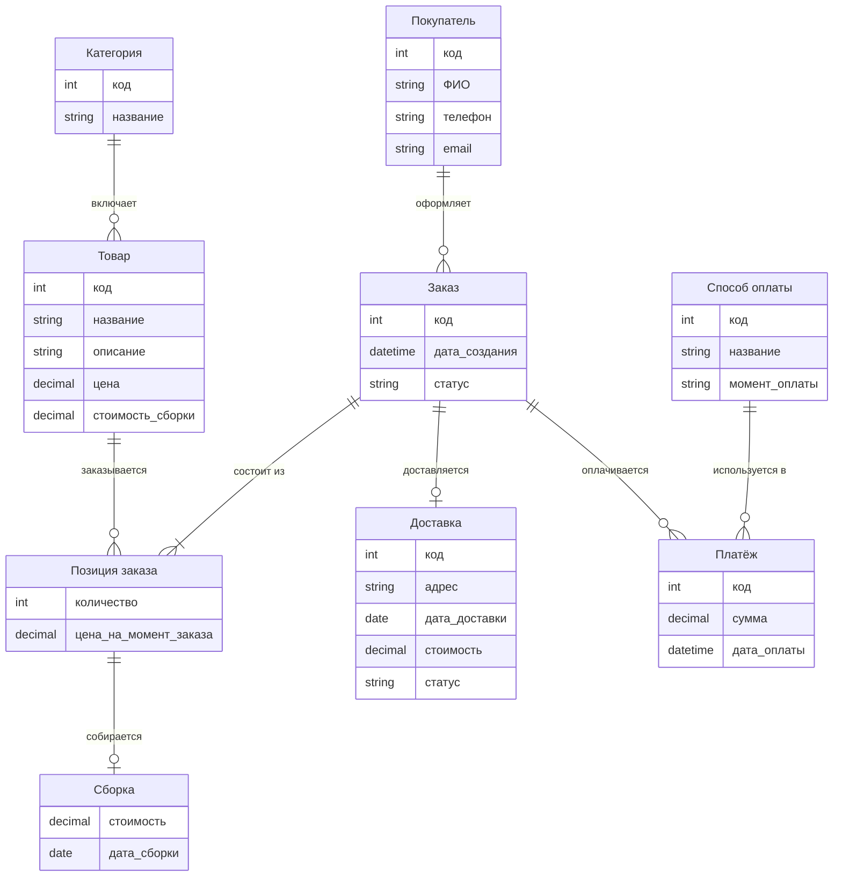

| Таблица / Атрибут     | ПК  | Обяз. | Уник. | Вн. ключ                             |
| --------------------- | --- | ----- | ----- | ------------------------------------ |
| **покупатель**        |     |       |       |                                      |
| код                   | +   | +     | +     |                                      |
| ФИО                   |     | +     |       |                                      |
| телефон               |     | +     | +     |                                      |
| email                 |     | +     | +     |                                      |
| **категория**         |     |       |       |                                      |
| код                   | +   | +     | +     |                                      |
| название              |     | +     | +     |                                      |
| **товар**             |     |       |       |                                      |
| код                   | +   | +     | +     |                                      |
| название              |     | +     |       |                                      |
| описание              |     |       |       |                                      |
| цена                  |     | +     |       |                                      |
| стоимость_сборки      |     |       |       |                                      |
| категория_код         |     | +     |       | категория(код)                       |
| **заказ**             |     |       |       |                                      |
| код                   | +   | +     | +     |                                      |
| покупатель_код        |     | +     |       | покупатель(код)                      |
| дата_создания         |     | +     |       |                                      |
| статус                |     | +     |       |                                      |
| **позиция_заказа**    |     |       |       |                                      |
| заказ_код             | +   | +     |       | заказ(код)                           |
| товар_код             | +   | +     |       | товар(код)                           |
| количество            |     | +     |       |                                      |
| цена*на*момент_заказа |     | +     |       |                                      |
| **сборка**            |     |       |       |                                      |
| заказ_код             | +   | +     |       | позиция*заказа(заказ*код, товар_код) |
| товар_код             | +   | +     |       | позиция*заказа(заказ*код, товар_код) |
| стоимость             |     | +     |       |                                      |
| дата_сборки           |     |       |       |                                      |
| **доставка**          |     |       |       |                                      |
| код                   | +   | +     | +     |                                      |
| заказ_код             |     | +     | +     | заказ(код)                           |
| адрес                 |     | +     |       |                                      |
| дата_доставки         |     |       |       |                                      |
| стоимость             |     | +     |       |                                      |
| статус                |     | +     |       |                                      |
| **способ_оплаты**     |     |       |       |                                      |
| код                   | +   | +     | +     |                                      |
| название              |     | +     | +     |                                      |
| момент_оплаты         |     | +     |       |                                      |
| **платёж**            |     |       |       |                                      |
| код                   | +   | +     | +     |                                      |
| заказ_код             |     | +     |       | заказ(код)                           |
| способ*оплаты*код     |     | +     |       | способ_оплаты(код)                   |
| сумма                 |     | +     |       |                                      |
| дата_оплаты           |     |       |       |                                      |

_`момент_оплаты IN ('на сайте','после доставки')`; `дата_оплаты IS NULL` — платёж ожидается (оплата после доставки)._

---

## 17. Онлайн-кинотеатр

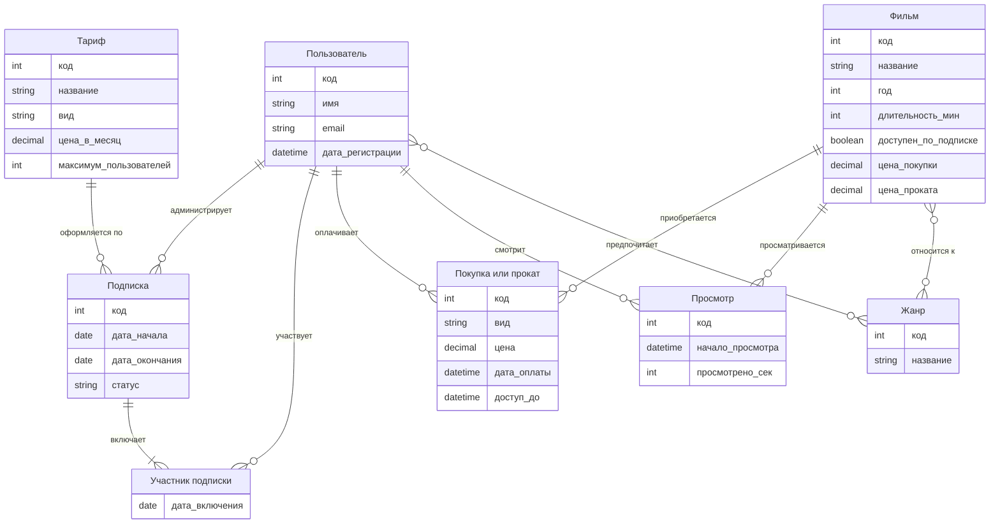

| Таблица / Атрибут      | ПК  | Обяз. | Уник. | Вн. ключ          |
| ---------------------- | --- | ----- | ----- | ----------------- |
| **пользователь**       |     |       |       |                   |
| код                    | +   | +     | +     |                   |
| имя                    |     | +     |       |                   |
| email                  |     | +     | +     |                   |
| дата_регистрации       |     | +     |       |                   |
| **тариф**              |     |       |       |                   |
| код                    | +   | +     | +     |                   |
| название               |     | +     | +     |                   |
| вид                    |     | +     |       |                   |
| цена*в*месяц           |     | +     |       |                   |
| максимум_пользователей |     | +     |       |                   |
| **подписка**           |     |       |       |                   |
| код                    | +   | +     | +     |                   |
| тариф_код              |     | +     |       | тариф(код)        |
| администратор_код      |     | +     |       | пользователь(код) |
| дата_начала            |     | +     |       |                   |
| дата_окончания         |     | +     |       |                   |
| статус                 |     | +     |       |                   |
| **участник_подписки**  |     |       |       |                   |
| подписка_код           | +   | +     |       | подписка(код)     |
| пользователь_код       | +   | +     |       | пользователь(код) |
| дата_включения         |     | +     |       |                   |
| **фильм**              |     |       |       |                   |
| код                    | +   | +     | +     |                   |
| название               |     | +     |       |                   |
| год                    |     | +     |       |                   |
| длительность_мин       |     | +     |       |                   |
| доступен*по*подписке   |     | +     |       |                   |
| цена_покупки           |     |       |       |                   |
| цена_проката           |     |       |       |                   |
| **жанр**               |     |       |       |                   |
| код                    | +   | +     | +     |                   |
| название               |     | +     | +     |                   |
| **фильм_жанр**         |     |       |       |                   |
| фильм_код              | +   | +     |       | фильм(код)        |
| жанр_код               | +   | +     |       | жанр(код)         |
| **пользователь_жанр**  |     |       |       |                   |
| пользователь_код       | +   | +     |       | пользователь(код) |
| жанр_код               | +   | +     |       | жанр(код)         |
| **покупка*или*прокат** |     |       |       |                   |
| код                    | +   | +     | +     |                   |
| пользователь_код       |     | +     |       | пользователь(код) |
| фильм_код              |     | +     |       | фильм(код)        |
| вид                    |     | +     |       |                   |
| цена                   |     | +     |       |                   |
| дата_оплаты            |     | +     |       |                   |
| доступ_до              |     |       |       |                   |
| **просмотр**           |     |       |       |                   |
| код                    | +   | +     | +     |                   |
| пользователь_код       |     | +     |       | пользователь(код) |
| фильм_код              |     | +     |       | фильм(код)        |
| начало_просмотра       |     | +     |       |                   |
| просмотрено_сек        |     | +     |       |                   |

_`вид IN ('покупка','прокат')`; `доступ_до` — NULL для покупки, `дата_оплаты + 1 месяц` для проката._

---

## 18. Бронирование авиабилетов (заказ на сайте)

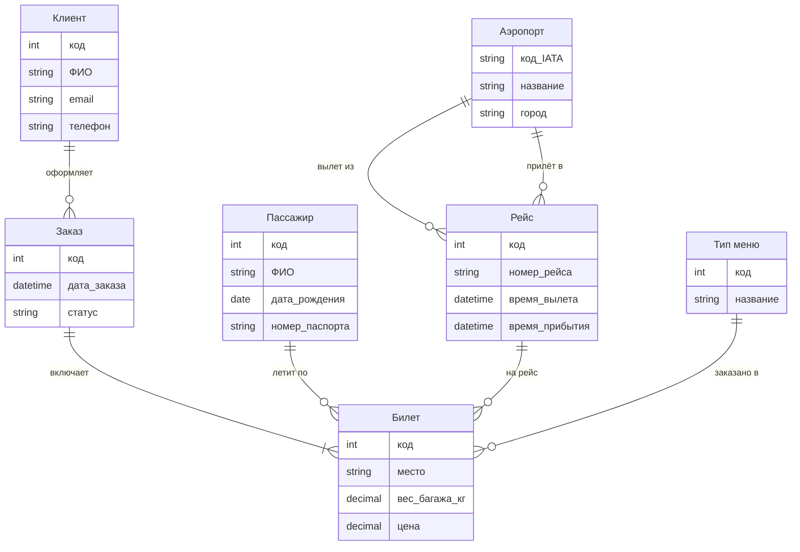

| Таблица / Атрибут | ПК  | Обяз. | Уник. | Вн. ключ           |
| ----------------- | --- | ----- | ----- | ------------------ |
| **клиент**        |     |       |       |                    |
| код               | +   | +     | +     |                    |
| ФИО               |     | +     |       |                    |
| email             |     | +     | +     |                    |
| телефон           |     |       |       |                    |
| **заказ**         |     |       |       |                    |
| код               | +   | +     | +     |                    |
| клиент_код        |     | +     |       | клиент(код)        |
| дата_заказа       |     | +     |       |                    |
| статус            |     | +     |       |                    |
| **пассажир**      |     |       |       |                    |
| код               | +   | +     | +     |                    |
| ФИО               |     | +     |       |                    |
| дата_рождения     |     | +     |       |                    |
| номер_паспорта    |     | +     | +     |                    |
| **аэропорт**      |     |       |       |                    |
| код_IATA          | +   | +     | +     |                    |
| название          |     | +     |       |                    |
| город             |     | +     |       |                    |
| **рейс**          |     |       |       |                    |
| код               | +   | +     | +     |                    |
| номер_рейса       |     | +     |       |                    |
| аэропорт_вылета   |     | +     |       | аэропорт(код_IATA) |
| аэропорт_прибытия |     | +     |       | аэропорт(код_IATA) |
| время_вылета      |     | +     |       |                    |
| время_прибытия    |     | +     |       |                    |
| **тип_меню**      |     |       |       |                    |
| код               | +   | +     | +     |                    |
| название          |     | +     | +     |                    |
| **билет**         |     |       |       |                    |
| код               | +   | +     | +     |                    |
| заказ_код         |     | +     |       | заказ(код)         |
| пассажир_код      |     | +     |       | пассажир(код)      |
| рейс_код          |     | +     |       | рейс(код)          |
| тип*меню*код      |     | +     |       | тип_меню(код)      |
| место             |     |       |       |                    |
| вес*багажа*кг     |     | +     |       |                    |
| цена              |     | +     |       |                    |

_Составные ограничения уникальности: `UNIQUE(рейс_код, место)`, `UNIQUE(заказ_код, пассажир_код, рейс_код)`; в «рейс» `UNIQUE(номер_рейса, время_вылета)`._

---

## 19. Музыкальные альбомы

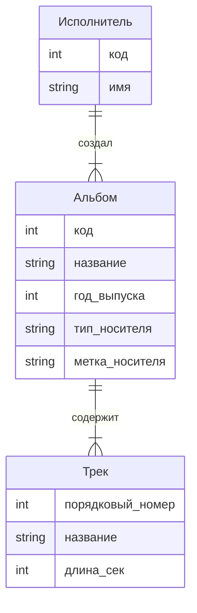

| Таблица / Атрибут | ПК  | Обяз. | Уник. | Вн. ключ         |
| ----------------- | --- | ----- | ----- | ---------------- |
| **исполнитель**   |     |       |       |                  |
| код               | +   | +     | +     |                  |
| имя               |     | +     | +     |                  |
| **альбом**        |     |       |       |                  |
| код               | +   | +     | +     |                  |
| исполнитель_код   |     | +     |       | исполнитель(код) |
| название          |     | +     |       |                  |
| год_выпуска       |     |       |       |                  |
| тип_носителя      |     | +     |       |                  |
| метка_носителя    |     | +     |       |                  |
| **трек**          |     |       |       |                  |
| альбом_код        | +   | +     |       | альбом(код)      |
| порядковый_номер  | +   | +     |       |                  |
| название          |     | +     |       |                  |
| длина_сек         |     | +     |       |                  |

_`тип_носителя IN ('Audio CD','жёсткий диск')`; `длина_сек > 0`, `порядковый_номер > 0`._

---

## 20. Бронирование авиабилетов (база рейсов)

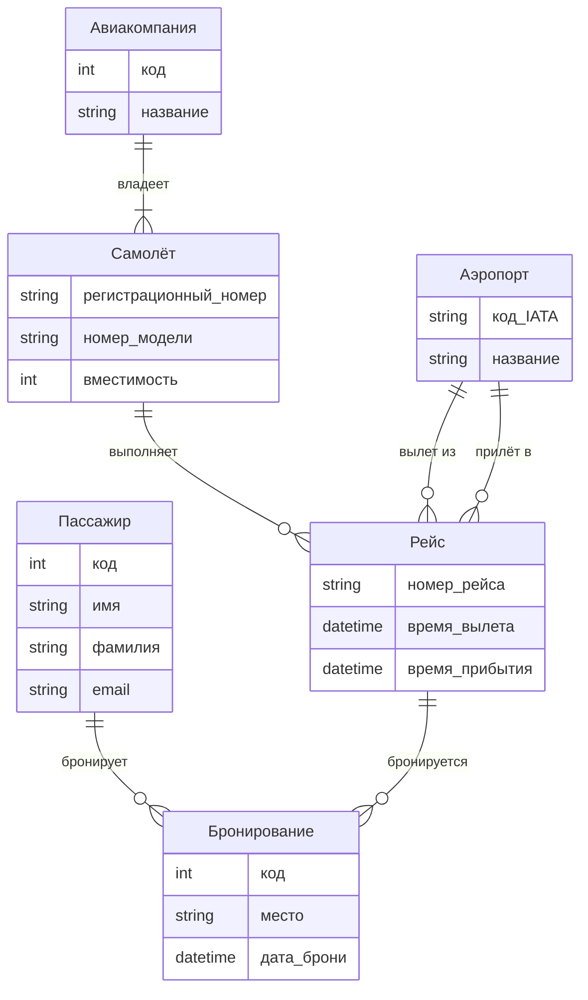

| Таблица / Атрибут     | ПК  | Обяз. | Уник. | Вн. ключ                       |
| --------------------- | --- | ----- | ----- | ------------------------------ |
| **авиакомпания**      |     |       |       |                                |
| код                   | +   | +     | +     |                                |
| название              |     | +     | +     |                                |
| **самолёт**           |     |       |       |                                |
| регистрационный_номер | +   | +     | +     |                                |
| номер_модели          |     | +     |       |                                |
| вместимость           |     | +     |       |                                |
| авиакомпания_код      |     | +     |       | авиакомпания(код)              |
| **аэропорт**          |     |       |       |                                |
| код_IATA              | +   | +     | +     |                                |
| название              |     | +     |       |                                |
| **рейс**              |     |       |       |                                |
| номер_рейса           | +   | +     | +     |                                |
| время_вылета          |     | +     |       |                                |
| время_прибытия        |     | +     |       |                                |
| аэропорт_вылета       |     | +     |       | аэропорт(код_IATA)             |
| аэропорт_прибытия     |     | +     |       | аэропорт(код_IATA)             |
| самолёт_номер         |     | +     |       | самолёт(регистрационный_номер) |
| **пассажир**          |     |       |       |                                |
| код                   | +   | +     | +     |                                |
| имя                   |     | +     |       |                                |
| фамилия               |     | +     |       |                                |
| email                 |     | +     | +     |                                |
| **бронирование**      |     |       |       |                                |
| код                   | +   | +     | +     |                                |
| пассажир_код          |     | +     |       | пассажир(код)                  |
| рейс_номер            |     | +     |       | рейс(номер_рейса)              |
| место                 |     | +     |       |                                |
| дата_брони            |     | +     |       |                                |

_`UNIQUE(рейс_номер, место)`; `время_прибытия > время_вылета`, `аэропорт_вылета <> аэропорт_прибытия`._

---

## 21. Курсы и студенты

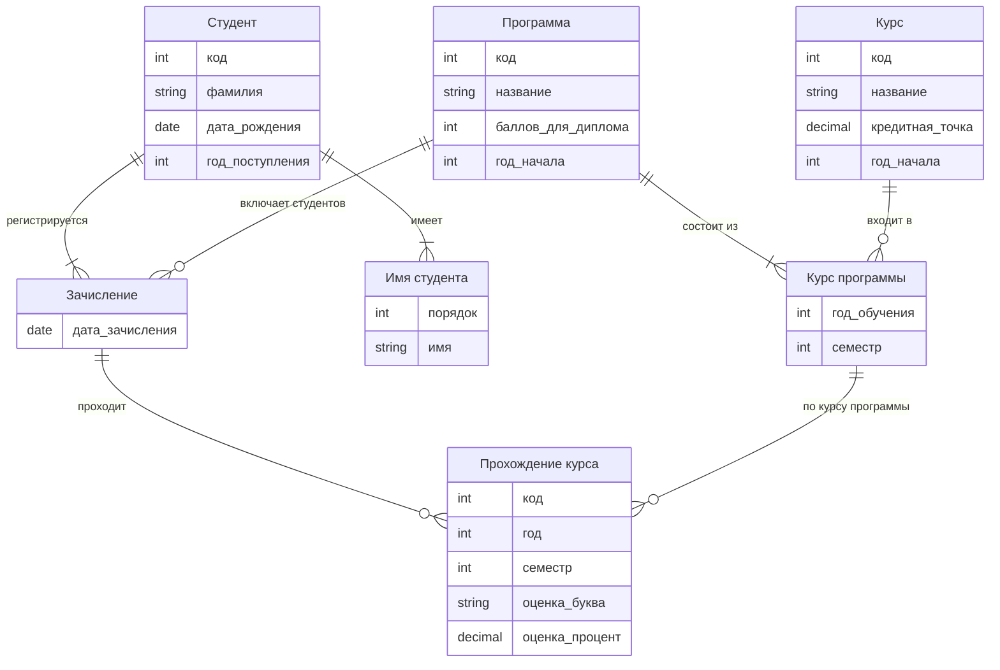

| Таблица / Атрибут     | ПК  | Обяз. | Уник. | Вн. ключ                                                                        |
| --------------------- | --- | ----- | ----- | ------------------------------------------------------------------------------- |
| **программа**         |     |       |       |                                                                                 |
| код                   | +   | +     | +     |                                                                                 |
| название              |     | +     |       |                                                                                 |
| баллов*для*диплома    |     | +     |       |                                                                                 |
| год_начала            |     | +     |       |                                                                                 |
| **курс**              |     |       |       |                                                                                 |
| код                   | +   | +     | +     |                                                                                 |
| название              |     | +     |       |                                                                                 |
| кредитная_точка       |     | +     |       |                                                                                 |
| год_начала            |     | +     |       |                                                                                 |
| **курс_программы**    |     |       |       |                                                                                 |
| программа_код         | +   | +     |       | программа(код)                                                                  |
| курс_код              | +   | +     |       | курс(код)                                                                       |
| год_обучения          |     | +     |       |                                                                                 |
| семестр               |     | +     |       |                                                                                 |
| **студент**           |     |       |       |                                                                                 |
| код                   | +   | +     | +     |                                                                                 |
| фамилия               |     | +     |       |                                                                                 |
| дата_рождения         |     | +     |       |                                                                                 |
| год_поступления       |     | +     |       |                                                                                 |
| **имя_студента**      |     |       |       |                                                                                 |
| студент_код           | +   | +     |       | студент(код)                                                                    |
| порядок               | +   | +     |       |                                                                                 |
| имя                   |     | +     |       |                                                                                 |
| **зачисление**        |     |       |       |                                                                                 |
| студент_код           | +   | +     |       | студент(код)                                                                    |
| программа_код         | +   | +     |       | программа(код)                                                                  |
| дата_зачисления       |     | +     |       |                                                                                 |
| **прохождение_курса** |     |       |       |                                                                                 |
| код                   | +   | +     | +     |                                                                                 |
| студент_код           |     | +     |       | зачисление(студент*код, программа*код)                                          |
| программа_код         |     | +     |       | зачисление(студент*код, программа*код); курс*программы(программа*код, курс_код) |
| курс_код              |     | +     |       | курс*программы(программа*код, курс_код)                                         |
| год                   |     | +     |       |                                                                                 |
| семестр               |     | +     |       |                                                                                 |
| оценка_буква          |     |       |       |                                                                                 |
| оценка_процент        |     |       |       |                                                                                 |

_`UNIQUE(студент_код, курс_код, год, семестр)`; `оценка_процент BETWEEN 0 AND 100`; `оценка_буква` и `оценка_процент` либо оба NULL, либо оба заданы._

---

## 22. Компания и сотрудники

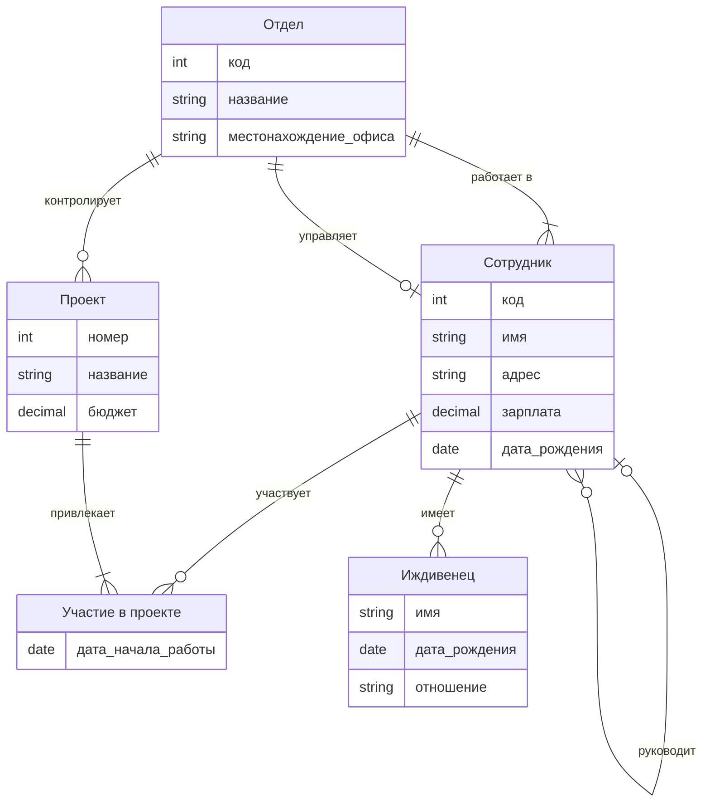

| Таблица / Атрибут     | ПК  | Обяз. | Уник. | Вн. ключ       |
| --------------------- | --- | ----- | ----- | -------------- |
| **отдел**             |     |       |       |                |
| код                   | +   | +     | +     |                |
| название              |     | +     | +     |                |
| местонахождение_офиса |     | +     |       |                |
| руководитель_код      |     | +     | +     | сотрудник(код) |
| **сотрудник**         |     |       |       |                |
| код                   | +   | +     | +     |                |
| имя                   |     | +     |       |                |
| адрес                 |     | +     |       |                |
| зарплата              |     | +     |       |                |
| дата_рождения         |     | +     |       |                |
| отдел_код             |     | +     |       | отдел(код)     |
| начальник_код         |     |       |       | сотрудник(код) |
| **проект**            |     |       |       |                |
| номер                 | +   | +     | +     |                |
| название              |     | +     | +     |                |
| бюджет                |     | +     |       |                |
| отдел_код             |     | +     |       | отдел(код)     |
| **участие*в*проекте** |     |       |       |                |
| сотрудник_код         | +   | +     |       | сотрудник(код) |
| проект_номер          | +   | +     |       | проект(номер)  |
| дата*начала*работы    |     | +     |       |                |
| **иждивенец**         |     |       |       |                |
| сотрудник_код         | +   | +     |       | сотрудник(код) |
| имя                   | +   | +     |       |                |
| дата_рождения         |     | +     |       |                |
| отношение             |     | +     |       |                |

_`зарплата >= 0`; руководитель отдела работает в этом же отделе._

---

## 23. Галереи

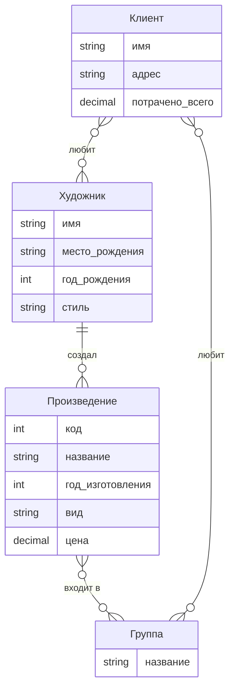

| Таблица / Атрибут       | ПК  | Обяз. | Уник. | Вн. ключ          |
| ----------------------- | --- | ----- | ----- | ----------------- |
| **художник**            |     |       |       |                   |
| имя                     | +   | +     | +     |                   |
| место_рождения          |     | +     |       |                   |
| год_рождения            |     | +     |       |                   |
| стиль                   |     | +     |       |                   |
| **произведение**        |     |       |       |                   |
| код                     | +   | +     | +     |                   |
| название                |     | +     |       |                   |
| год_изготовления        |     | +     |       |                   |
| вид                     |     | +     |       |                   |
| цена                    |     | +     |       |                   |
| художник_имя            |     | +     |       | художник(имя)     |
| **группа**              |     |       |       |                   |
| название                | +   | +     | +     |                   |
| **произведение_группа** |     |       |       |                   |
| произведение_код        | +   | +     |       | произведение(код) |
| группа_название         | +   | +     |       | группа(название)  |
| **клиент**              |     |       |       |                   |
| имя                     | +   | +     | +     |                   |
| адрес                   |     | +     |       |                   |
| потрачено_всего         |     | +     |       |                   |
| **клиент_художник**     |     |       |       |                   |
| клиент_имя              | +   | +     |       | клиент(имя)       |
| художник_имя            | +   | +     |       | художник(имя)     |
| **клиент_группа**       |     |       |       |                   |
| клиент_имя              | +   | +     |       | клиент(имя)       |
| группа_название         | +   | +     |       | группа(название)  |

_`потрачено_всего DEFAULT 0`, `потрачено_всего >= 0`, `цена >= 0`._

---

## 24. Сеть отелей B&B

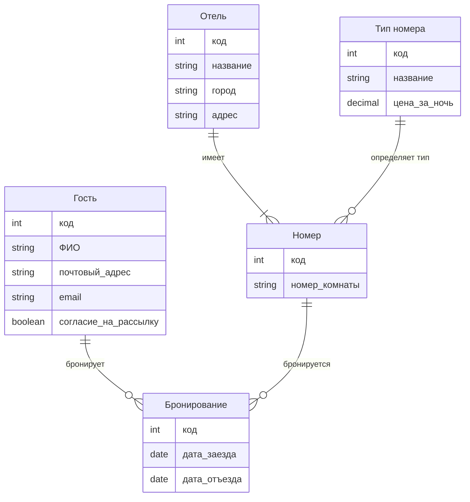

| Таблица / Атрибут    | ПК  | Обяз. | Уник. | Вн. ключ        |
| -------------------- | --- | ----- | ----- | --------------- |
| **отель**            |     |       |       |                 |
| код                  | +   | +     | +     |                 |
| название             |     | +     |       |                 |
| город                |     | +     |       |                 |
| адрес                |     | +     |       |                 |
| **тип_номера**       |     |       |       |                 |
| код                  | +   | +     | +     |                 |
| название             |     | +     | +     |                 |
| цена*за*ночь         |     | +     |       |                 |
| **номер**            |     |       |       |                 |
| код                  | +   | +     | +     |                 |
| отель_код            |     | +     |       | отель(код)      |
| тип_код              |     | +     |       | тип_номера(код) |
| номер_комнаты        |     | +     |       |                 |
| **гость**            |     |       |       |                 |
| код                  | +   | +     | +     |                 |
| ФИО                  |     | +     |       |                 |
| почтовый_адрес       |     |       |       |                 |
| email                |     | +     | +     |                 |
| согласие*на*рассылку |     | +     |       |                 |
| **бронирование**     |     |       |       |                 |
| код                  | +   | +     | +     |                 |
| гость_код            |     | +     |       | гость(код)      |
| номер_код            |     | +     |       | номер(код)      |
| дата_заезда          |     | +     |       |                 |
| дата_отъезда         |     | +     |       |                 |

_`UNIQUE(отель_код, номер_комнаты)`; `дата_отъезда > дата_заезда`._

---

## 25. Прокат автомобилей

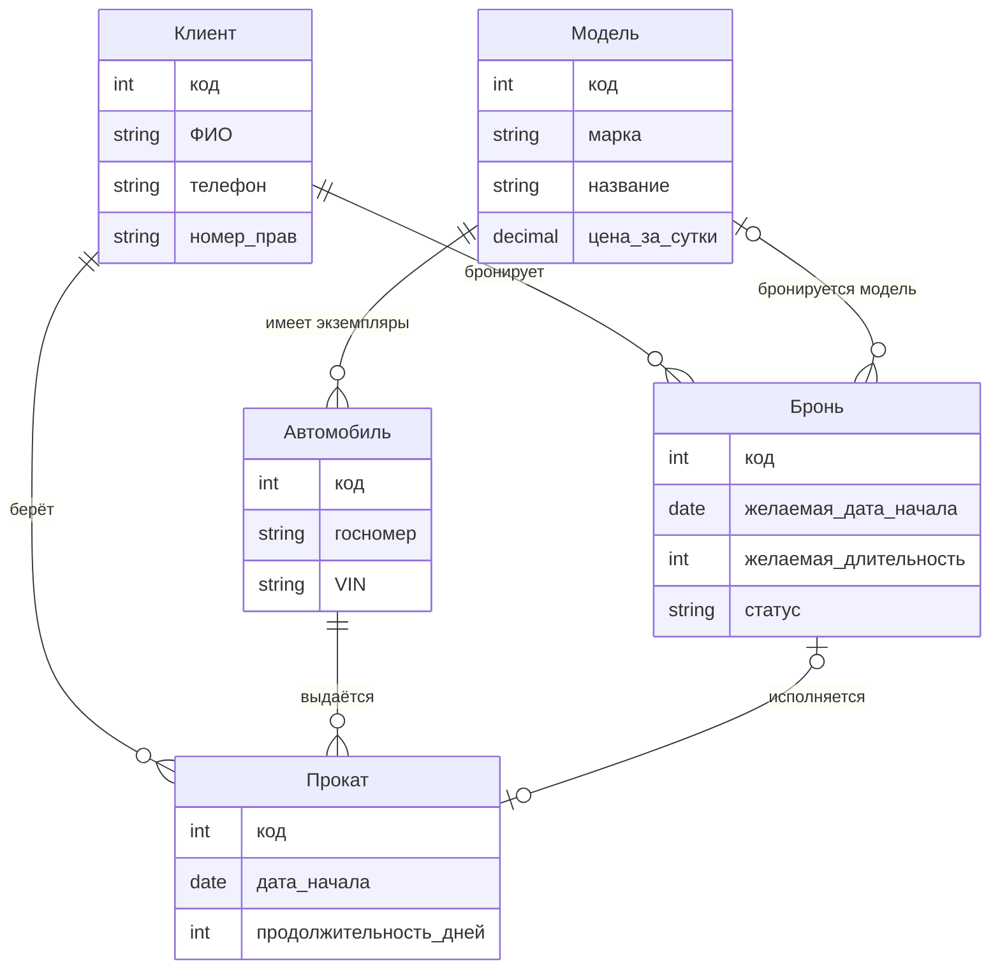

| Таблица / Атрибут      | ПК  | Обяз. | Уник. | Вн. ключ        |
| ---------------------- | --- | ----- | ----- | --------------- |
| **модель**             |     |       |       |                 |
| код                    | +   | +     | +     |                 |
| марка                  |     | +     |       |                 |
| название               |     | +     |       |                 |
| цена*за*сутки          |     | +     |       |                 |
| **автомобиль**         |     |       |       |                 |
| код                    | +   | +     | +     |                 |
| госномер               |     | +     | +     |                 |
| VIN                    |     | +     | +     |                 |
| модель_код             |     | +     |       | модель(код)     |
| **клиент**             |     |       |       |                 |
| код                    | +   | +     | +     |                 |
| ФИО                    |     | +     |       |                 |
| телефон                |     | +     |       |                 |
| номер_прав             |     | +     | +     |                 |
| **бронь**              |     |       |       |                 |
| код                    | +   | +     | +     |                 |
| клиент_код             |     | +     |       | клиент(код)     |
| модель_код             |     |       |       | модель(код)     |
| желаемая*дата*начала   |     | +     |       |                 |
| желаемая_длительность  |     | +     |       |                 |
| статус                 |     | +     |       |                 |
| **прокат**             |     |       |       |                 |
| код                    | +   | +     | +     |                 |
| клиент_код             |     | +     |       | клиент(код)     |
| автомобиль_код         |     | +     |       | автомобиль(код) |
| бронь_код              |     |       | +     | бронь(код)      |
| дата_начала            |     | +     |       |                 |
| продолжительность_дней |     | +     |       |                 |

_`модель_код IS NULL` — клиент согласен на любую модель; `продолжительность_дней > 0`; периоды проката одного автомобиля не пересекаются._

---

## 26. КХЛ

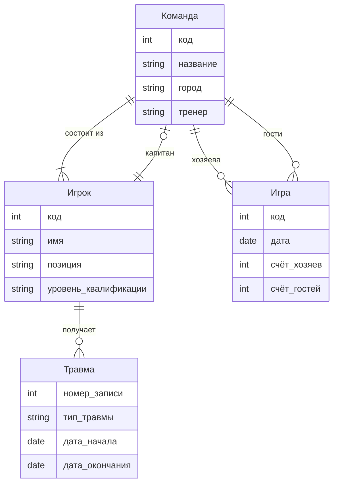

| Таблица / Атрибут    | ПК  | Обяз. | Уник. | Вн. ключ     |
| -------------------- | --- | ----- | ----- | ------------ |
| **команда**          |     |       |       |              |
| код                  | +   | +     | +     |              |
| название             |     | +     | +     |              |
| город                |     | +     |       |              |
| тренер               |     | +     |       |              |
| капитан_код          |     |       | +     | игрок(код)   |
| **игрок**            |     |       |       |              |
| код                  | +   | +     | +     |              |
| команда_код          |     | +     |       | команда(код) |
| имя                  |     | +     |       |              |
| позиция              |     | +     |       |              |
| уровень_квалификации |     | +     |       |              |
| **травма**           |     |       |       |              |
| игрок_код            | +   | +     |       | игрок(код)   |
| номер_записи         | +   | +     |       |              |
| тип_травмы           |     | +     |       |              |
| дата_начала          |     | +     |       |              |
| дата_окончания       |     |       |       |              |
| **игра**             |     |       |       |              |
| код                  | +   | +     | +     |              |
| дата                 |     | +     |       |              |
| хозяева_код          |     | +     |       | команда(код) |
| гости_код            |     | +     |       | команда(код) |
| счёт_хозяев          |     | +     |       |              |
| счёт_гостей          |     | +     |       |              |

_`хозяева_код <> гости_код`; `UNIQUE(дата, хозяева_код, гости_код)`; капитан — игрок той же команды; `капитан_код` может быть NULL при создании команды._

---

## 27. Книжный онлайн-магазин

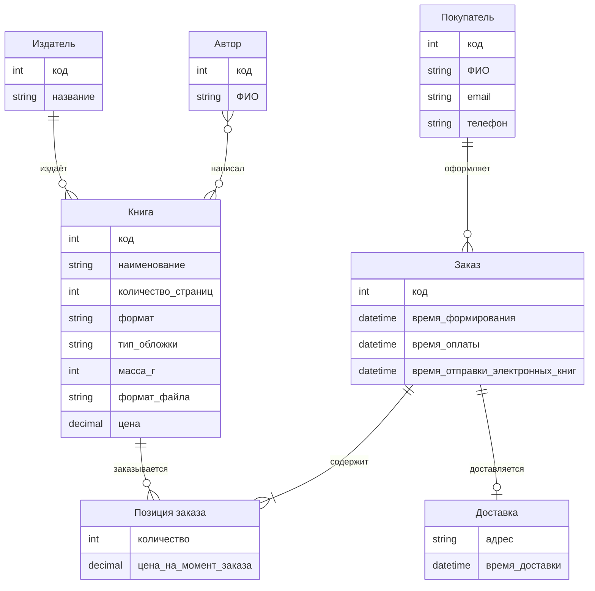

| Таблица / Атрибут               | ПК  | Обяз. | Уник. | Вн. ключ        |
| ------------------------------- | --- | ----- | ----- | --------------- |
| **издатель**                    |     |       |       |                 |
| код                             | +   | +     | +     |                 |
| название                        |     | +     | +     |                 |
| **автор**                       |     |       |       |                 |
| код                             | +   | +     | +     |                 |
| ФИО                             |     | +     |       |                 |
| **книга**                       |     |       |       |                 |
| код                             | +   | +     | +     |                 |
| наименование                    |     | +     |       |                 |
| издатель_код                    |     | +     |       | издатель(код)   |
| количество_страниц              |     | +     |       |                 |
| формат                          |     | +     |       |                 |
| тип_обложки                     |     |       |       |                 |
| масса_г                         |     |       |       |                 |
| формат_файла                    |     |       |       |                 |
| цена                            |     | +     |       |                 |
| **книга_автор**                 |     |       |       |                 |
| книга_код                       | +   | +     |       | книга(код)      |
| автор_код                       | +   | +     |       | автор(код)      |
| **покупатель**                  |     |       |       |                 |
| код                             | +   | +     | +     |                 |
| ФИО                             |     | +     |       |                 |
| email                           |     | +     | +     |                 |
| телефон                         |     |       |       |                 |
| **заказ**                       |     |       |       |                 |
| код                             | +   | +     | +     |                 |
| покупатель_код                  |     | +     |       | покупатель(код) |
| время_формирования              |     | +     |       |                 |
| время_оплаты                    |     |       |       |                 |
| время*отправки*электронных_книг |     |       |       |                 |
| **позиция_заказа**              |     |       |       |                 |
| заказ_код                       | +   | +     |       | заказ(код)      |
| книга_код                       | +   | +     |       | книга(код)      |
| количество                      |     | +     |       |                 |
| цена*на*момент_заказа           |     | +     |       |                 |
| **доставка**                    |     |       |       |                 |
| заказ_код                       | +   | +     | +     | заказ(код)      |
| адрес                           |     | +     |       |                 |
| время_доставки                  |     |       |       |                 |

_Ограничения «книга»:_ `формат IN ('бумажная','электронная')`; для бумажной `тип_обложки IN ('мягкая','твёрдая','суперобложка')` и `масса_г > 0` обязательны, для электронной обязателен `формат_файла`. Электронная книга в заказе — `количество = 1`.

---

## 28. Мастерская по ремонту бытовой техники

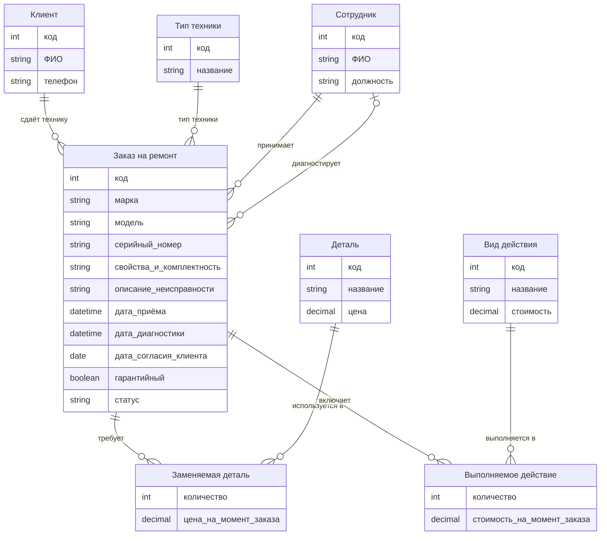

| Таблица / Атрибут          | ПК  | Обяз. | Уник. | Вн. ключ             |
| -------------------------- | --- | ----- | ----- | -------------------- |
| **клиент**                 |     |       |       |                      |
| код                        | +   | +     | +     |                      |
| ФИО                        |     | +     |       |                      |
| телефон                    |     | +     |       |                      |
| **тип_техники**            |     |       |       |                      |
| код                        | +   | +     | +     |                      |
| название                   |     | +     | +     |                      |
| **сотрудник**              |     |       |       |                      |
| код                        | +   | +     | +     |                      |
| ФИО                        |     | +     |       |                      |
| должность                  |     | +     |       |                      |
| **заказ*на*ремонт**        |     |       |       |                      |
| код                        | +   | +     | +     |                      |
| клиент_код                 |     | +     |       | клиент(код)          |
| тип*техники*код            |     | +     |       | тип_техники(код)     |
| приёмщик_код               |     | +     |       | сотрудник(код)       |
| мастер_код                 |     |       |       | сотрудник(код)       |
| марка                      |     | +     |       |                      |
| модель                     |     | +     |       |                      |
| серийный_номер             |     |       |       |                      |
| свойства*и*комплектность   |     |       |       |                      |
| описание_неисправности     |     | +     |       |                      |
| дата_приёма                |     | +     |       |                      |
| дата_диагностики           |     |       |       |                      |
| дата*согласия*клиента      |     |       |       |                      |
| гарантийный                |     | +     |       |                      |
| статус                     |     | +     |       |                      |
| **деталь**                 |     |       |       |                      |
| код                        | +   | +     | +     |                      |
| название                   |     | +     | +     |                      |
| цена                       |     | +     |       |                      |
| **вид_действия**           |     |       |       |                      |
| код                        | +   | +     | +     |                      |
| название                   |     | +     | +     |                      |
| стоимость                  |     | +     |       |                      |
| **заменяемая_деталь**      |     |       |       |                      |
| заказ_код                  | +   | +     |       | заказ*на*ремонт(код) |
| деталь_код                 | +   | +     |       | деталь(код)          |
| количество                 |     | +     |       |                      |
| цена*на*момент_заказа      |     | +     |       |                      |
| **выполняемое_действие**   |     |       |       |                      |
| заказ_код                  | +   | +     |       | заказ*на*ремонт(код) |
| вид*действия*код           | +   | +     |       | вид_действия(код)    |
| количество                 |     | +     |       |                      |
| стоимость*на*момент_заказа |     | +     |       |                      |

_Ремонт начинается только при `дата_согласия_клиента IS NOT NULL`; сумма к оплате = сумма по деталям и действиям, если `гарантийный = false`, иначе 0; `мастер_код` — сотрудник с должностью «мастер»._

---

## 29. ЖЭК

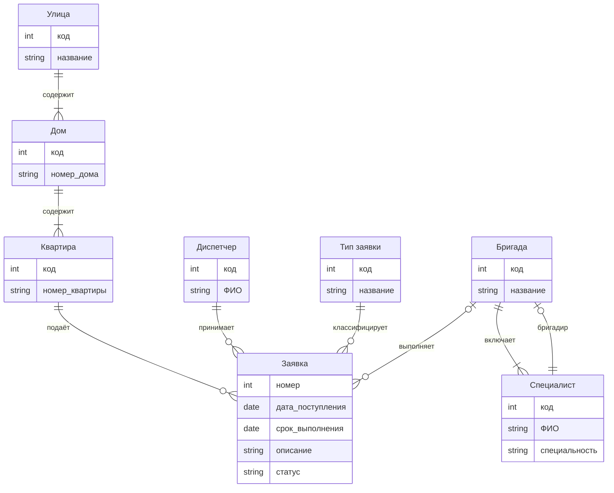

| Таблица / Атрибут | ПК  | Обяз. | Уник. | Вн. ключ        |
| ----------------- | --- | ----- | ----- | --------------- |
| **улица**         |     |       |       |                 |
| код               | +   | +     | +     |                 |
| название          |     | +     | +     |                 |
| **дом**           |     |       |       |                 |
| код               | +   | +     | +     |                 |
| улица_код         |     | +     |       | улица(код)      |
| номер_дома        |     | +     |       |                 |
| **квартира**      |     |       |       |                 |
| код               | +   | +     | +     |                 |
| дом_код           |     | +     |       | дом(код)        |
| номер_квартиры    |     | +     |       |                 |
| **диспетчер**     |     |       |       |                 |
| код               | +   | +     | +     |                 |
| ФИО               |     | +     |       |                 |
| **тип_заявки**    |     |       |       |                 |
| код               | +   | +     | +     |                 |
| название          |     | +     | +     |                 |
| **бригада**       |     |       |       |                 |
| код               | +   | +     | +     |                 |
| название          |     | +     | +     |                 |
| бригадир_код      |     |       | +     | специалист(код) |
| **специалист**    |     |       |       |                 |
| код               | +   | +     | +     |                 |
| ФИО               |     | +     |       |                 |
| специальность     |     | +     |       |                 |
| бригада_код       |     | +     |       | бригада(код)    |
| **заявка**        |     |       |       |                 |
| номер             | +   | +     | +     |                 |
| дата_поступления  |     | +     |       |                 |
| срок_выполнения   |     | +     |       |                 |
| описание          |     |       |       |                 |
| статус            |     | +     |       |                 |
| квартира_код      |     | +     |       | квартира(код)   |
| диспетчер_код     |     | +     |       | диспетчер(код)  |
| тип*заявки*код    |     | +     |       | тип_заявки(код) |
| бригада_код       |     |       |       | бригада(код)    |

_`UNIQUE(улица_код, номер_дома)`, `UNIQUE(дом_код, номер_квартиры)`; `срок_выполнения >= дата_поступления`; бригадир входит в свою бригаду._

---

## 30. Парки города

```mermaid
erDiagram
    "Парк" {
        int код
        string наименование
        decimal площадь
        string адрес
    }
    "Вид растения" {
        int код
        string тип_культуры
        string наименование
        decimal средняя_продолжительность_жизни
    }
    "Насаждение парка" {
        int количество
    }
    "Фонтан" {
        string шифр
        date дата_постройки
        decimal расход_воды_максимальный
        decimal расход_воды_нормальный
        decimal площадь
    }
    "Павильон" {
        int код
        string наименование
        string тип
        decimal занимаемая_площадь
    }
    "Парк" ||--o{ "Насаждение парка" : "имеет насаждения"
    "Вид растения" ||--o{ "Насаждение парка" : "высажен в"
    "Парк" ||--o{ "Фонтан" : "содержит"
    "Парк" ||--o{ "Павильон" : "содержит"
```

| Таблица / Атрибут               | ПК  | Обяз. | Уник. | Вн. ключ          |
| ------------------------------- | --- | ----- | ----- | ----------------- |
| **парк**                        |     |       |       |                   |
| код                             | +   | +     | +     |                   |
| наименование                    |     | +     | +     |                   |
| площадь                         |     | +     |       |                   |
| адрес                           |     | +     |       |                   |
| **вид_растения**                |     |       |       |                   |
| код                             | +   | +     | +     |                   |
| тип_культуры                    |     | +     |       |                   |
| наименование                    |     | +     | +     |                   |
| средняя*продолжительность*жизни |     | +     |       |                   |
| **насаждение_парка**            |     |       |       |                   |
| парк_код                        | +   | +     |       | парк(код)         |
| вид*растения*код                | +   | +     |       | вид_растения(код) |
| количество                      |     | +     |       |                   |
| **фонтан**                      |     |       |       |                   |
| шифр                            | +   | +     | +     |                   |
| парк_код                        |     | +     |       | парк(код)         |
| дата_постройки                  |     | +     |       |                   |
| расход*воды*максимальный        |     | +     |       |                   |
| расход*воды*нормальный          |     | +     |       |                   |
| площадь                         |     | +     |       |                   |
| **павильон**                    |     |       |       |                   |
| код                             | +   | +     | +     |                   |
| парк_код                        |     | +     |       | парк(код)         |
| наименование                    |     | +     |       |                   |
| тип                             |     | +     |       |                   |
| занимаемая_площадь              |     | +     |       |                   |

_`тип IN ('кафе','продуктовый','развлекательный','прокат вещей')`; `расход_воды_нормальный <= расход_воды_максимальный`; `количество > 0`; `площадь > 0`._
