## 11. Кулинарная книга

**ER-диаграмма**

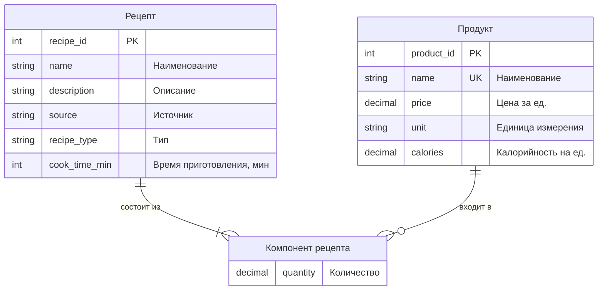

**Логическая схема**

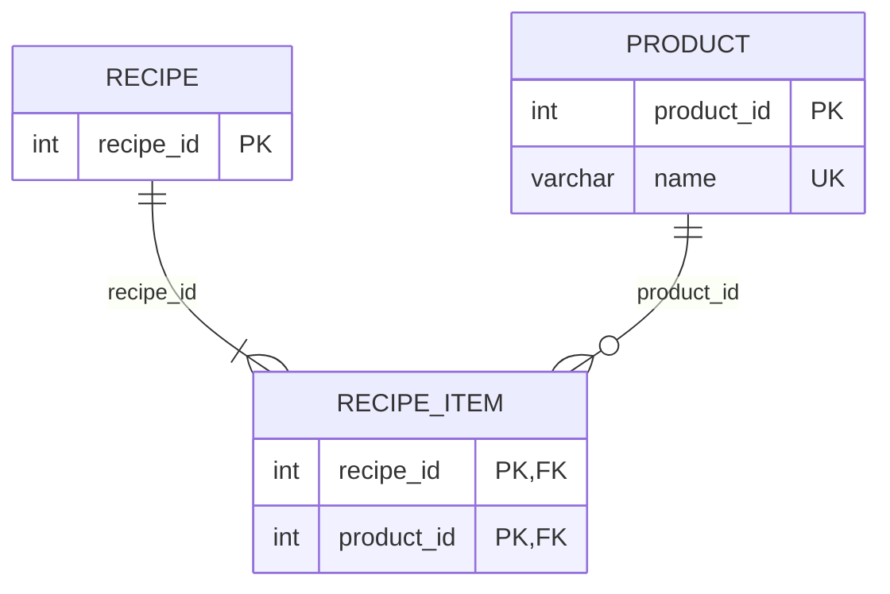

| Таблица / Атрибут | ПК  | Обяз. | Уник. | Вн. ключ            |
| ----------------- | --- | ----- | ----- | ------------------- |
| **RECIPE**        |     |       |       |                     |
| recipe_id         | +   | +     | +     |                     |
| name              |     | +     |       |                     |
| description       |     |       |       |                     |
| source            |     |       |       |                     |
| recipe_type       |     | +     |       |                     |
| cook_time_min     |     | +     |       |                     |
| **PRODUCT**       |     |       |       |                     |
| product_id        | +   | +     | +     |                     |
| name              |     | +     | +     |                     |
| price             |     | +     |       |                     |
| unit              |     | +     |       |                     |
| calories          |     | +     |       |                     |
| **RECIPE_ITEM**   |     |       |       |                     |
| recipe_id         | +   | +     |       | RECIPE(recipe_id)   |
| product_id        | +   | +     |       | PRODUCT(product_id) |
| quantity          |     | +     |       |                     |

---

## 12. Поликлиника

**ER-диаграмма**

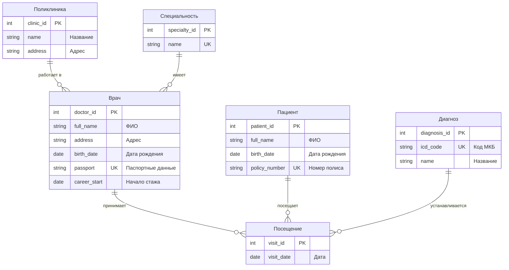

**Логическая схема**

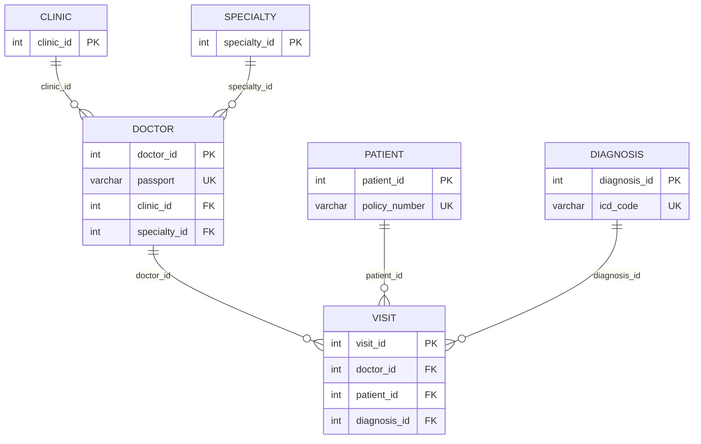

| Таблица / Атрибут | ПК  | Обяз. | Уник. | Вн. ключ                |
| ----------------- | --- | ----- | ----- | ----------------------- |
| **CLINIC**        |     |       |       |                         |
| clinic_id         | +   | +     | +     |                         |
| name              |     | +     |       |                         |
| address           |     | +     |       |                         |
| **SPECIALTY**     |     |       |       |                         |
| specialty_id      | +   | +     | +     |                         |
| name              |     | +     | +     |                         |
| **DOCTOR**        |     |       |       |                         |
| doctor_id         | +   | +     | +     |                         |
| full_name         |     | +     |       |                         |
| address           |     | +     |       |                         |
| birth_date        |     | +     |       |                         |
| passport          |     | +     | +     |                         |
| career_start      |     | +     |       |                         |
| clinic_id         |     | +     |       | CLINIC(clinic_id)       |
| specialty_id      |     | +     |       | SPECIALTY(specialty_id) |
| **PATIENT**       |     |       |       |                         |
| patient_id        | +   | +     | +     |                         |
| full_name         |     | +     |       |                         |
| birth_date        |     | +     |       |                         |
| policy_number     |     | +     | +     |                         |
| **DIAGNOSIS**     |     |       |       |                         |
| diagnosis_id      | +   | +     | +     |                         |
| icd_code          |     | +     | +     |                         |
| name              |     | +     |       |                         |
| **VISIT**         |     |       |       |                         |
| visit_id          | +   | +     | +     |                         |
| visit_date        |     | +     |       |                         |
| doctor_id         |     | +     |       | DOCTOR(doctor_id)       |
| patient_id        |     | +     |       | PATIENT(patient_id)     |
| diagnosis_id      |     |       |       | DIAGNOSIS(diagnosis_id) |

---

## 13. Сессия

**ER-диаграмма**

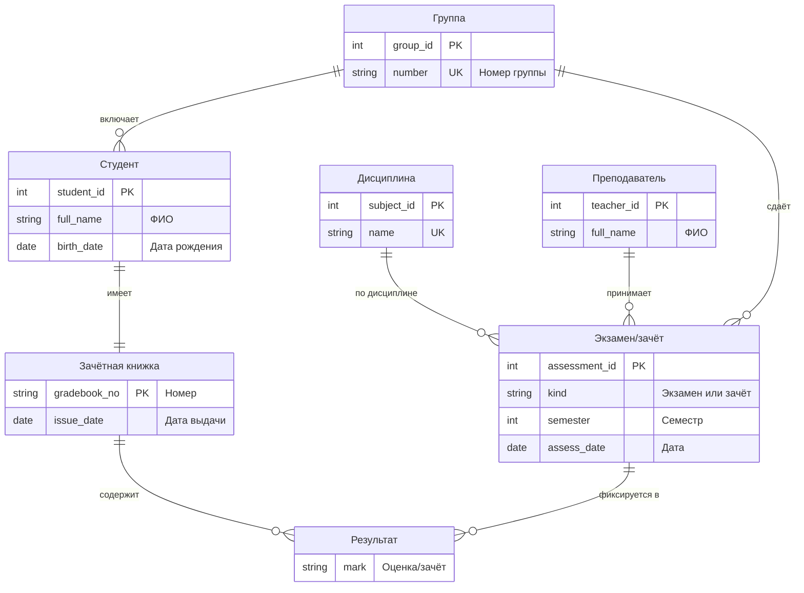

**Логическая схема**

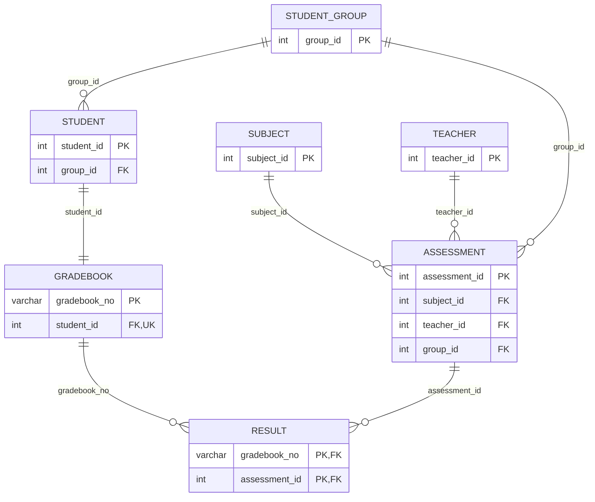

| Таблица / Атрибут | ПК  | Обяз. | Уник. | Вн. ключ                  |
| ----------------- | --- | ----- | ----- | ------------------------- |
| **STUDENT_GROUP** |     |       |       |                           |
| group_id          | +   | +     | +     |                           |
| number            |     | +     | +     |                           |
| **STUDENT**       |     |       |       |                           |
| student_id        | +   | +     | +     |                           |
| full_name         |     | +     |       |                           |
| birth_date        |     | +     |       |                           |
| group_id          |     | +     |       | STUDENT_GROUP(group_id)   |
| **GRADEBOOK**     |     |       |       |                           |
| gradebook_no      | +   | +     | +     |                           |
| student_id        |     | +     | +     | STUDENT(student_id)       |
| issue_date        |     | +     |       |                           |
| **TEACHER**       |     |       |       |                           |
| teacher_id        | +   | +     | +     |                           |
| full_name         |     | +     |       |                           |
| **SUBJECT**       |     |       |       |                           |
| subject_id        | +   | +     | +     |                           |
| name              |     | +     | +     |                           |
| **ASSESSMENT**    |     |       |       |                           |
| assessment_id     | +   | +     | +     |                           |
| kind              |     | +     |       |                           |
| semester          |     | +     |       |                           |
| assess_date       |     | +     |       |                           |
| subject_id        |     | +     |       | SUBJECT(subject_id)       |
| teacher_id        |     | +     |       | TEACHER(teacher_id)       |
| group_id          |     | +     |       | STUDENT_GROUP(group_id)   |
| **RESULT**        |     |       |       |                           |
| gradebook_no      | +   | +     |       | GRADEBOOK(gradebook_no)   |
| assessment_id     | +   | +     |       | ASSESSMENT(assessment_id) |
| mark              |     | +     |       |                           |

_`kind IN ('экзамен','зачёт')`; `mark` — 2..5 для экзамена, «зачёт»/«незачёт» для зачёта._

---

## 14. Расписание занятий

**ER-диаграмма**

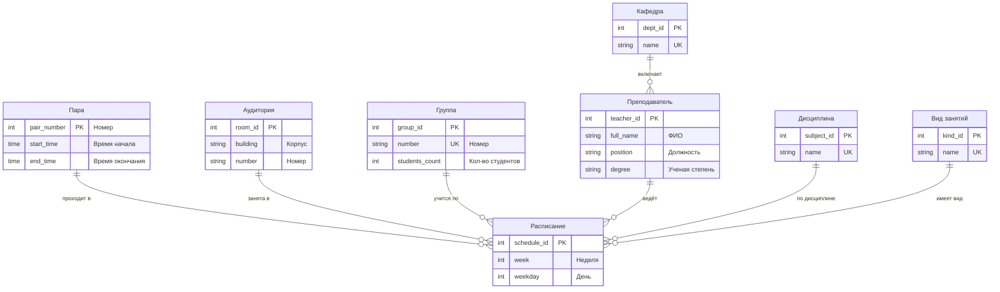

**Логическая схема**

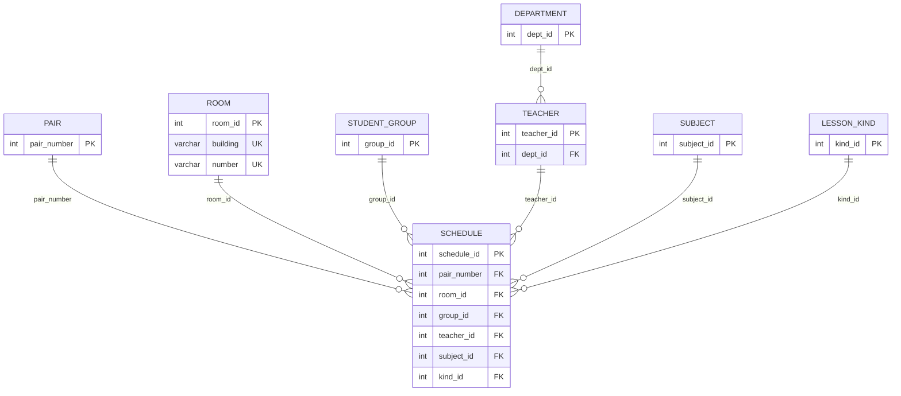

| Таблица / Атрибут | ПК  | Обяз. | Уник. | Вн. ключ                |
| ----------------- | --- | ----- | ----- | ----------------------- |
| **DEPARTMENT**    |     |       |       |                         |
| dept_id           | +   | +     | +     |                         |
| name              |     | +     | +     |                         |
| **TEACHER**       |     |       |       |                         |
| teacher_id        | +   | +     | +     |                         |
| full_name         |     | +     |       |                         |
| position          |     | +     |       |                         |
| degree            |     |       |       |                         |
| dept_id           |     | +     |       | DEPARTMENT(dept_id)     |
| **PAIR**          |     |       |       |                         |
| pair_number       | +   | +     | +     |                         |
| start_time        |     | +     |       |                         |
| end_time          |     | +     |       |                         |
| **ROOM**          |     |       |       |                         |
| room_id           | +   | +     | +     |                         |
| building          |     | +     |       |                         |
| number            |     | +     |       |                         |
| **STUDENT_GROUP** |     |       |       |                         |
| group_id          | +   | +     | +     |                         |
| number            |     | +     | +     |                         |
| students_count    |     | +     |       |                         |
| **SUBJECT**       |     |       |       |                         |
| subject_id        | +   | +     | +     |                         |
| name              |     | +     | +     |                         |
| **LESSON_KIND**   |     |       |       |                         |
| kind_id           | +   | +     | +     |                         |
| name              |     | +     | +     |                         |
| **SCHEDULE**      |     |       |       |                         |
| schedule_id       | +   | +     | +     |                         |
| week              |     | +     |       |                         |
| weekday           |     | +     |       |                         |
| pair_number       |     | +     |       | PAIR(pair_number)       |
| room_id           |     | +     |       | ROOM(room_id)           |
| group_id          |     | +     |       | STUDENT_GROUP(group_id) |
| teacher_id        |     | +     |       | TEACHER(teacher_id)     |
| subject_id        |     | +     |       | SUBJECT(subject_id)     |
| kind_id           |     | +     |       | LESSON_KIND(kind_id)    |

_Составные ограничения уникальности: `UNIQUE(week, weekday, pair_number, group_id)`, `UNIQUE(week, weekday, pair_number, teacher_id)`, `UNIQUE(week, weekday, pair_number, room_id)`; `UNIQUE(building, number)` в ROOM._

---

## 15. Социальная сеть (ВКонтакте)

**ER-диаграмма**

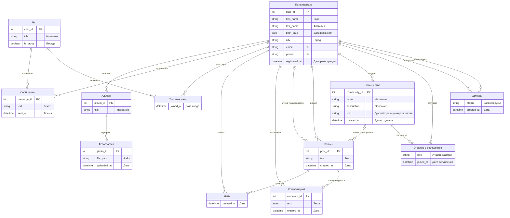

**Логическая схема**

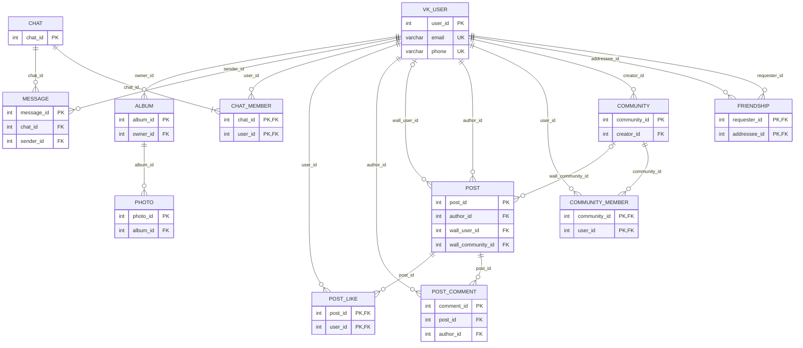

| Таблица / Атрибут    | ПК  | Обяз. | Уник. | Вн. ключ                |
| -------------------- | --- | ----- | ----- | ----------------------- |
| **VK_USER**          |     |       |       |                         |
| user_id              | +   | +     | +     |                         |
| first_name           |     | +     |       |                         |
| last_name            |     | +     |       |                         |
| birth_date           |     |       |       |                         |
| city                 |     |       |       |                         |
| email                |     |       | +     |                         |
| phone                |     |       | +     |                         |
| registered_at        |     | +     |       |                         |
| **FRIENDSHIP**       |     |       |       |                         |
| requester_id         | +   | +     |       | VK_USER(user_id)        |
| addressee_id         | +   | +     |       | VK_USER(user_id)        |
| status               |     | +     |       |                         |
| created_at           |     | +     |       |                         |
| **COMMUNITY**        |     |       |       |                         |
| community_id         | +   | +     | +     |                         |
| name                 |     | +     |       |                         |
| description          |     |       |       |                         |
| kind                 |     | +     |       |                         |
| created_at           |     | +     |       |                         |
| creator_id           |     | +     |       | VK_USER(user_id)        |
| **COMMUNITY_MEMBER** |     |       |       |                         |
| community_id         | +   | +     |       | COMMUNITY(community_id) |
| user_id              | +   | +     |       | VK_USER(user_id)        |
| role                 |     | +     |       |                         |
| joined_at            |     | +     |       |                         |
| **POST**             |     |       |       |                         |
| post_id              | +   | +     | +     |                         |
| author_id            |     | +     |       | VK_USER(user_id)        |
| wall_user_id         |     |       |       | VK_USER(user_id)        |
| wall_community_id    |     |       |       | COMMUNITY(community_id) |
| text                 |     | +     |       |                         |
| created_at           |     | +     |       |                         |
| **POST_COMMENT**     |     |       |       |                         |
| comment_id           | +   | +     | +     |                         |
| post_id              |     | +     |       | POST(post_id)           |
| author_id            |     | +     |       | VK_USER(user_id)        |
| text                 |     | +     |       |                         |
| created_at           |     | +     |       |                         |
| **POST_LIKE**        |     |       |       |                         |
| post_id              | +   | +     |       | POST(post_id)           |
| user_id              | +   | +     |       | VK_USER(user_id)        |
| created_at           |     | +     |       |                         |
| **CHAT**             |     |       |       |                         |
| chat_id              | +   | +     | +     |                         |
| title                |     |       |       |                         |
| is_group             |     | +     |       |                         |
| **CHAT_MEMBER**      |     |       |       |                         |
| chat_id              | +   | +     |       | CHAT(chat_id)           |
| user_id              | +   | +     |       | VK_USER(user_id)        |
| joined_at            |     | +     |       |                         |
| **MESSAGE**          |     |       |       |                         |
| message_id           | +   | +     | +     |                         |
| chat_id              |     | +     |       | CHAT(chat_id)           |
| sender_id            |     | +     |       | VK_USER(user_id)        |
| text                 |     | +     |       |                         |
| sent_at              |     | +     |       |                         |
| **ALBUM**            |     |       |       |                         |
| album_id             | +   | +     | +     |                         |
| owner_id             |     | +     |       | VK_USER(user_id)        |
| title                |     | +     |       |                         |
| **PHOTO**            |     |       |       |                         |
| photo_id             | +   | +     | +     |                         |
| album_id             |     | +     |       | ALBUM(album_id)         |
| file_path            |     | +     |       |                         |
| uploaded_at          |     | +     |       |                         |

_Ограничения:_ в POST ровно одно из `wall_user_id` / `wall_community_id` не NULL; в FRIENDSHIP `requester_id <> addressee_id`; пара не дублируется в обратном порядке.

---

## 16. Интернет-магазин мебели

**ER-диаграмма**

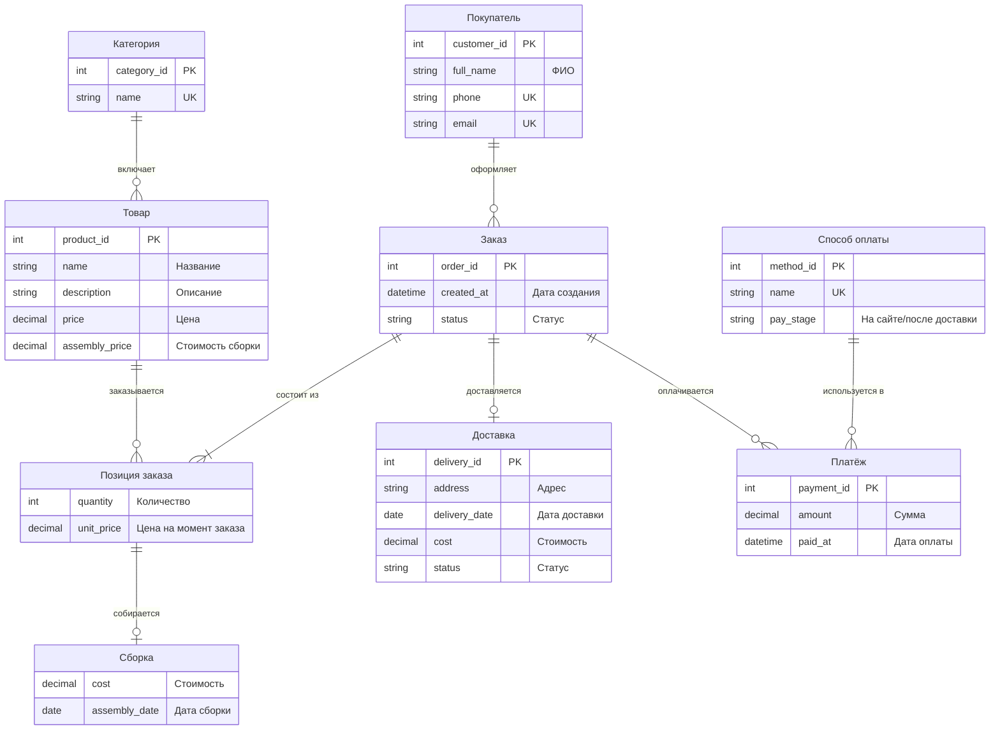

**Логическая схема**

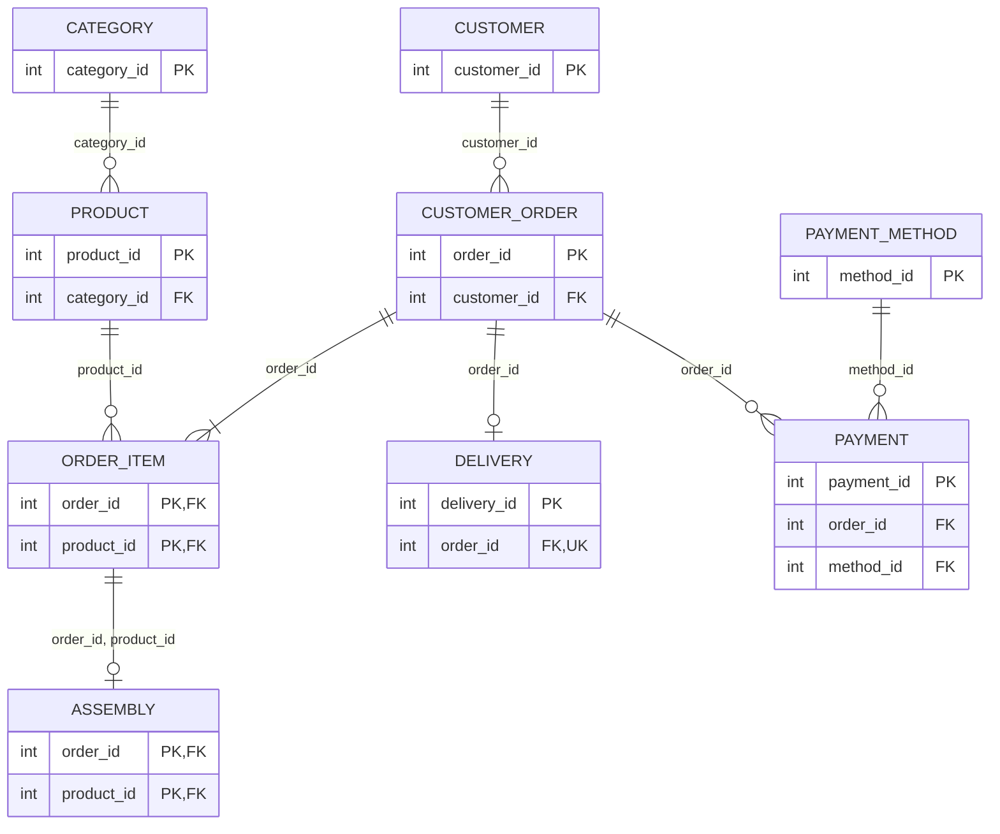

| Таблица / Атрибут  | ПК  | Обяз. | Уник. | Вн. ключ                         |
| ------------------ | --- | ----- | ----- | -------------------------------- |
| **CUSTOMER**       |     |       |       |                                  |
| customer_id        | +   | +     | +     |                                  |
| full_name          |     | +     |       |                                  |
| phone              |     | +     | +     |                                  |
| email              |     | +     | +     |                                  |
| **CATEGORY**       |     |       |       |                                  |
| category_id        | +   | +     | +     |                                  |
| name               |     | +     | +     |                                  |
| **PRODUCT**        |     |       |       |                                  |
| product_id         | +   | +     | +     |                                  |
| name               |     | +     |       |                                  |
| description        |     |       |       |                                  |
| price              |     | +     |       |                                  |
| assembly_price     |     |       |       |                                  |
| category_id        |     | +     |       | CATEGORY(category_id)            |
| **CUSTOMER_ORDER** |     |       |       |                                  |
| order_id           | +   | +     | +     |                                  |
| customer_id        |     | +     |       | CUSTOMER(customer_id)            |
| created_at         |     | +     |       |                                  |
| status             |     | +     |       |                                  |
| **ORDER_ITEM**     |     |       |       |                                  |
| order_id           | +   | +     |       | CUSTOMER_ORDER(order_id)         |
| product_id         | +   | +     |       | PRODUCT(product_id)              |
| quantity           |     | +     |       |                                  |
| unit_price         |     | +     |       |                                  |
| **ASSEMBLY**       |     |       |       |                                  |
| order_id           | +   | +     |       | ORDER_ITEM(order_id, product_id) |
| product_id         | +   | +     |       | ORDER_ITEM(order_id, product_id) |
| cost               |     | +     |       |                                  |
| assembly_date      |     |       |       |                                  |
| **DELIVERY**       |     |       |       |                                  |
| delivery_id        | +   | +     | +     |                                  |
| order_id           |     | +     | +     | CUSTOMER_ORDER(order_id)         |
| address            |     | +     |       |                                  |
| delivery_date      |     |       |       |                                  |
| cost               |     | +     |       |                                  |
| status             |     | +     |       |                                  |
| **PAYMENT_METHOD** |     |       |       |                                  |
| method_id          | +   | +     | +     |                                  |
| name               |     | +     | +     |                                  |
| pay_stage          |     | +     |       |                                  |
| **PAYMENT**        |     |       |       |                                  |
| payment_id         | +   | +     | +     |                                  |
| order_id           |     | +     |       | CUSTOMER_ORDER(order_id)         |
| method_id          |     | +     |       | PAYMENT_METHOD(method_id)        |
| amount             |     | +     |       |                                  |
| paid_at            |     |       |       |                                  |

_`pay_stage IN ('на сайте','после доставки')`; `paid_at IS NULL` — платёж ожидается (оплата после доставки)._

---

## 17. Онлайн-кинотеатр

**Допущения**

- Тариф (индивидуальный или семейный) — справочник с ценой и максимумом пользователей (1 или 5).
- Подписка принадлежит администратору; участники подписки — ассоциативная сущность (администратор тоже участник; не более 5 участников на семейную подписку — триггер).
- Фильм доступен по подписке (признак), покупке (цена покупки) или прокату (цена проката).
- Доступ по покупке/прокату — запись «Покупка»: вид (покупка/прокат), срок окончания проката = дата оплаты + 1 месяц; у покупки срока нет.
- Просмотры фиксируются отдельно (кто, что, когда).
- Жанровые предпочтения — M:N пользователь–жанр; жанры фильма — M:N фильм–жанр.

**ER-диаграмма**

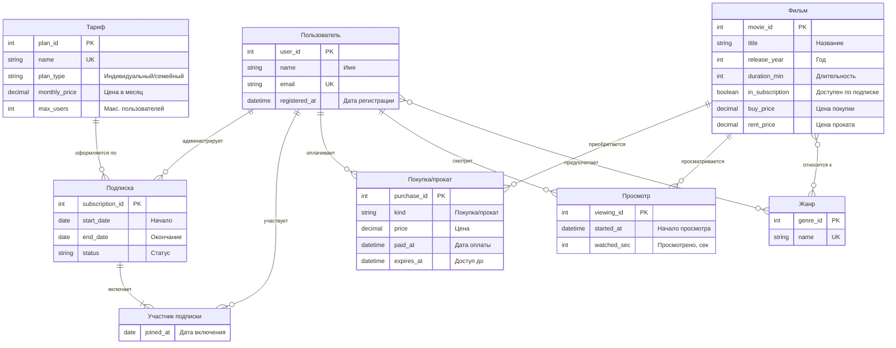

**Логическая схема**

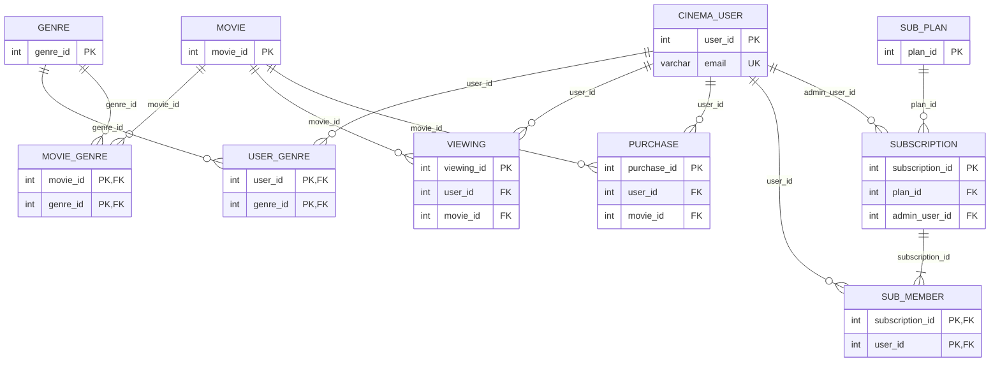

| Таблица / Атрибут | ПК  | Обяз. | Уник. | Вн. ключ                      |
| ----------------- | --- | ----- | ----- | ----------------------------- |
| **CINEMA_USER**   |     |       |       |                               |
| user_id           | +   | +     | +     |                               |
| name              |     | +     |       |                               |
| email             |     | +     | +     |                               |
| registered_at     |     | +     |       |                               |
| **SUB_PLAN**      |     |       |       |                               |
| plan_id           | +   | +     | +     |                               |
| name              |     | +     | +     |                               |
| plan_type         |     | +     |       |                               |
| monthly_price     |     | +     |       |                               |
| max_users         |     | +     |       |                               |
| **SUBSCRIPTION**  |     |       |       |                               |
| subscription_id   | +   | +     | +     |                               |
| plan_id           |     | +     |       | SUB_PLAN(plan_id)             |
| admin_user_id     |     | +     |       | CINEMA_USER(user_id)          |
| start_date        |     | +     |       |                               |
| end_date          |     | +     |       |                               |
| status            |     | +     |       |                               |
| **SUB_MEMBER**    |     |       |       |                               |
| subscription_id   | +   | +     |       | SUBSCRIPTION(subscription_id) |
| user_id           | +   | +     |       | CINEMA_USER(user_id)          |
| joined_at         |     | +     |       |                               |
| **MOVIE**         |     |       |       |                               |
| movie_id          | +   | +     | +     |                               |
| title             |     | +     |       |                               |
| release_year      |     | +     |       |                               |
| duration_min      |     | +     |       |                               |
| in_subscription   |     | +     |       |                               |
| buy_price         |     |       |       |                               |
| rent_price        |     |       |       |                               |
| **GENRE**         |     |       |       |                               |
| genre_id          | +   | +     | +     |                               |
| name              |     | +     | +     |                               |
| **MOVIE_GENRE**   |     |       |       |                               |
| movie_id          | +   | +     |       | MOVIE(movie_id)               |
| genre_id          | +   | +     |       | GENRE(genre_id)               |
| **USER_GENRE**    |     |       |       |                               |
| user_id           | +   | +     |       | CINEMA_USER(user_id)          |
| genre_id          | +   | +     |       | GENRE(genre_id)               |
| **PURCHASE**      |     |       |       |                               |
| purchase_id       | +   | +     | +     |                               |
| user_id           |     | +     |       | CINEMA_USER(user_id)          |
| movie_id          |     | +     |       | MOVIE(movie_id)               |
| kind              |     | +     |       |                               |
| price             |     | +     |       |                               |
| paid_at           |     | +     |       |                               |
| expires_at        |     |       |       |                               |
| **VIEWING**       |     |       |       |                               |
| viewing_id        | +   | +     | +     |                               |
| user_id           |     | +     |       | CINEMA_USER(user_id)          |
| movie_id          |     | +     |       | MOVIE(movie_id)               |
| started_at        |     | +     |       |                               |
| watched_sec       |     | +     |       |                               |

_`kind IN ('покупка','прокат')`; `expires_at` — NULL для покупки, `paid_at + 1 месяц` для проката._

---

## 18. Бронирование авиабилетов (заказ на сайте)

**Допущения**

- Заказ оформляет покупатель (клиент сайта) на нескольких пассажиров, включая себя.
- Маршрут из А в Б может состоять из нескольких перелётов (рейсов); билет оформляется на каждого пассажира на каждый рейс заказа.
- Вес багажа и тип меню указываются в билете. Тип меню — справочник (обычное, вегетарианское, детское, …).
- Место на рейсе уникально; пассажир не может иметь два билета на один рейс в рамках заказа.
- Дата перелёта определяется датой вылета рейса.

**ER-диаграмма**

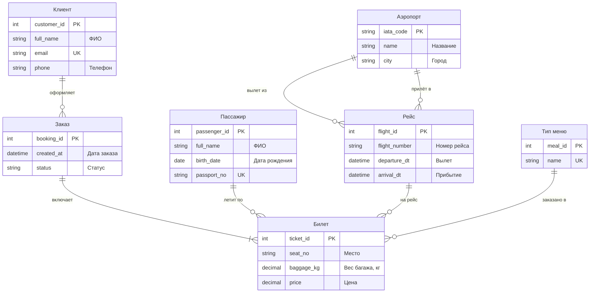

**Логическая схема**

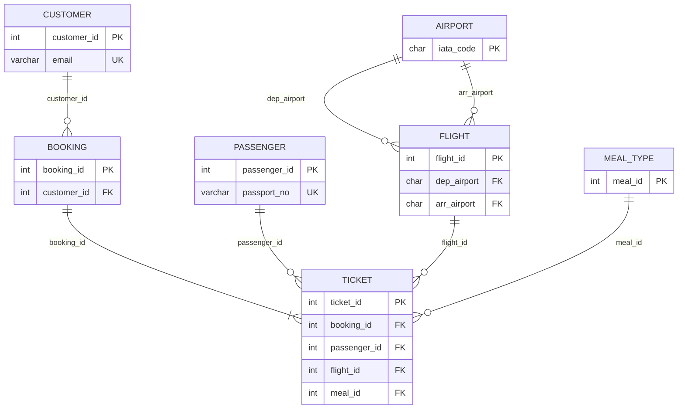

| Таблица / Атрибут | ПК  | Обяз. | Уник. | Вн. ключ                |
| ----------------- | --- | ----- | ----- | ----------------------- |
| **CUSTOMER**      |     |       |       |                         |
| customer_id       | +   | +     | +     |                         |
| full_name         |     | +     |       |                         |
| email             |     | +     | +     |                         |
| phone             |     |       |       |                         |
| **BOOKING**       |     |       |       |                         |
| booking_id        | +   | +     | +     |                         |
| customer_id       |     | +     |       | CUSTOMER(customer_id)   |
| created_at        |     | +     |       |                         |
| status            |     | +     |       |                         |
| **PASSENGER**     |     |       |       |                         |
| passenger_id      | +   | +     | +     |                         |
| full_name         |     | +     |       |                         |
| birth_date        |     | +     |       |                         |
| passport_no       |     | +     | +     |                         |
| **AIRPORT**       |     |       |       |                         |
| iata_code         | +   | +     | +     |                         |
| name              |     | +     |       |                         |
| city              |     | +     |       |                         |
| **FLIGHT**        |     |       |       |                         |
| flight_id         | +   | +     | +     |                         |
| flight_number     |     | +     |       |                         |
| dep_airport       |     | +     |       | AIRPORT(iata_code)      |
| arr_airport       |     | +     |       | AIRPORT(iata_code)      |
| departure_dt      |     | +     |       |                         |
| arrival_dt        |     | +     |       |                         |
| **MEAL_TYPE**     |     |       |       |                         |
| meal_id           | +   | +     | +     |                         |
| name              |     | +     | +     |                         |
| **TICKET**        |     |       |       |                         |
| ticket_id         | +   | +     | +     |                         |
| booking_id        |     | +     |       | BOOKING(booking_id)     |
| passenger_id      |     | +     |       | PASSENGER(passenger_id) |
| flight_id         |     | +     |       | FLIGHT(flight_id)       |
| meal_id           |     | +     |       | MEAL_TYPE(meal_id)      |
| seat_no           |     |       |       |                         |
| baggage_kg        |     | +     |       |                         |
| price             |     | +     |       |                         |

_Составные ограничения уникальности: `UNIQUE(flight_id, seat_no)`, `UNIQUE(booking_id, passenger_id, flight_id)`. В FLIGHT: `UNIQUE(flight_number, departure_dt)`._

---

## 19. Музыкальные альбомы

**Допущения**

- Альбом хранится на одном носителе: Audio CD или жёсткий диск; указывается идентификатор носителя (метка диска или путь).
- Трек — слабая сущность: идентифицируется альбомом и порядковым номером; принадлежит ровно одному альбому.
- Длина трека — в секундах.

**ER-диаграмма**

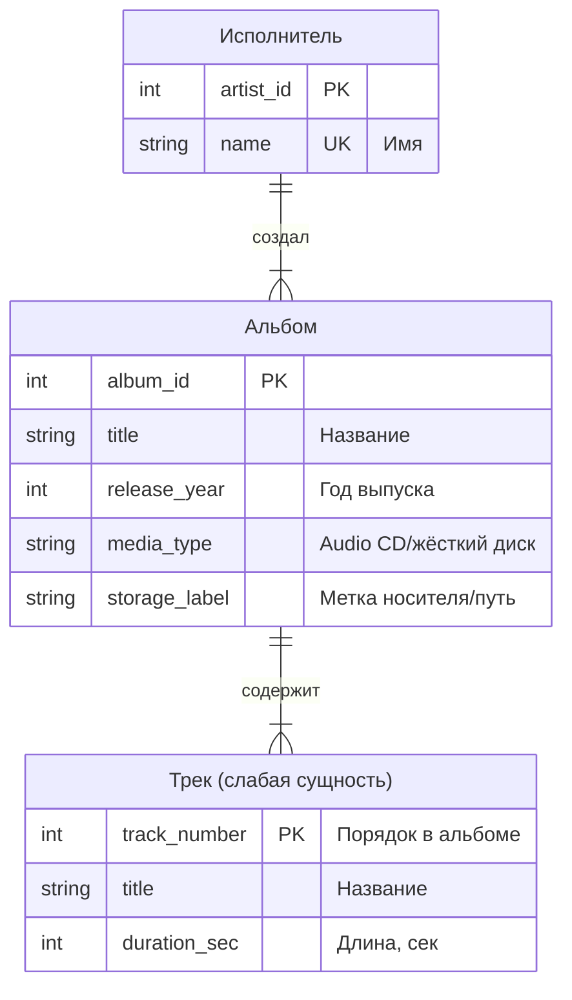

**Логическая схема**

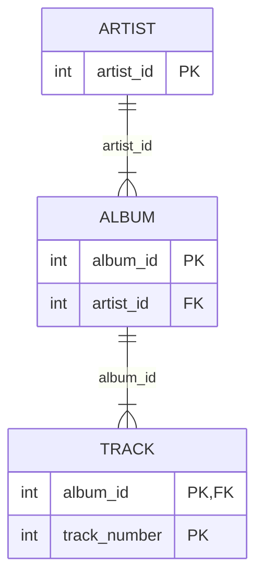

| Таблица / Атрибут | ПК  | Обяз. | Уник. | Вн. ключ          |
| ----------------- | --- | ----- | ----- | ----------------- |
| **ARTIST**        |     |       |       |                   |
| artist_id         | +   | +     | +     |                   |
| name              |     | +     | +     |                   |
| **ALBUM**         |     |       |       |                   |
| album_id          | +   | +     | +     |                   |
| artist_id         |     | +     |       | ARTIST(artist_id) |
| title             |     | +     |       |                   |
| release_year      |     |       |       |                   |
| media_type        |     | +     |       |                   |
| storage_label     |     | +     |       |                   |
| **TRACK**         |     |       |       |                   |
| album_id          | +   | +     |       | ALBUM(album_id)   |
| track_number      | +   | +     |       |                   |
| title             |     | +     |       |                   |
| duration_sec      |     | +     |       |                   |

_`media_type IN ('Audio CD','HDD')`; `duration_sec > 0`, `track_number > 0`._

---

## 20. Бронирование авиабилетов (база рейсов)

**Допущения**

- У авиакомпании один или несколько самолётов; самолёт принадлежит одной авиакомпании.
- Вместимость (число пассажирских мест) хранится у самолёта; «номер модели» — атрибут самолёта.
- Рейс идентифицируется уникальным номером. Место на рейсе уникально; бронирование — ассоциативная сущность пассажир–рейс.
- Адрес электронной почты пассажира уникален.

**ER-диаграмма**

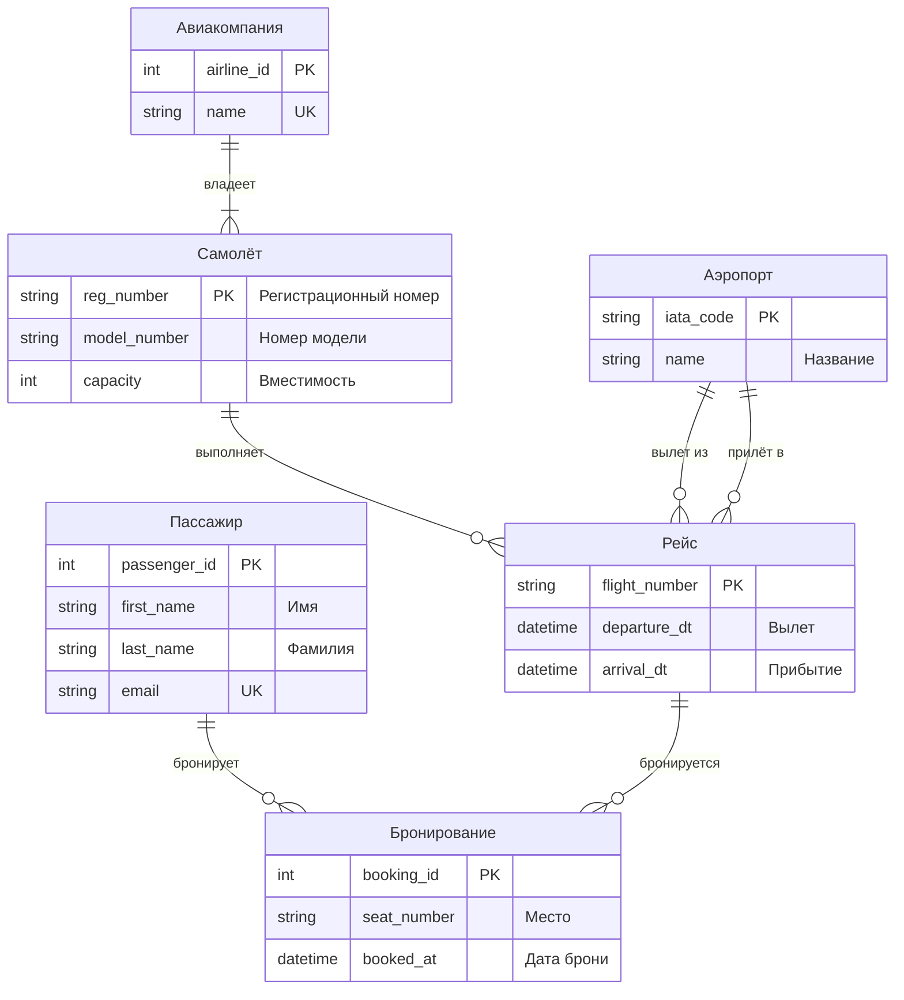

**Логическая схема**

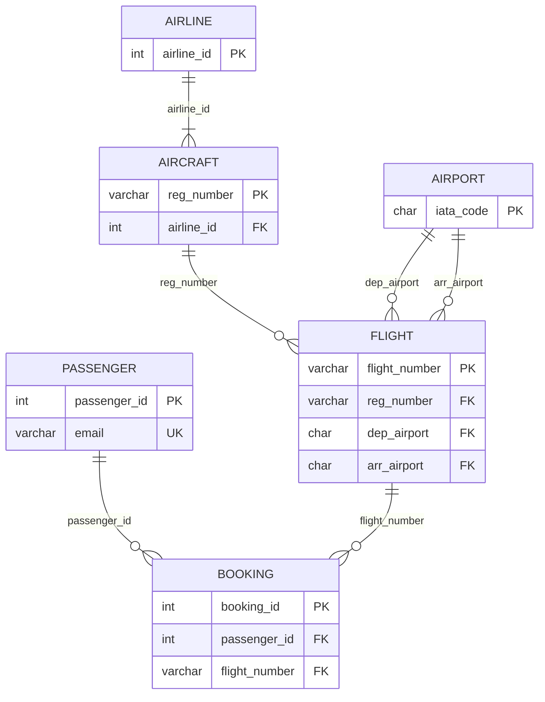

| Таблица / Атрибут | ПК  | Обяз. | Уник. | Вн. ключ                |
| ----------------- | --- | ----- | ----- | ----------------------- |
| **AIRLINE**       |     |       |       |                         |
| airline_id        | +   | +     | +     |                         |
| name              |     | +     | +     |                         |
| **AIRCRAFT**      |     |       |       |                         |
| reg_number        | +   | +     | +     |                         |
| model_number      |     | +     |       |                         |
| capacity          |     | +     |       |                         |
| airline_id        |     | +     |       | AIRLINE(airline_id)     |
| **AIRPORT**       |     |       |       |                         |
| iata_code         | +   | +     | +     |                         |
| name              |     | +     |       |                         |
| **FLIGHT**        |     |       |       |                         |
| flight_number     | +   | +     | +     |                         |
| departure_dt      |     | +     |       |                         |
| arrival_dt        |     | +     |       |                         |
| dep_airport       |     | +     |       | AIRPORT(iata_code)      |
| arr_airport       |     | +     |       | AIRPORT(iata_code)      |
| reg_number        |     | +     |       | AIRCRAFT(reg_number)    |
| **PASSENGER**     |     |       |       |                         |
| passenger_id      | +   | +     | +     |                         |
| first_name        |     | +     |       |                         |
| last_name         |     | +     |       |                         |
| email             |     | +     | +     |                         |
| **BOOKING**       |     |       |       |                         |
| booking_id        | +   | +     | +     |                         |
| passenger_id      |     | +     |       | PASSENGER(passenger_id) |
| flight_number     |     | +     |       | FLIGHT(flight_number)   |
| seat_number       |     | +     |       |                         |
| booked_at         |     | +     |       |                         |

_Составное ограничение уникальности: `UNIQUE(flight_number, seat_number)`; `arrival_dt > departure_dt`, `dep_airport <> arr_airport`._

## 21. Курсы и студенты

**ER-диаграмма**

```mermaid
erDiagram
    PROGRAM["Программа"] {
        int program_id PK
        string name "Название"
        int total_points "Баллов для диплома"
        int start_year "Год начала"
    }
    COURSE["Курс"] {
        int course_id PK
        string name "Название"
        decimal credit_value "Кредитная точка"
        int start_year "Год начала"
    }
    PROGRAM_COURSE["Курс программы"] {
        int study_year "Год обучения"
        int semester "Семестр"
    }
    STUDENT["Студент"] {
        int student_id PK
        string last_name "Фамилия"
        date birth_date "Дата рождения"
        int enroll_year "Год поступления"
    }
    STUDENT_NAME["Имя студента (слабая)"] {
        int name_order PK "Порядок"
        string given_name "Имя"
    }
    ENROLLMENT["Зачисление в программу"] {
        date enroll_date "Дата"
    }
    COURSE_ATTEMPT["Прохождение курса"] {
        int attempt_id PK
        int attempt_year "Год"
        int attempt_semester "Семестр"
        string grade_letter "Оценка (A, B...)"
        decimal percent "Оценка в %"
    }
    PROGRAM ||--|{ PROGRAM_COURSE : "состоит из"
    COURSE ||--o{ PROGRAM_COURSE : "входит в"
    STUDENT ||--|{ STUDENT_NAME : "имеет"
    STUDENT ||--|{ ENROLLMENT : "регистрируется"
    PROGRAM ||--o{ ENROLLMENT : "включает студентов"
    ENROLLMENT ||--o{ COURSE_ATTEMPT : "проходит"
    PROGRAM_COURSE ||--o{ COURSE_ATTEMPT : "по курсу программы"
```

**Логическая схема**

```mermaid
erDiagram
    PROGRAM { int program_id PK }
    COURSE { int course_id PK }
    PROGRAM_COURSE {
        int program_id PK, FK
        int course_id PK, FK
    }
    STUDENT { int student_id PK }
    STUDENT_NAME {
        int student_id PK, FK
        int name_order PK
    }
    ENROLLMENT {
        int student_id PK, FK
        int program_id PK, FK
    }
    COURSE_ATTEMPT {
        int attempt_id PK
        int student_id FK
        int program_id FK
        int course_id FK
    }
    PROGRAM ||--|{ PROGRAM_COURSE : "program_id"
    COURSE ||--o{ PROGRAM_COURSE : "course_id"
    STUDENT ||--|{ STUDENT_NAME : "student_id"
    STUDENT ||--|{ ENROLLMENT : "student_id"
    PROGRAM ||--o{ ENROLLMENT : "program_id"
    ENROLLMENT ||--o{ COURSE_ATTEMPT : "student_id, program_id"
    PROGRAM_COURSE ||--o{ COURSE_ATTEMPT : "program_id, course_id"
```

| Таблица / Атрибут  | ПК  | Обяз. | Уник. | Вн. ключ                                                                  |
| ------------------ | --- | ----- | ----- | ------------------------------------------------------------------------- |
| **PROGRAM**        |     |       |       |                                                                           |
| program_id         | +   | +     | +     |                                                                           |
| name               |     | +     |       |                                                                           |
| total_points       |     | +     |       |                                                                           |
| start_year         |     | +     |       |                                                                           |
| **COURSE**         |     |       |       |                                                                           |
| course_id          | +   | +     | +     |                                                                           |
| name               |     | +     |       |                                                                           |
| credit_value       |     | +     |       |                                                                           |
| start_year         |     | +     |       |                                                                           |
| **PROGRAM_COURSE** |     |       |       |                                                                           |
| program_id         | +   | +     |       | PROGRAM(program_id)                                                       |
| course_id          | +   | +     |       | COURSE(course_id)                                                         |
| study_year         |     | +     |       |                                                                           |
| semester           |     | +     |       |                                                                           |
| **STUDENT**        |     |       |       |                                                                           |
| student_id         | +   | +     | +     |                                                                           |
| last_name          |     | +     |       |                                                                           |
| birth_date         |     | +     |       |                                                                           |
| enroll_year        |     | +     |       |                                                                           |
| **STUDENT_NAME**   |     |       |       |                                                                           |
| student_id         | +   | +     |       | STUDENT(student_id)                                                       |
| name_order         | +   | +     |       |                                                                           |
| given_name         |     | +     |       |                                                                           |
| **ENROLLMENT**     |     |       |       |                                                                           |
| student_id         | +   | +     |       | STUDENT(student_id)                                                       |
| program_id         | +   | +     |       | PROGRAM(program_id)                                                       |
| enroll_date        |     | +     |       |                                                                           |
| **COURSE_ATTEMPT** |     |       |       |                                                                           |
| attempt_id         | +   | +     | +     |                                                                           |
| student_id         |     | +     |       | ENROLLMENT(student_id, program_id)                                        |
| program_id         |     | +     |       | ENROLLMENT(student_id, program_id); PROGRAM_COURSE(program_id, course_id) |
| course_id          |     | +     |       | PROGRAM_COURSE(program_id, course_id)                                     |
| attempt_year       |     | +     |       |                                                                           |
| attempt_semester   |     | +     |       |                                                                           |
| grade_letter       |     |       |       |                                                                           |
| percent            |     |       |       |                                                                           |

_Составное ограничение уникальности: `UNIQUE(student_id, course_id, attempt_year, attempt_semester)`; `percent BETWEEN 0 AND 100`; `grade_letter` и `percent` либо оба NULL, либо оба заданы._

---

## 22. Компания и сотрудники

**Допущения**

- Руководитель отдела — сотрудник этого отдела (связь 1:1 «управляет», у отдела ровно один руководитель; создаётся после сотрудника).
- Сотрудник работает в одном отделе, имеет не более одного непосредственного руководителя (рекурсивная связь).
- Отдел контролирует проекты; проект принадлежит одному отделу.
- Участие сотрудника в проекте — ассоциативная сущность с датой начала работы.
- Иждивенец — слабая сущность, идентифицируется сотрудником и именем.

**ER-диаграмма**

```mermaid
erDiagram
    DEPARTMENT["Отдел"] {
        int dept_id PK
        string name UK "Название"
        string office_location "Офис"
    }
    EMPLOYEE["Сотрудник"] {
        int emp_id PK
        string name "Имя"
        string address "Адрес"
        decimal salary "Зарплата"
        date birth_date "Дата рождения"
    }
    PROJECT["Проект"] {
        int project_no PK "Номер"
        string name UK "Имя"
        decimal budget "Бюджет"
    }
    WORKS_ON["Участие в проекте"] {
        date start_date "Дата начала работы"
    }
    DEPENDENT["Иждивенец (слабая)"] {
        string dep_name PK "Имя"
        date birth_date "Дата рождения"
        string relationship "Отношение"
    }
    DEPARTMENT ||--|{ EMPLOYEE : "работает в"
    EMPLOYEE |o--|| DEPARTMENT : "управляет"
    EMPLOYEE |o--o{ EMPLOYEE : "руководит"
    DEPARTMENT ||--o{ PROJECT : "контролирует"
    EMPLOYEE ||--o{ WORKS_ON : "участвует"
    PROJECT ||--|{ WORKS_ON : "привлекает"
    EMPLOYEE ||--o{ DEPENDENT : "имеет"
```

**Логическая схема**

```mermaid
erDiagram
    DEPARTMENT {
        int dept_id PK
        varchar name UK
        int manager_id FK, UK
    }
    EMPLOYEE {
        int emp_id PK
        int dept_id FK
        int supervisor_id FK
    }
    PROJECT {
        int project_no PK
        varchar name UK
        int dept_id FK
    }
    WORKS_ON {
        int emp_id PK, FK
        int project_no PK, FK
    }
    DEPENDENT {
        int emp_id PK, FK
        varchar dep_name PK
    }
    DEPARTMENT ||--|{ EMPLOYEE : "dept_id"
    EMPLOYEE |o--|| DEPARTMENT : "manager_id"
    EMPLOYEE |o--o{ EMPLOYEE : "supervisor_id"
    DEPARTMENT ||--o{ PROJECT : "dept_id"
    EMPLOYEE ||--o{ WORKS_ON : "emp_id"
    PROJECT ||--|{ WORKS_ON : "project_no"
    EMPLOYEE ||--o{ DEPENDENT : "emp_id"
```

| Таблица / Атрибут | ПК  | Обяз. | Уник. | Вн. ключ            |
| ----------------- | --- | ----- | ----- | ------------------- |
| **DEPARTMENT**    |     |       |       |                     |
| dept_id           | +   | +     | +     |                     |
| name              |     | +     | +     |                     |
| office_location   |     | +     |       |                     |
| manager_id        |     | +     | +     | EMPLOYEE(emp_id)    |
| **EMPLOYEE**      |     |       |       |                     |
| emp_id            | +   | +     | +     |                     |
| name              |     | +     |       |                     |
| address           |     | +     |       |                     |
| salary            |     | +     |       |                     |
| birth_date        |     | +     |       |                     |
| dept_id           |     | +     |       | DEPARTMENT(dept_id) |
| supervisor_id     |     |       |       | EMPLOYEE(emp_id)    |
| **PROJECT**       |     |       |       |                     |
| project_no        | +   | +     | +     |                     |
| name              |     | +     | +     |                     |
| budget            |     | +     |       |                     |
| dept_id           |     | +     |       | DEPARTMENT(dept_id) |
| **WORKS_ON**      |     |       |       |                     |
| emp_id            | +   | +     |       | EMPLOYEE(emp_id)    |
| project_no        | +   | +     |       | PROJECT(project_no) |
| start_date        |     | +     |       |                     |
| **DEPENDENT**     |     |       |       |                     |
| emp_id            | +   | +     |       | EMPLOYEE(emp_id)    |
| dep_name          | +   | +     |       |                     |
| birth_date        |     | +     |       |                     |
| relationship      |     | +     |       |                     |

_`DEPARTMENT.manager_id` обязателен после начальной загрузки (циклическая ссылка: отдел и руководитель вносятся с отложенной проверкой ограничений); `salary >= 0`._

---

## 23. Галереи

**Допущения**

- Творческое имя художника уникально и служит первичным ключом. Вместо возраста хранится год рождения.
- Стиль искусства и вид произведения — атрибуты (по условию заданы одним значением).
- Группа (портреты, натюрморты, Пикассо, XIX век) — сущность с именем-идентификатором; произведение может входить в несколько групп.
- Имя клиента уникально (по условию); общая сумма потраченных денег хранится в атрибуте.
- Предпочтения клиента — две M:N связи: с художниками и с группами.

**ER-диаграмма**

```mermaid
erDiagram
    ARTIST["Художник"] {
        string name PK "Творческое имя"
        string birth_place "Место рождения"
        int birth_year "Год рождения"
        string art_style "Стиль"
    }
    ARTWORK["Произведение"] {
        int artwork_id PK
        string title "Название"
        int creation_year "Год изготовления"
        string kind "Вид"
        decimal price "Цена"
    }
    ART_GROUP["Группа"] {
        string name PK "Название группы"
    }
    CUSTOMER["Клиент"] {
        string name PK "Уникальное имя"
        string address "Адрес"
        decimal total_spent "Всего потрачено"
    }
    ARTIST ||--o{ ARTWORK : "создал"
    ARTWORK }o--o{ ART_GROUP : "входит в"
    CUSTOMER }o--o{ ARTIST : "любит"
    CUSTOMER }o--o{ ART_GROUP : "любит"
```

**Логическая схема**

```mermaid
erDiagram
    ARTIST { varchar name PK }
    ARTWORK {
        int artwork_id PK
        varchar artist_name FK
    }
    ART_GROUP { varchar name PK }
    ARTWORK_GROUP {
        int artwork_id PK, FK
        varchar group_name PK, FK
    }
    CUSTOMER { varchar name PK }
    CUSTOMER_ARTIST {
        varchar customer_name PK, FK
        varchar artist_name PK, FK
    }
    CUSTOMER_GROUP {
        varchar customer_name PK, FK
        varchar group_name PK, FK
    }
    ARTIST ||--o{ ARTWORK : "artist_name"
    ARTWORK ||--o{ ARTWORK_GROUP : "artwork_id"
    ART_GROUP ||--o{ ARTWORK_GROUP : "group_name"
    CUSTOMER ||--o{ CUSTOMER_ARTIST : "customer_name"
    ARTIST ||--o{ CUSTOMER_ARTIST : "artist_name"
    CUSTOMER ||--o{ CUSTOMER_GROUP : "customer_name"
    ART_GROUP ||--o{ CUSTOMER_GROUP : "group_name"
```

| Таблица / Атрибут   | ПК  | Обяз. | Уник. | Вн. ключ            |
| ------------------- | --- | ----- | ----- | ------------------- |
| **ARTIST**          |     |       |       |                     |
| name                | +   | +     | +     |                     |
| birth_place         |     | +     |       |                     |
| birth_year          |     | +     |       |                     |
| art_style           |     | +     |       |                     |
| **ARTWORK**         |     |       |       |                     |
| artwork_id          | +   | +     | +     |                     |
| title               |     | +     |       |                     |
| creation_year       |     | +     |       |                     |
| kind                |     | +     |       |                     |
| price               |     | +     |       |                     |
| artist_name         |     | +     |       | ARTIST(name)        |
| **ART_GROUP**       |     |       |       |                     |
| name                | +   | +     | +     |                     |
| **ARTWORK_GROUP**   |     |       |       |                     |
| artwork_id          | +   | +     |       | ARTWORK(artwork_id) |
| group_name          | +   | +     |       | ART_GROUP(name)     |
| **CUSTOMER**        |     |       |       |                     |
| name                | +   | +     | +     |                     |
| address             |     | +     |       |                     |
| total_spent         |     | +     |       |                     |
| **CUSTOMER_ARTIST** |     |       |       |                     |
| customer_name       | +   | +     |       | CUSTOMER(name)      |
| artist_name         | +   | +     |       | ARTIST(name)        |
| **CUSTOMER_GROUP**  |     |       |       |                     |
| customer_name       | +   | +     |       | CUSTOMER(name)      |
| group_name          | +   | +     |       | ART_GROUP(name)     |

_`total_spent DEFAULT 0`, `total_spent >= 0`, `price >= 0`._

---

## 24. Сеть отелей B&B

**Допущения**

- Цена зависит от типа номера (единая для сети): хранится в справочнике типов.
- Количество дней проживания не хранится — вычисляется как `check_out - check_in` (иначе возникает избыточность).
- Для рассылки писем и предложений у гостя хранятся адрес и e-mail; согласие на рассылку — флаг.
- Одна бронь — один номер на период; пересекающиеся периоды для одного номера запрещены.

**ER-диаграмма**

```mermaid
erDiagram
    HOTEL["Отель"] {
        int hotel_id PK
        string name "Название"
        string city "Город"
        string address "Адрес"
    }
    ROOM_TYPE["Тип номера"] {
        int type_id PK
        string name UK
        decimal price_per_night "Цена за ночь"
    }
    ROOM["Номер"] {
        int room_id PK
        string room_number "Номер комнаты"
    }
    GUEST["Гость"] {
        int guest_id PK
        string full_name "ФИО"
        string postal_address "Почтовый адрес"
        string email UK
        boolean mailing_consent "Согласие на рассылку"
    }
    BOOKING["Бронирование"] {
        int booking_id PK
        date check_in "Дата заезда"
        date check_out "Дата отъезда"
    }
    HOTEL ||--|{ ROOM : "имеет"
    ROOM_TYPE ||--o{ ROOM : "определяет тип"
    GUEST ||--o{ BOOKING : "бронирует"
    ROOM ||--o{ BOOKING : "бронируется"
```

**Логическая схема**

```mermaid
erDiagram
    HOTEL { int hotel_id PK }
    ROOM_TYPE { int type_id PK }
    ROOM {
        int room_id PK
        int hotel_id FK
        int type_id FK
    }
    GUEST {
        int guest_id PK
        varchar email UK
    }
    BOOKING {
        int booking_id PK
        int guest_id FK
        int room_id FK
    }
    HOTEL ||--|{ ROOM : "hotel_id"
    ROOM_TYPE ||--o{ ROOM : "type_id"
    GUEST ||--o{ BOOKING : "guest_id"
    ROOM ||--o{ BOOKING : "room_id"
```

| Таблица / Атрибут | ПК  | Обяз. | Уник. | Вн. ключ           |
| ----------------- | --- | ----- | ----- | ------------------ |
| **HOTEL**         |     |       |       |                    |
| hotel_id          | +   | +     | +     |                    |
| name              |     | +     |       |                    |
| city              |     | +     |       |                    |
| address           |     | +     |       |                    |
| **ROOM_TYPE**     |     |       |       |                    |
| type_id           | +   | +     | +     |                    |
| name              |     | +     | +     |                    |
| price_per_night   |     | +     |       |                    |
| **ROOM**          |     |       |       |                    |
| room_id           | +   | +     | +     |                    |
| hotel_id          |     | +     |       | HOTEL(hotel_id)    |
| type_id           |     | +     |       | ROOM_TYPE(type_id) |
| room_number       |     | +     |       |                    |
| **GUEST**         |     |       |       |                    |
| guest_id          | +   | +     | +     |                    |
| full_name         |     | +     |       |                    |
| postal_address    |     |       |       |                    |
| email             |     | +     | +     |                    |
| mailing_consent   |     | +     |       |                    |
| **BOOKING**       |     |       |       |                    |
| booking_id        | +   | +     | +     |                    |
| guest_id          |     | +     |       | GUEST(guest_id)    |
| room_id           |     | +     |       | ROOM(room_id)      |
| check_in          |     | +     |       |                    |
| check_out         |     | +     |       |                    |

_`UNIQUE(hotel_id, room_number)`; `check_out > check_in`; количество дней = `check_out − check_in` (вычисляется)._

---

## 25. Прокат автомобилей

**Допущения**

- Бронь относится к модели (конкретная модель или «любая» — `model_id = NULL`), а не к конкретному автомобилю.
- Когда подходящий автомобиль освобождается, оформляется прокат, который ссылается на бронь (0..1): прокат может быть и без брони (клиент пришёл сразу).
- Конкретный автомобиль привязывается к клиенту только при выдаче — в таблице проката.
- Дата начала и продолжительность (в днях) хранятся в прокате; плановая дата начала — в брони.

**ER-диаграмма**

```mermaid
erDiagram
    CAR_MODEL["Модель"] {
        int model_id PK
        string brand "Марка"
        string name "Название модели"
        decimal daily_price "Цена за сутки"
    }
    CAR["Автомобиль"] {
        int car_id PK
        string plate_no UK "Госномер"
        string vin UK "VIN"
    }
    CLIENT["Клиент"] {
        int client_id PK
        string full_name "ФИО"
        string phone "Телефон"
        string license_no UK "Водительское удостоверение"
    }
    RESERVATION["Бронь"] {
        int reservation_id PK
        date planned_start "Желаемая дата начала"
        int planned_days "Желаемая длительность"
        string status "Активна/выполнена/отменена"
    }
    RENTAL["Прокат"] {
        int rental_id PK
        date start_date "Дата начала"
        int duration_days "Продолжительность, дни"
    }
    CAR_MODEL ||--o{ CAR : "имеет экземпляры"
    CLIENT ||--o{ RESERVATION : "бронирует"
    CAR_MODEL |o--o{ RESERVATION : "бронируется модель"
    CLIENT ||--o{ RENTAL : "берёт"
    CAR ||--o{ RENTAL : "выдаётся"
    RESERVATION |o--o| RENTAL : "исполняется"
```

**Логическая схема**

```mermaid
erDiagram
    CAR_MODEL { int model_id PK }
    CAR {
        int car_id PK
        varchar plate_no UK
        varchar vin UK
        int model_id FK
    }
    CLIENT {
        int client_id PK
        varchar license_no UK
    }
    RESERVATION {
        int reservation_id PK
        int client_id FK
        int model_id FK
    }
    RENTAL {
        int rental_id PK
        int client_id FK
        int car_id FK
        int reservation_id FK, UK
    }
    CAR_MODEL ||--o{ CAR : "model_id"
    CLIENT ||--o{ RESERVATION : "client_id"
    CAR_MODEL |o--o{ RESERVATION : "model_id"
    CLIENT ||--o{ RENTAL : "client_id"
    CAR ||--o{ RENTAL : "car_id"
    RESERVATION |o--o| RENTAL : "reservation_id"
```

| Таблица / Атрибут | ПК  | Обяз. | Уник. | Вн. ключ                    |
| ----------------- | --- | ----- | ----- | --------------------------- |
| **CAR_MODEL**     |     |       |       |                             |
| model_id          | +   | +     | +     |                             |
| brand             |     | +     |       |                             |
| name              |     | +     |       |                             |
| daily_price       |     | +     |       |                             |
| **CAR**           |     |       |       |                             |
| car_id            | +   | +     | +     |                             |
| plate_no          |     | +     | +     |                             |
| vin               |     | +     | +     |                             |
| model_id          |     | +     |       | CAR_MODEL(model_id)         |
| **CLIENT**        |     |       |       |                             |
| client_id         | +   | +     | +     |                             |
| full_name         |     | +     |       |                             |
| phone             |     | +     |       |                             |
| license_no        |     | +     | +     |                             |
| **RESERVATION**   |     |       |       |                             |
| reservation_id    | +   | +     | +     |                             |
| client_id         |     | +     |       | CLIENT(client_id)           |
| model_id          |     |       |       | CAR_MODEL(model_id)         |
| planned_start     |     | +     |       |                             |
| planned_days      |     | +     |       |                             |
| status            |     | +     |       |                             |
| **RENTAL**        |     |       |       |                             |
| rental_id         | +   | +     | +     |                             |
| client_id         |     | +     |       | CLIENT(client_id)           |
| car_id            |     | +     |       | CAR(car_id)                 |
| reservation_id    |     |       | +     | RESERVATION(reservation_id) |
| start_date        |     | +     |       |                             |
| duration_days     |     | +     |       |                             |

_`model_id IS NULL` в брони — клиент согласен на любую модель; `duration_days > 0`; периоды проката одного автомобиля не пересекаются._

---

## 26. КХЛ

**Допущения**

- Тренер — атрибут команды (отдельных данных о нём в условии нет).
- Игрок принадлежит ровно одной команде; капитан — игрок своей команды (связь 1:1 команда–игрок; проверяется, что капитан играет за эту же команду).
- Травмы — слабая сущность игрока (набор записей): тип, дата начала, дата окончания.
- Игра — две команды (хозяева и гости), дата и счёт хозяев и гостей.

**ER-диаграмма**

```mermaid
erDiagram
    TEAM["Команда"] {
        int team_id PK
        string name UK "Название"
        string city "Город"
        string coach "Тренер"
    }
    PLAYER["Игрок"] {
        int player_id PK
        string full_name "Имя"
        string position "Позиция"
        string skill_level "Уровень квалификации"
    }
    INJURY["Травма (слабая)"] {
        int injury_no PK "Номер записи"
        string injury_type "Тип травмы"
        date start_date "Начало"
        date end_date "Окончание"
    }
    GAME["Игра"] {
        int game_id PK
        date game_date "Дата"
        int home_score "Счёт хозяев"
        int guest_score "Счёт гостей"
    }
    TEAM ||--|{ PLAYER : "состоит из"
    TEAM |o--|| PLAYER : "капитан"
    PLAYER ||--o{ INJURY : "получает"
    TEAM ||--o{ GAME : "хозяева"
    TEAM ||--o{ GAME : "гости"
```

**Логическая схема**

```mermaid
erDiagram
    TEAM {
        int team_id PK
        varchar name UK
        int captain_id FK, UK
    }
    PLAYER {
        int player_id PK
        int team_id FK
    }
    INJURY {
        int player_id PK, FK
        int injury_no PK
    }
    GAME {
        int game_id PK
        int home_team_id FK
        int guest_team_id FK
    }
    TEAM ||--|{ PLAYER : "team_id"
    TEAM |o--|| PLAYER : "captain_id"
    PLAYER ||--o{ INJURY : "player_id"
    TEAM ||--o{ GAME : "home_team_id"
    TEAM ||--o{ GAME : "guest_team_id"
```

| Таблица / Атрибут | ПК  | Обяз. | Уник. | Вн. ключ          |
| ----------------- | --- | ----- | ----- | ----------------- |
| **TEAM**          |     |       |       |                   |
| team_id           | +   | +     | +     |                   |
| name              |     | +     | +     |                   |
| city              |     | +     |       |                   |
| coach             |     | +     |       |                   |
| captain_id        |     |       | +     | PLAYER(player_id) |
| **PLAYER**        |     |       |       |                   |
| player_id         | +   | +     | +     |                   |
| team_id           |     | +     |       | TEAM(team_id)     |
| full_name         |     | +     |       |                   |
| position          |     | +     |       |                   |
| skill_level       |     | +     |       |                   |
| **INJURY**        |     |       |       |                   |
| player_id         | +   | +     |       | PLAYER(player_id) |
| injury_no         | +   | +     |       |                   |
| injury_type       |     | +     |       |                   |
| start_date        |     | +     |       |                   |
| end_date          |     |       |       |                   |
| **GAME**          |     |       |       |                   |
| game_id           | +   | +     | +     |                   |
| game_date         |     | +     |       |                   |
| home_team_id      |     | +     |       | TEAM(team_id)     |
| guest_team_id     |     | +     |       | TEAM(team_id)     |
| home_score        |     | +     |       |                   |
| guest_score       |     | +     |       |                   |

_Ограничения:_ `home_team_id <> guest_team_id`; `UNIQUE(game_date, home_team_id, guest_team_id)`; капитан — игрок той же команды (триггер); `captain_id` NULL допустим на момент создания команды.

---

## 27. Книжный онлайн-магазин

**Допущения**

- У книги могут быть несколько авторов (M:N); издатель — справочник.
- Формат книги: «бумажная» или «электронная». Для бумажной обязательны тип обложки и масса; для электронной — формат файла. Остальные атрибуты общие.
- Заказ может содержать оба формата. Бумажные книги доставляются по адресу (доставка 0..1 на заказ — нужна только при наличии бумажных книг), электронные отправляются на e-mail покупателя; время отправки фиксируется.
- Фиксируются время формирования заказа, оплаты и доставки. Масса заказа вычисляется по бумажным позициям.

**ER-диаграмма**

```mermaid
erDiagram
    PUBLISHER["Издатель"] {
        int publisher_id PK
        string name UK
    }
    AUTHOR["Автор"] {
        int author_id PK
        string full_name "ФИО"
    }
    BOOK["Книга"] {
        int book_id PK
        string title "Наименование"
        int pages "Страниц"
        string format "Бумажная/электронная"
        string cover_type "Тип обложки"
        int weight_g "Масса, г"
        string file_format "Формат файла"
        decimal price "Цена"
    }
    CUSTOMER["Покупатель"] {
        int customer_id PK
        string full_name "ФИО"
        string email UK
        string phone "Телефон"
    }
    BOOK_ORDER["Заказ"] {
        int order_id PK
        datetime created_at "Время формирования"
        datetime paid_at "Время оплаты"
        datetime ebooks_sent_at "Время отправки эл. книг"
    }
    ORDER_ITEM["Позиция заказа"] {
        int quantity "Количество"
        decimal unit_price "Цена на момент заказа"
    }
    DELIVERY["Доставка"] {
        string address "Адрес"
        datetime delivered_at "Время доставки"
    }
    PUBLISHER ||--o{ BOOK : "издаёт"
    AUTHOR }o--o{ BOOK : "написал"
    CUSTOMER ||--o{ BOOK_ORDER : "оформляет"
    BOOK_ORDER ||--|{ ORDER_ITEM : "содержит"
    BOOK ||--o{ ORDER_ITEM : "заказывается"
    BOOK_ORDER ||--o| DELIVERY : "доставляется"
```

**Логическая схема**

```mermaid
erDiagram
    PUBLISHER { int publisher_id PK }
    AUTHOR { int author_id PK }
    BOOK {
        int book_id PK
        int publisher_id FK
    }
    BOOK_AUTHOR {
        int book_id PK, FK
        int author_id PK, FK
    }
    CUSTOMER {
        int customer_id PK
        varchar email UK
    }
    BOOK_ORDER {
        int order_id PK
        int customer_id FK
    }
    ORDER_ITEM {
        int order_id PK, FK
        int book_id PK, FK
    }
    DELIVERY {
        int order_id PK, FK
    }
    PUBLISHER ||--o{ BOOK : "publisher_id"
    BOOK ||--o{ BOOK_AUTHOR : "book_id"
    AUTHOR ||--o{ BOOK_AUTHOR : "author_id"
    CUSTOMER ||--o{ BOOK_ORDER : "customer_id"
    BOOK_ORDER ||--|{ ORDER_ITEM : "order_id"
    BOOK ||--o{ ORDER_ITEM : "book_id"
    BOOK_ORDER ||--o| DELIVERY : "order_id"
```

| Таблица / Атрибут | ПК  | Обяз. | Уник. | Вн. ключ                |
| ----------------- | --- | ----- | ----- | ----------------------- |
| **PUBLISHER**     |     |       |       |                         |
| publisher_id      | +   | +     | +     |                         |
| name              |     | +     | +     |                         |
| **AUTHOR**        |     |       |       |                         |
| author_id         | +   | +     | +     |                         |
| full_name         |     | +     |       |                         |
| **BOOK**          |     |       |       |                         |
| book_id           | +   | +     | +     |                         |
| title             |     | +     |       |                         |
| publisher_id      |     | +     |       | PUBLISHER(publisher_id) |
| pages             |     | +     |       |                         |
| format            |     | +     |       |                         |
| cover_type        |     |       |       |                         |
| weight_g          |     |       |       |                         |
| file_format       |     |       |       |                         |
| price             |     | +     |       |                         |
| **BOOK_AUTHOR**   |     |       |       |                         |
| book_id           | +   | +     |       | BOOK(book_id)           |
| author_id         | +   | +     |       | AUTHOR(author_id)       |
| **CUSTOMER**      |     |       |       |                         |
| customer_id       | +   | +     | +     |                         |
| full_name         |     | +     |       |                         |
| email             |     | +     | +     |                         |
| phone             |     |       |       |                         |
| **BOOK_ORDER**    |     |       |       |                         |
| order_id          | +   | +     | +     |                         |
| customer_id       |     | +     |       | CUSTOMER(customer_id)   |
| created_at        |     | +     |       |                         |
| paid_at           |     |       |       |                         |
| ebooks_sent_at    |     |       |       |                         |
| **ORDER_ITEM**    |     |       |       |                         |
| order_id          | +   | +     |       | BOOK_ORDER(order_id)    |
| book_id           | +   | +     |       | BOOK(book_id)           |
| quantity          |     | +     |       |                         |
| unit_price        |     | +     |       |                         |
| **DELIVERY**      |     |       |       |                         |
| order_id          | +   | +     | +     | BOOK_ORDER(order_id)    |
| address           |     | +     |       |                         |
| delivered_at      |     |       |       |                         |

_Ограничения BOOK:_ `format IN ('бумажная','электронная')`; для бумажной `cover_type IN ('мягкая','твёрдая','суперобложка')` и `weight_g > 0` обязательны, для электронной обязателен `file_format`. Электронная книга в заказе — `quantity = 1`.

---

## 28. Мастерская по ремонту бытовой техники

**Допущения**

- Типы техники: холодильник, стиральная машина, телевизор, микроволновая печь (справочник).
- Приём техники оформляется заказом на ремонт с описанием неисправности и необходимых свойств (марка, модель, серийный номер, комплектность).
- Приём и диагностику выполняют сотрудники (приёмщик и мастер); мастер оценивает ремонт в течение 3 дней после приёма (контроль срока `diagnosed_at <= received_at + 3 дня`).
- Стоимость ремонта = сумма стоимости заменяемых деталей и выполненных работ (вычисляется); хранится список деталей и список работ. Для гарантийного ремонта клиент не платит.
- Клиент уведомляется, согласие фиксируется датой согласия.

**ER-диаграмма**

```mermaid
erDiagram
    CLIENT["Клиент"] {
        int client_id PK
        string full_name "ФИО"
        string phone "Телефон"
    }
    DEVICE_TYPE["Тип техники"] {
        int type_id PK
        string name UK
    }
    EMPLOYEE["Сотрудник"] {
        int employee_id PK
        string full_name "ФИО"
        string role "Приёмщик/мастер"
    }
    REPAIR_ORDER["Заказ на ремонт"] {
        int order_id PK
        string brand "Марка"
        string model "Модель"
        string serial_no "Серийный номер"
        string device_props "Свойства и комплектность"
        string defect "Описание неисправности"
        datetime received_at "Дата приёма"
        datetime diagnosed_at "Дата диагностики"
        date client_agreed_at "Дата согласия клиента"
        boolean is_warranty "Гарантийный ремонт"
        string status "Статус"
    }
    SPARE_PART["Деталь"] {
        int part_id PK
        string name UK
        decimal price "Цена"
    }
    WORK_TYPE["Вид работ"] {
        int work_id PK
        string name UK
        decimal price "Стоимость"
    }
    ORDER_PART["Заменяемая деталь"] {
        int quantity "Количество"
        decimal unit_price "Цена на момент заказа"
    }
    ORDER_WORK["Действие"] {
        int quantity "Количество"
        decimal unit_price "Стоимость на момент заказа"
    }
    CLIENT ||--o{ REPAIR_ORDER : "сдаёт технику"
    DEVICE_TYPE ||--o{ REPAIR_ORDER : "тип техники"
    EMPLOYEE ||--o{ REPAIR_ORDER : "принимает"
    EMPLOYEE |o--o{ REPAIR_ORDER : "диагностирует"
    REPAIR_ORDER ||--o{ ORDER_PART : "требует"
    SPARE_PART ||--o{ ORDER_PART : "используется в"
    REPAIR_ORDER ||--o{ ORDER_WORK : "включает"
    WORK_TYPE ||--o{ ORDER_WORK : "выполняется в"
```

**Логическая схема**

```mermaid
erDiagram
    CLIENT { int client_id PK }
    DEVICE_TYPE { int type_id PK }
    EMPLOYEE { int employee_id PK }
    REPAIR_ORDER {
        int order_id PK
        int client_id FK
        int type_id FK
        int receiver_id FK
        int master_id FK
    }
    SPARE_PART { int part_id PK }
    WORK_TYPE { int work_id PK }
    ORDER_PART {
        int order_id PK, FK
        int part_id PK, FK
    }
    ORDER_WORK {
        int order_id PK, FK
        int work_id PK, FK
    }
    CLIENT ||--o{ REPAIR_ORDER : "client_id"
    DEVICE_TYPE ||--o{ REPAIR_ORDER : "type_id"
    EMPLOYEE ||--o{ REPAIR_ORDER : "receiver_id"
    EMPLOYEE |o--o{ REPAIR_ORDER : "master_id"
    REPAIR_ORDER ||--o{ ORDER_PART : "order_id"
    SPARE_PART ||--o{ ORDER_PART : "part_id"
    REPAIR_ORDER ||--o{ ORDER_WORK : "order_id"
    WORK_TYPE ||--o{ ORDER_WORK : "work_id"
```

| Таблица / Атрибут | ПК  | Обяз. | Уник. | Вн. ключ               |
| ----------------- | --- | ----- | ----- | ---------------------- |
| **CLIENT**        |     |       |       |                        |
| client_id         | +   | +     | +     |                        |
| full_name         |     | +     |       |                        |
| phone             |     | +     |       |                        |
| **DEVICE_TYPE**   |     |       |       |                        |
| type_id           | +   | +     | +     |                        |
| name              |     | +     | +     |                        |
| **EMPLOYEE**      |     |       |       |                        |
| employee_id       | +   | +     | +     |                        |
| full_name         |     | +     |       |                        |
| role              |     | +     |       |                        |
| **REPAIR_ORDER**  |     |       |       |                        |
| order_id          | +   | +     | +     |                        |
| client_id         |     | +     |       | CLIENT(client_id)      |
| type_id           |     | +     |       | DEVICE_TYPE(type_id)   |
| receiver_id       |     | +     |       | EMPLOYEE(employee_id)  |
| master_id         |     |       |       | EMPLOYEE(employee_id)  |
| brand             |     | +     |       |                        |
| model             |     | +     |       |                        |
| serial_no         |     |       |       |                        |
| device_props      |     |       |       |                        |
| defect            |     | +     |       |                        |
| received_at       |     | +     |       |                        |
| diagnosed_at      |     |       |       |                        |
| client_agreed_at  |     |       |       |                        |
| is_warranty       |     | +     |       |                        |
| status            |     | +     |       |                        |
| **SPARE_PART**    |     |       |       |                        |
| part_id           | +   | +     | +     |                        |
| name              |     | +     | +     |                        |
| price             |     | +     |       |                        |
| **WORK_TYPE**     |     |       |       |                        |
| work_id           | +   | +     | +     |                        |
| name              |     | +     | +     |                        |
| price             |     | +     |       |                        |
| **ORDER_PART**    |     |       |       |                        |
| order_id          | +   | +     |       | REPAIR_ORDER(order_id) |
| part_id           | +   | +     |       | SPARE_PART(part_id)    |
| quantity          |     | +     |       |                        |
| unit_price        |     | +     |       |                        |
| **ORDER_WORK**    |     |       |       |                        |
| order_id          | +   | +     |       | REPAIR_ORDER(order_id) |
| work_id           | +   | +     |       | WORK_TYPE(work_id)     |
| quantity          |     | +     |       |                        |
| unit_price        |     | +     |       |                        |

_Ограничения:_ ремонт начинается только при `client_agreed_at IS NOT NULL`; `diagnosed_at <= received_at + 3 дня`; сумма к оплате = сумма по ORDER_PART и ORDER_WORK, если `is_warranty = false`, иначе 0; `master_id` — сотрудник с ролью «мастер».

---

## 29. ЖЭК

**Допущения**

- Адрес квартиры: улица → дом → квартира (три справочника).
- Номер заявки уникален; диспетчер задаёт номер, дату поступления, тип заявки и срок выполнения.
- Заявку выполняет бригада; до назначения бригады `team_id` пуст.
- Специалист работает ровно в одной бригаде; бригадир — специалист этой бригады (1:1 бригада–бригадир).

**ER-диаграмма**

```mermaid
erDiagram
    STREET["Улица"] {
        int street_id PK
        string name UK
    }
    BUILDING["Дом"] {
        int building_id PK
        string house_number "Номер дома"
    }
    APARTMENT["Квартира"] {
        int apartment_id PK
        string apt_number "Номер квартиры"
    }
    DISPATCHER["Диспетчер"] {
        int dispatcher_id PK
        string full_name "ФИО"
    }
    REQUEST_TYPE["Тип заявки"] {
        int type_id PK
        string name UK
    }
    TEAM["Бригада"] {
        int team_id PK
        string name UK
    }
    SPECIALIST["Специалист"] {
        int specialist_id PK
        string full_name "ФИО"
        string profession "Специальность"
    }
    REQUEST["Заявка"] {
        int request_number PK "Номер"
        date received_date "Дата поступления"
        date due_date "Срок выполнения"
        string description "Описание"
        string status "Статус"
    }
    STREET ||--|{ BUILDING : "содержит"
    BUILDING ||--|{ APARTMENT : "содержит"
    APARTMENT ||--o{ REQUEST : "подаёт"
    DISPATCHER ||--o{ REQUEST : "принимает"
    REQUEST_TYPE ||--o{ REQUEST : "классифицирует"
    TEAM |o--o{ REQUEST : "выполняет"
    TEAM ||--|{ SPECIALIST : "включает"
    TEAM |o--|| SPECIALIST : "бригадир"
```

**Логическая схема**

```mermaid
erDiagram
    STREET { int street_id PK }
    BUILDING {
        int building_id PK
        int street_id FK
    }
    APARTMENT {
        int apartment_id PK
        int building_id FK
    }
    DISPATCHER { int dispatcher_id PK }
    REQUEST_TYPE { int type_id PK }
    TEAM {
        int team_id PK
        int foreman_id FK, UK
    }
    SPECIALIST {
        int specialist_id PK
        int team_id FK
    }
    REQUEST {
        int request_number PK
        int apartment_id FK
        int dispatcher_id FK
        int type_id FK
        int team_id FK
    }
    STREET ||--|{ BUILDING : "street_id"
    BUILDING ||--|{ APARTMENT : "building_id"
    APARTMENT ||--o{ REQUEST : "apartment_id"
    DISPATCHER ||--o{ REQUEST : "dispatcher_id"
    REQUEST_TYPE ||--o{ REQUEST : "type_id"
    TEAM |o--o{ REQUEST : "team_id"
    TEAM ||--|{ SPECIALIST : "team_id"
    TEAM |o--|| SPECIALIST : "foreman_id"
```

| Таблица / Атрибут | ПК  | Обяз. | Уник. | Вн. ключ                  |
| ----------------- | --- | ----- | ----- | ------------------------- |
| **STREET**        |     |       |       |                           |
| street_id         | +   | +     | +     |                           |
| name              |     | +     | +     |                           |
| **BUILDING**      |     |       |       |                           |
| building_id       | +   | +     | +     |                           |
| street_id         |     | +     |       | STREET(street_id)         |
| house_number      |     | +     |       |                           |
| **APARTMENT**     |     |       |       |                           |
| apartment_id      | +   | +     | +     |                           |
| building_id       |     | +     |       | BUILDING(building_id)     |
| apt_number        |     | +     |       |                           |
| **DISPATCHER**    |     |       |       |                           |
| dispatcher_id     | +   | +     | +     |                           |
| full_name         |     | +     |       |                           |
| **REQUEST_TYPE**  |     |       |       |                           |
| type_id           | +   | +     | +     |                           |
| name              |     | +     | +     |                           |
| **TEAM**          |     |       |       |                           |
| team_id           | +   | +     | +     |                           |
| name              |     | +     | +     |                           |
| foreman_id        |     |       | +     | SPECIALIST(specialist_id) |
| **SPECIALIST**    |     |       |       |                           |
| specialist_id     | +   | +     | +     |                           |
| full_name         |     | +     |       |                           |
| profession        |     | +     |       |                           |
| team_id           |     | +     |       | TEAM(team_id)             |
| **REQUEST**       |     |       |       |                           |
| request_number    | +   | +     | +     |                           |
| received_date     |     | +     |       |                           |
| due_date          |     | +     |       |                           |
| description       |     |       |       |                           |
| status            |     | +     |       |                           |
| apartment_id      |     | +     |       | APARTMENT(apartment_id)   |
| dispatcher_id     |     | +     |       | DISPATCHER(dispatcher_id) |
| type_id           |     | +     |       | REQUEST_TYPE(type_id)     |
| team_id           |     |       |       | TEAM(team_id)             |

_Ограничения:_ `UNIQUE(street_id, house_number)`, `UNIQUE(building_id, apt_number)`; `due_date >= received_date`; бригадир входит в свою бригаду (триггер).

---

## 30. Парки города

**Допущения**

- Имя парка уникально. Фонтан и павильон расположены ровно в одном парке (0..N на парк).
- Насаждения: вид растения — справочник (тип культуры, наименование, средняя продолжительность жизни); количество каждого вида в парке — ассоциативная сущность «Насаждение парка».
- Фонтан идентифицируется шифром; расход воды: максимальный и нормальный.
- Тип павильона — из набора: кафе, продуктовый, развлекательный, прокат вещей.

**ER-диаграмма**

```mermaid
erDiagram
    PARK["Парк"] {
        int park_id PK
        string name UK "Наименование"
        decimal area "Площадь"
        string address "Место нахождения"
    }
    PLANT_SPECIES["Вид растения"] {
        int species_id PK
        string culture_type "Тип культуры"
        string name UK "Наименование"
        decimal avg_lifespan "Средняя продолжительность жизни, лет"
    }
    PARK_PLANTING["Насаждение парка"] {
        int quantity "Количество"
    }
    FOUNTAIN["Фонтан"] {
        string code PK "Шифр"
        date built_date "Дата постройки"
        decimal max_water_flow "Расход воды макс."
        decimal normal_water_flow "Расход воды норм."
        decimal area "Площадь"
    }
    PAVILION["Павильон"] {
        int pavilion_id PK
        string name "Наименование"
        string kind "Тип"
        decimal area "Занимаемая площадь"
    }
    PARK ||--o{ PARK_PLANTING : "имеет насаждения"
    PLANT_SPECIES ||--o{ PARK_PLANTING : "высажен в"
    PARK ||--o{ FOUNTAIN : "содержит"
    PARK ||--o{ PAVILION : "содержит"
```

**Логическая схема**

```mermaid
erDiagram
    PARK { int park_id PK }
    PLANT_SPECIES { int species_id PK }
    PARK_PLANTING {
        int park_id PK, FK
        int species_id PK, FK
    }
    FOUNTAIN {
        varchar code PK
        int park_id FK
    }
    PAVILION {
        int pavilion_id PK
        int park_id FK
    }
    PARK ||--o{ PARK_PLANTING : "park_id"
    PLANT_SPECIES ||--o{ PARK_PLANTING : "species_id"
    PARK ||--o{ FOUNTAIN : "park_id"
    PARK ||--o{ PAVILION : "park_id"
```

| Таблица / Атрибут | ПК  | Обяз. | Уник. | Вн. ключ                  |
| ----------------- | --- | ----- | ----- | ------------------------- |
| **PARK**          |     |       |       |                           |
| park_id           | +   | +     | +     |                           |
| name              |     | +     | +     |                           |
| area              |     | +     |       |                           |
| address           |     | +     |       |                           |
| **PLANT_SPECIES** |     |       |       |                           |
| species_id        | +   | +     | +     |                           |
| culture_type      |     | +     |       |                           |
| name              |     | +     | +     |                           |
| avg_lifespan      |     | +     |       |                           |
| **PARK_PLANTING** |     |       |       |                           |
| park_id           | +   | +     |       | PARK(park_id)             |
| species_id        | +   | +     |       | PLANT_SPECIES(species_id) |
| quantity          |     | +     |       |                           |
| **FOUNTAIN**      |     |       |       |                           |
| code              | +   | +     | +     |                           |
| park_id           |     | +     |       | PARK(park_id)             |
| built_date        |     | +     |       |                           |
| max_water_flow    |     | +     |       |                           |
| normal_water_flow |     | +     |       |                           |
| area              |     | +     |       |                           |
| **PAVILION**      |     |       |       |                           |
| pavilion_id       | +   | +     | +     |                           |
| park_id           |     | +     |       | PARK(park_id)             |
| name              |     | +     |       |                           |
| kind              |     | +     |       |                           |
| area              |     | +     |       |                           |

_Ограничения:_ `kind IN ('кафе','продуктовый','развлекательный','прокат вещей')`; `normal_water_flow <= max_water_flow`; `quantity > 0`; `area > 0`.
