# ER-диаграммы и реляционные схемы — задания 21–30

Нотация: **«воронья лапка» (Crow's Foot)**. Обозначения: `||` — ровно один, `o|` — 0..1, `}o` — 0..N, `}|` — 1..N.

Структура каждого задания: допущения → ER-диаграмма (все атрибуты) → логическая схема (ключи и связи) → таблица атрибутов (Атрибут, ПК, Обяз., Уник., Вн. ключ).

---

## 21. Курсы и студенты

**Допущения**
- «Одно или несколько имён» — многозначный атрибут, выносится в отдельную таблицу `STUDENT_NAME` (слабая сущность с порядковым номером имени).
- Курс входит в программу в определённый год и семестр обучения — ассоциативная сущность «Курс программы».
- Студент записывается в программу (запись о зачислении); прохождение курса — попытка, привязанная к зачислению и к курсу этой же программы (составные внешние ключи гарантируют, что курс входит в программу студента).
- Оценка (буква) и процент заполняются, когда курс закончен; до этого NULL. Допускаются повторные попытки в разных семестрах.

**ER-диаграмма**
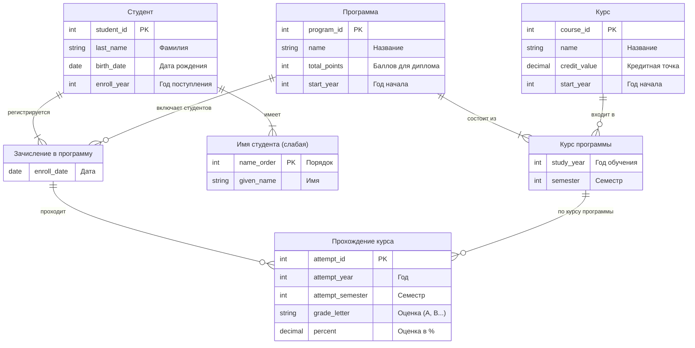

**Логическая схема**
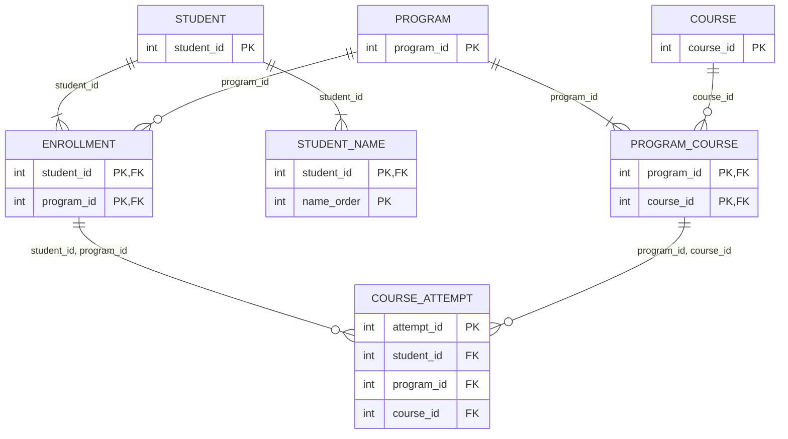

| Таблица / Атрибут | ПК | Обяз. | Уник. | Вн. ключ |
|---|---|---|---|---|
| **PROGRAM** | | | | |
| program_id | + | + | + | |
| name | | + | | |
| total_points | | + | | |
| start_year | | + | | |
| **COURSE** | | | | |
| course_id | + | + | + | |
| name | | + | | |
| credit_value | | + | | |
| start_year | | + | | |
| **PROGRAM_COURSE** | | | | |
| program_id | + | + | | PROGRAM(program_id) |
| course_id | + | + | | COURSE(course_id) |
| study_year | | + | | |
| semester | | + | | |
| **STUDENT** | | | | |
| student_id | + | + | + | |
| last_name | | + | | |
| birth_date | | + | | |
| enroll_year | | + | | |
| **STUDENT_NAME** | | | | |
| student_id | + | + | | STUDENT(student_id) |
| name_order | + | + | | |
| given_name | | + | | |
| **ENROLLMENT** | | | | |
| student_id | + | + | | STUDENT(student_id) |
| program_id | + | + | | PROGRAM(program_id) |
| enroll_date | | + | | |
| **COURSE_ATTEMPT** | | | | |
| attempt_id | + | + | + | |
| student_id | | + | | ENROLLMENT(student_id, program_id) |
| program_id | | + | | ENROLLMENT(student_id, program_id); PROGRAM_COURSE(program_id, course_id) |
| course_id | | + | | PROGRAM_COURSE(program_id, course_id) |
| attempt_year | | + | | |
| attempt_semester | | + | | |
| grade_letter | | | | |
| percent | | | | |

*Составное ограничение уникальности: `UNIQUE(student_id, course_id, attempt_year, attempt_semester)`; `percent BETWEEN 0 AND 100`; `grade_letter` и `percent` либо оба NULL, либо оба заданы.*

---

## 22. Компания и сотрудники

**Допущения**
- Руководитель отдела — сотрудник этого отдела (связь 1:1 «управляет», у отдела ровно один руководитель; создаётся после сотрудника).
- Сотрудник работает в одном отделе, имеет не более одного непосредственного руководителя (рекурсивная связь).
- Отдел контролирует проекты; проект принадлежит одному отделу.
- Участие сотрудника в проекте — ассоциативная сущность с датой начала работы.
- Иждивенец — слабая сущность, идентифицируется сотрудником и именем.

**ER-диаграмма**
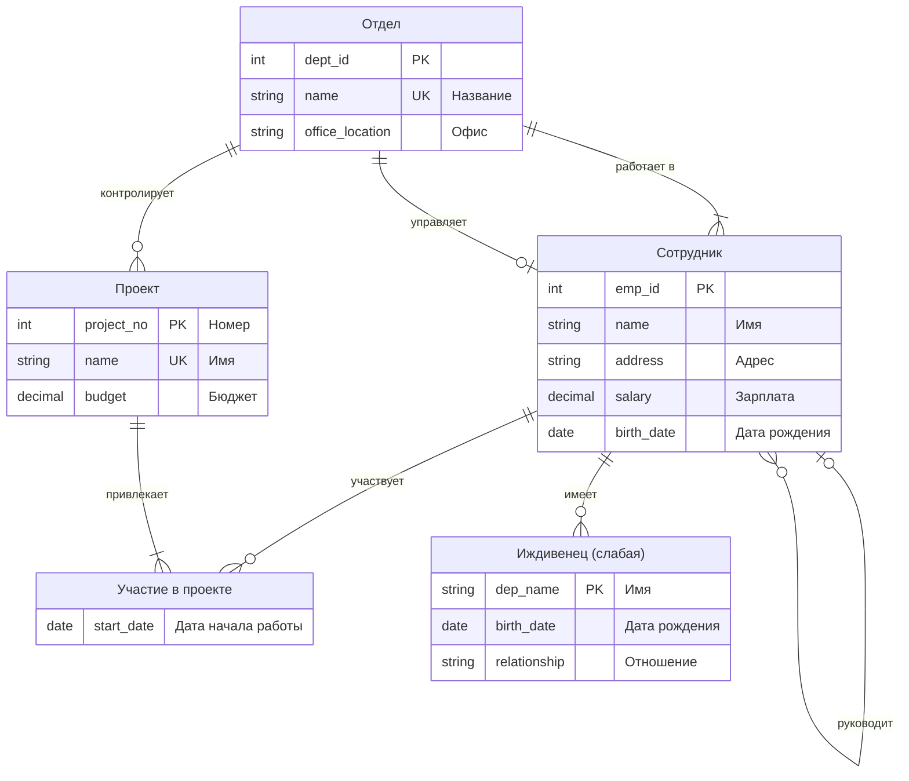

**Логическая схема**
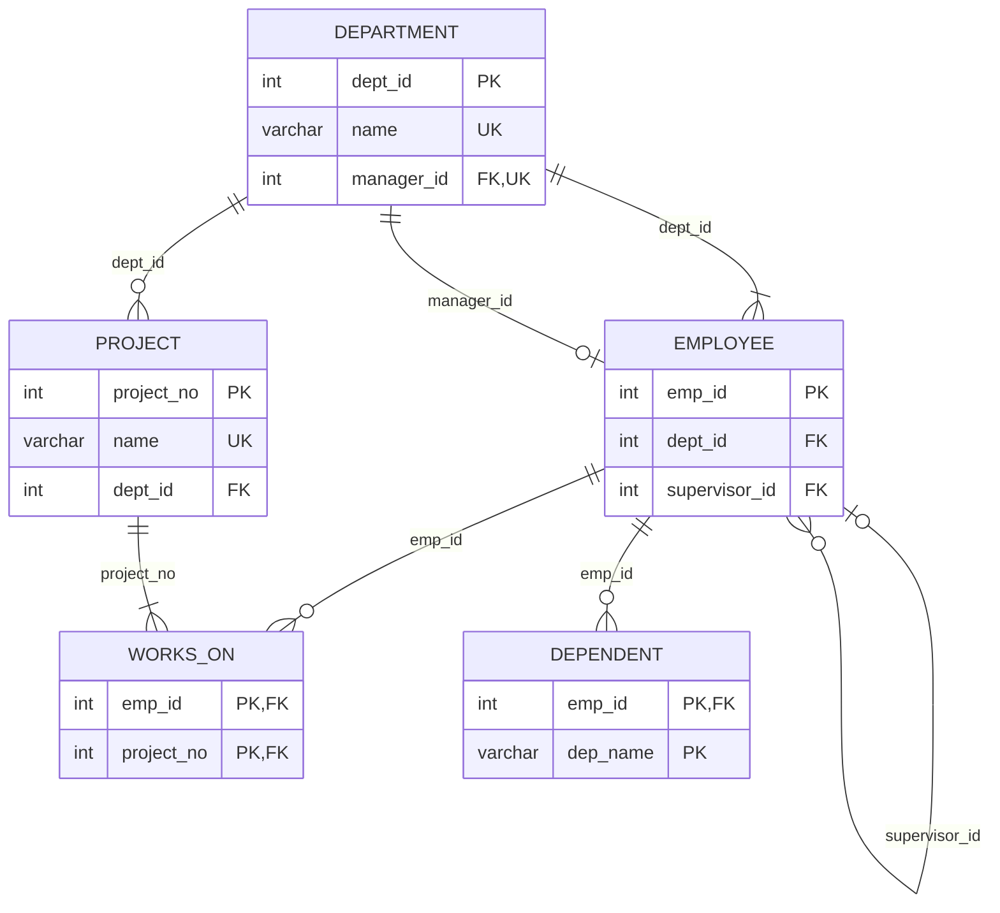

| Таблица / Атрибут | ПК | Обяз. | Уник. | Вн. ключ |
|---|---|---|---|---|
| **DEPARTMENT** | | | | |
| dept_id | + | + | + | |
| name | | + | + | |
| office_location | | + | | |
| manager_id | | + | + | EMPLOYEE(emp_id) |
| **EMPLOYEE** | | | | |
| emp_id | + | + | + | |
| name | | + | | |
| address | | + | | |
| salary | | + | | |
| birth_date | | + | | |
| dept_id | | + | | DEPARTMENT(dept_id) |
| supervisor_id | | | | EMPLOYEE(emp_id) |
| **PROJECT** | | | | |
| project_no | + | + | + | |
| name | | + | + | |
| budget | | + | | |
| dept_id | | + | | DEPARTMENT(dept_id) |
| **WORKS_ON** | | | | |
| emp_id | + | + | | EMPLOYEE(emp_id) |
| project_no | + | + | | PROJECT(project_no) |
| start_date | | + | | |
| **DEPENDENT** | | | | |
| emp_id | + | + | | EMPLOYEE(emp_id) |
| dep_name | + | + | | |
| birth_date | | + | | |
| relationship | | + | | |

*`DEPARTMENT.manager_id` обязателен после начальной загрузки (циклическая ссылка: отдел и руководитель вносятся с отложенной проверкой ограничений); `salary >= 0`.*

---

## 23. Галереи

**Допущения**
- Творческое имя художника уникально и служит первичным ключом. Вместо возраста хранится год рождения.
- Стиль искусства и вид произведения — атрибуты (по условию заданы одним значением).
- Группа (портреты, натюрморты, Пикассо, XIX век) — сущность с именем-идентификатором; произведение может входить в несколько групп.
- Имя клиента уникально (по условию); общая сумма потраченных денег хранится в атрибуте.
- Предпочтения клиента — две M:N связи: с художниками и с группами.

**ER-диаграмма**
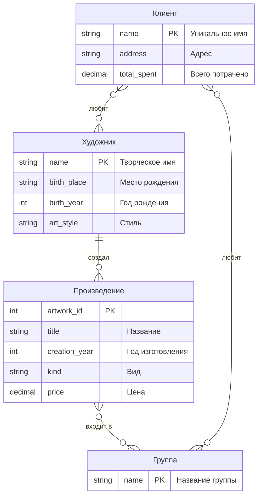

**Логическая схема**
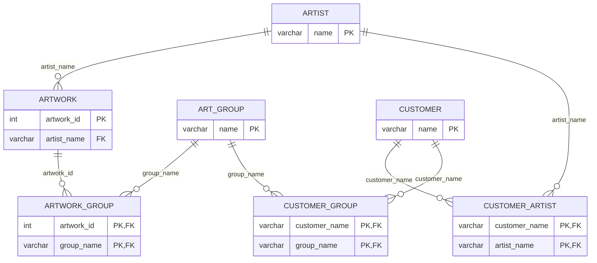

| Таблица / Атрибут | ПК | Обяз. | Уник. | Вн. ключ |
|---|---|---|---|---|
| **ARTIST** | | | | |
| name | + | + | + | |
| birth_place | | + | | |
| birth_year | | + | | |
| art_style | | + | | |
| **ARTWORK** | | | | |
| artwork_id | + | + | + | |
| title | | + | | |
| creation_year | | + | | |
| kind | | + | | |
| price | | + | | |
| artist_name | | + | | ARTIST(name) |
| **ART_GROUP** | | | | |
| name | + | + | + | |
| **ARTWORK_GROUP** | | | | |
| artwork_id | + | + | | ARTWORK(artwork_id) |
| group_name | + | + | | ART_GROUP(name) |
| **CUSTOMER** | | | | |
| name | + | + | + | |
| address | | + | | |
| total_spent | | + | | |
| **CUSTOMER_ARTIST** | | | | |
| customer_name | + | + | | CUSTOMER(name) |
| artist_name | + | + | | ARTIST(name) |
| **CUSTOMER_GROUP** | | | | |
| customer_name | + | + | | CUSTOMER(name) |
| group_name | + | + | | ART_GROUP(name) |

*`total_spent DEFAULT 0`, `total_spent >= 0`, `price >= 0`.*

---

## 24. Сеть отелей B&B

**Допущения**
- Цена зависит от типа номера (единая для сети): хранится в справочнике типов.
- Количество дней проживания не хранится — вычисляется как `check_out - check_in` (иначе возникает избыточность).
- Для рассылки писем и предложений у гостя хранятся адрес и e-mail; согласие на рассылку — флаг.
- Одна бронь — один номер на период; пересекающиеся периоды для одного номера запрещены.

**ER-диаграмма**
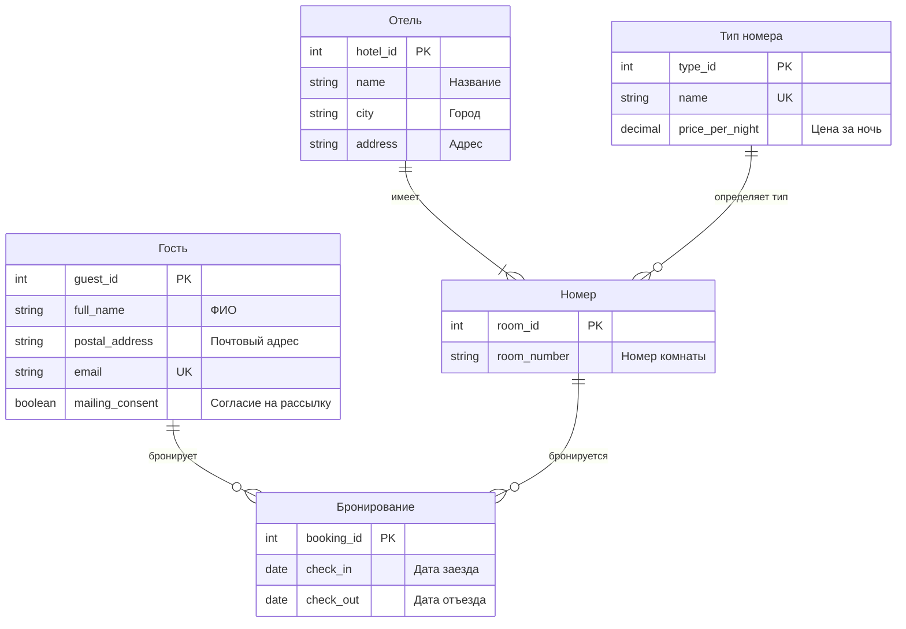

**Логическая схема**
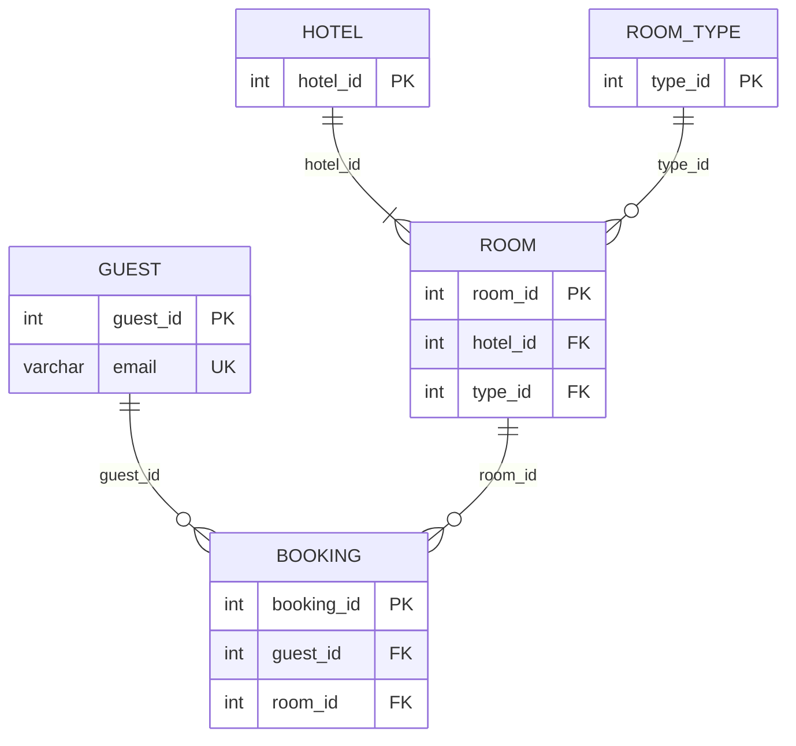

| Таблица / Атрибут | ПК | Обяз. | Уник. | Вн. ключ |
|---|---|---|---|---|
| **HOTEL** | | | | |
| hotel_id | + | + | + | |
| name | | + | | |
| city | | + | | |
| address | | + | | |
| **ROOM_TYPE** | | | | |
| type_id | + | + | + | |
| name | | + | + | |
| price_per_night | | + | | |
| **ROOM** | | | | |
| room_id | + | + | + | |
| hotel_id | | + | | HOTEL(hotel_id) |
| type_id | | + | | ROOM_TYPE(type_id) |
| room_number | | + | | |
| **GUEST** | | | | |
| guest_id | + | + | + | |
| full_name | | + | | |
| postal_address | | | | |
| email | | + | + | |
| mailing_consent | | + | | |
| **BOOKING** | | | | |
| booking_id | + | + | + | |
| guest_id | | + | | GUEST(guest_id) |
| room_id | | + | | ROOM(room_id) |
| check_in | | + | | |
| check_out | | + | | |

*`UNIQUE(hotel_id, room_number)`; `check_out > check_in`; количество дней = `check_out − check_in` (вычисляется).*

---

## 25. Прокат автомобилей

**Допущения**
- Бронь относится к модели (конкретная модель или «любая» — `model_id = NULL`), а не к конкретному автомобилю.
- Когда подходящий автомобиль освобождается, оформляется прокат, который ссылается на бронь (0..1): прокат может быть и без брони (клиент пришёл сразу).
- Конкретный автомобиль привязывается к клиенту только при выдаче — в таблице проката.
- Дата начала и продолжительность (в днях) хранятся в прокате; плановая дата начала — в брони.

**ER-диаграмма**
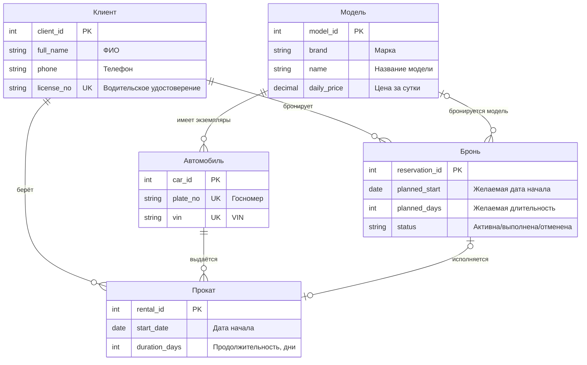

**Логическая схема**
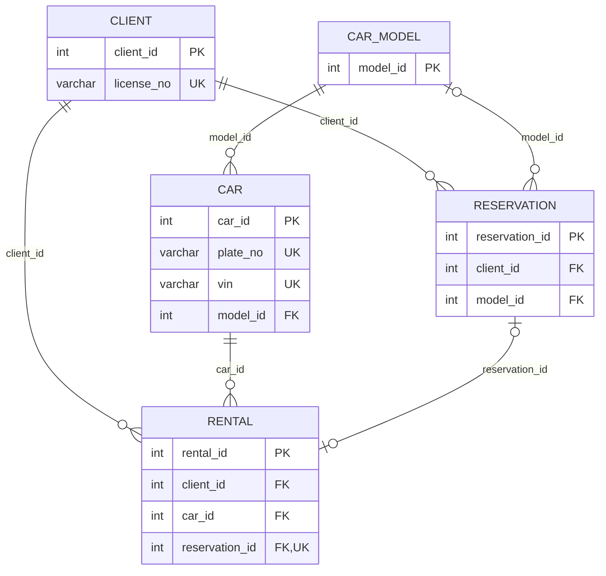

| Таблица / Атрибут | ПК | Обяз. | Уник. | Вн. ключ |
|---|---|---|---|---|
| **CAR_MODEL** | | | | |
| model_id | + | + | + | |
| brand | | + | | |
| name | | + | | |
| daily_price | | + | | |
| **CAR** | | | | |
| car_id | + | + | + | |
| plate_no | | + | + | |
| vin | | + | + | |
| model_id | | + | | CAR_MODEL(model_id) |
| **CLIENT** | | | | |
| client_id | + | + | + | |
| full_name | | + | | |
| phone | | + | | |
| license_no | | + | + | |
| **RESERVATION** | | | | |
| reservation_id | + | + | + | |
| client_id | | + | | CLIENT(client_id) |
| model_id | | | | CAR_MODEL(model_id) |
| planned_start | | + | | |
| planned_days | | + | | |
| status | | + | | |
| **RENTAL** | | | | |
| rental_id | + | + | + | |
| client_id | | + | | CLIENT(client_id) |
| car_id | | + | | CAR(car_id) |
| reservation_id | | | + | RESERVATION(reservation_id) |
| start_date | | + | | |
| duration_days | | + | | |

*`model_id IS NULL` в брони — клиент согласен на любую модель; `duration_days > 0`; периоды проката одного автомобиля не пересекаются.*

---

## 26. КХЛ

**Допущения**
- Тренер — атрибут команды (отдельных данных о нём в условии нет).
- Игрок принадлежит ровно одной команде; капитан — игрок своей команды (связь 1:1 команда–игрок; проверяется, что капитан играет за эту же команду).
- Травмы — слабая сущность игрока (набор записей): тип, дата начала, дата окончания.
- Игра — две команды (хозяева и гости), дата и счёт хозяев и гостей.

**ER-диаграмма**
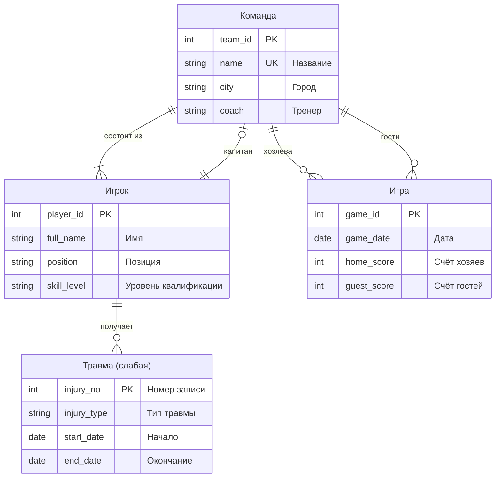

**Логическая схема**
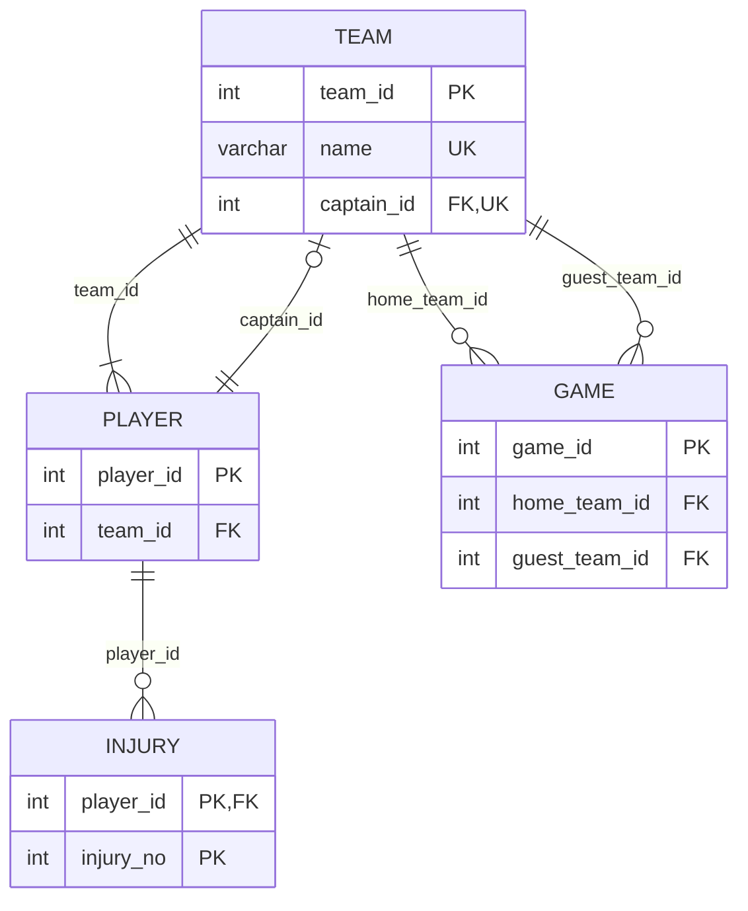

| Таблица / Атрибут | ПК | Обяз. | Уник. | Вн. ключ |
|---|---|---|---|---|
| **TEAM** | | | | |
| team_id | + | + | + | |
| name | | + | + | |
| city | | + | | |
| coach | | + | | |
| captain_id | | | + | PLAYER(player_id) |
| **PLAYER** | | | | |
| player_id | + | + | + | |
| team_id | | + | | TEAM(team_id) |
| full_name | | + | | |
| position | | + | | |
| skill_level | | + | | |
| **INJURY** | | | | |
| player_id | + | + | | PLAYER(player_id) |
| injury_no | + | + | | |
| injury_type | | + | | |
| start_date | | + | | |
| end_date | | | | |
| **GAME** | | | | |
| game_id | + | + | + | |
| game_date | | + | | |
| home_team_id | | + | | TEAM(team_id) |
| guest_team_id | | + | | TEAM(team_id) |
| home_score | | + | | |
| guest_score | | + | | |

*Ограничения:* `home_team_id <> guest_team_id`; `UNIQUE(game_date, home_team_id, guest_team_id)`; капитан — игрок той же команды (триггер); `captain_id` NULL допустим на момент создания команды.

---

## 27. Книжный онлайн-магазин

**Допущения**
- У книги могут быть несколько авторов (M:N); издатель — справочник.
- Формат книги: «бумажная» или «электронная». Для бумажной обязательны тип обложки и масса; для электронной — формат файла. Остальные атрибуты общие.
- Заказ может содержать оба формата. Бумажные книги доставляются по адресу (доставка 0..1 на заказ — нужна только при наличии бумажных книг), электронные отправляются на e-mail покупателя; время отправки фиксируется.
- Фиксируются время формирования заказа, оплаты и доставки. Масса заказа вычисляется по бумажным позициям.

**ER-диаграмма**
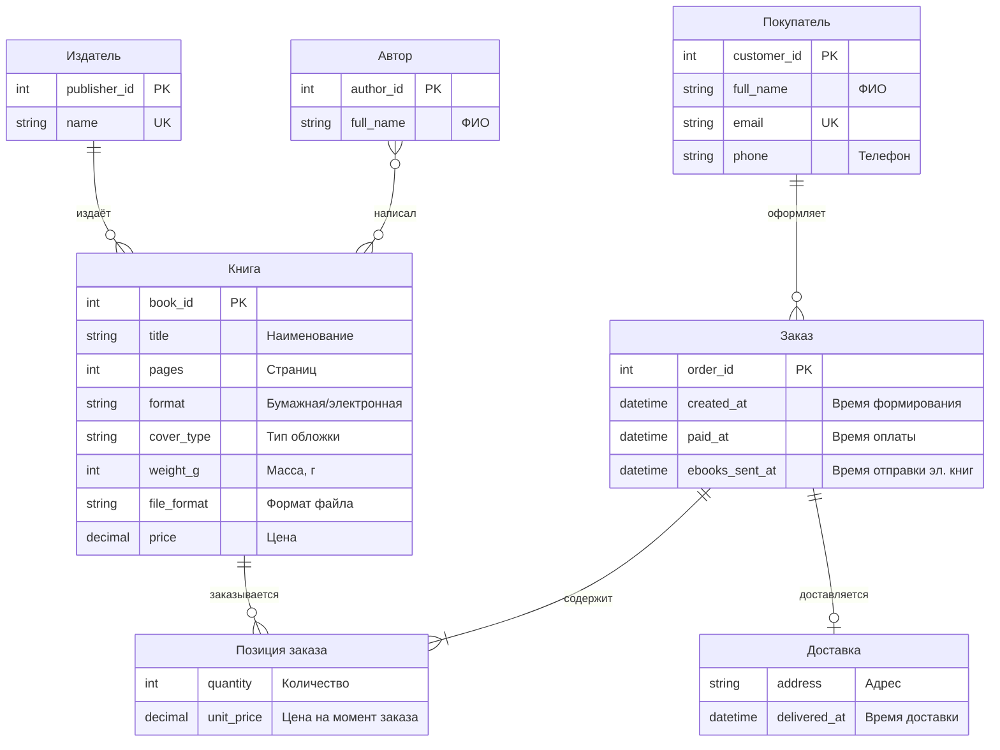

**Логическая схема**
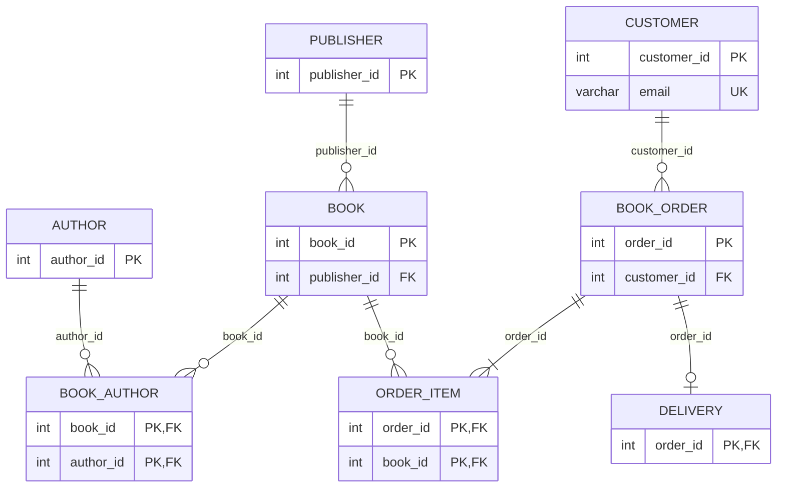

| Таблица / Атрибут | ПК | Обяз. | Уник. | Вн. ключ |
|---|---|---|---|---|
| **PUBLISHER** | | | | |
| publisher_id | + | + | + | |
| name | | + | + | |
| **AUTHOR** | | | | |
| author_id | + | + | + | |
| full_name | | + | | |
| **BOOK** | | | | |
| book_id | + | + | + | |
| title | | + | | |
| publisher_id | | + | | PUBLISHER(publisher_id) |
| pages | | + | | |
| format | | + | | |
| cover_type | | | | |
| weight_g | | | | |
| file_format | | | | |
| price | | + | | |
| **BOOK_AUTHOR** | | | | |
| book_id | + | + | | BOOK(book_id) |
| author_id | + | + | | AUTHOR(author_id) |
| **CUSTOMER** | | | | |
| customer_id | + | + | + | |
| full_name | | + | | |
| email | | + | + | |
| phone | | | | |
| **BOOK_ORDER** | | | | |
| order_id | + | + | + | |
| customer_id | | + | | CUSTOMER(customer_id) |
| created_at | | + | | |
| paid_at | | | | |
| ebooks_sent_at | | | | |
| **ORDER_ITEM** | | | | |
| order_id | + | + | | BOOK_ORDER(order_id) |
| book_id | + | + | | BOOK(book_id) |
| quantity | | + | | |
| unit_price | | + | | |
| **DELIVERY** | | | | |
| order_id | + | + | + | BOOK_ORDER(order_id) |
| address | | + | | |
| delivered_at | | | | |

*Ограничения BOOK:* `format IN ('бумажная','электронная')`; для бумажной `cover_type IN ('мягкая','твёрдая','суперобложка')` и `weight_g > 0` обязательны, для электронной обязателен `file_format`. Электронная книга в заказе — `quantity = 1`.

---

## 28. Мастерская по ремонту бытовой техники

**Допущения**
- Типы техники: холодильник, стиральная машина, телевизор, микроволновая печь (справочник).
- Приём техники оформляется заказом на ремонт с описанием неисправности и необходимых свойств (марка, модель, серийный номер, комплектность).
- Приём и диагностику выполняют сотрудники (приёмщик и мастер); мастер оценивает ремонт в течение 3 дней после приёма (контроль срока `diagnosed_at <= received_at + 3 дня`).
- Стоимость ремонта = сумма стоимости заменяемых деталей и выполненных работ (вычисляется); хранится список деталей и список работ. Для гарантийного ремонта клиент не платит.
- Клиент уведомляется, согласие фиксируется датой согласия.

**ER-диаграмма**
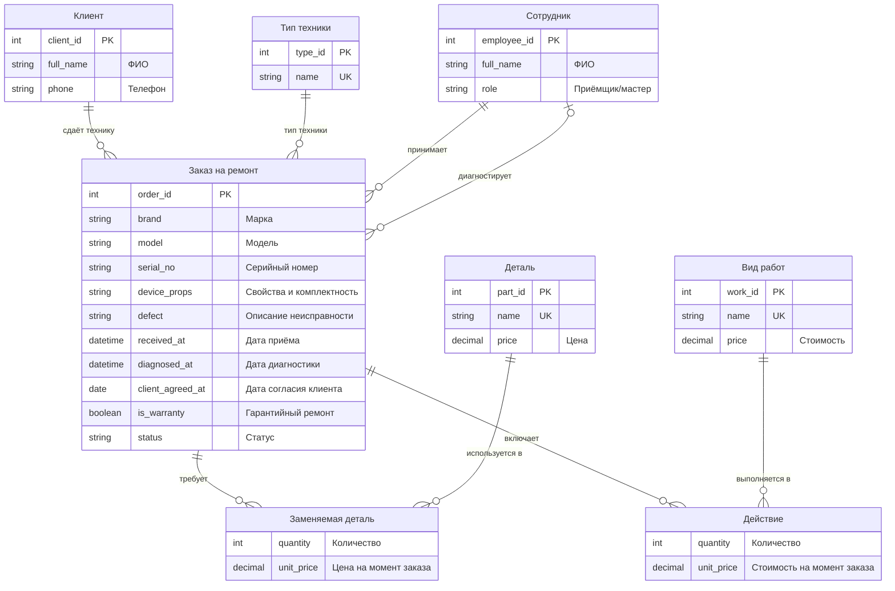

**Логическая схема**
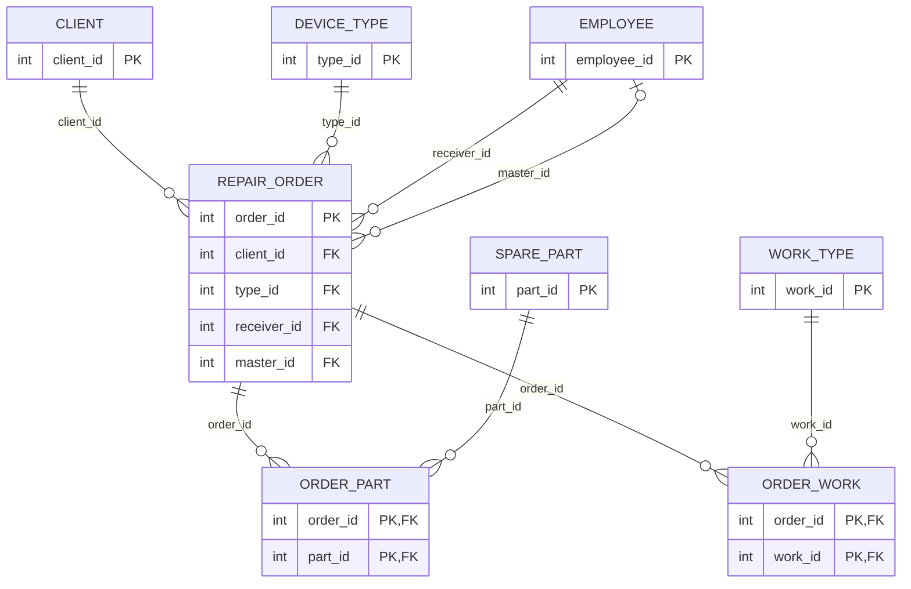

| Таблица / Атрибут | ПК | Обяз. | Уник. | Вн. ключ |
|---|---|---|---|---|
| **CLIENT** | | | | |
| client_id | + | + | + | |
| full_name | | + | | |
| phone | | + | | |
| **DEVICE_TYPE** | | | | |
| type_id | + | + | + | |
| name | | + | + | |
| **EMPLOYEE** | | | | |
| employee_id | + | + | + | |
| full_name | | + | | |
| role | | + | | |
| **REPAIR_ORDER** | | | | |
| order_id | + | + | + | |
| client_id | | + | | CLIENT(client_id) |
| type_id | | + | | DEVICE_TYPE(type_id) |
| receiver_id | | + | | EMPLOYEE(employee_id) |
| master_id | | | | EMPLOYEE(employee_id) |
| brand | | + | | |
| model | | + | | |
| serial_no | | | | |
| device_props | | | | |
| defect | | + | | |
| received_at | | + | | |
| diagnosed_at | | | | |
| client_agreed_at | | | | |
| is_warranty | | + | | |
| status | | + | | |
| **SPARE_PART** | | | | |
| part_id | + | + | + | |
| name | | + | + | |
| price | | + | | |
| **WORK_TYPE** | | | | |
| work_id | + | + | + | |
| name | | + | + | |
| price | | + | | |
| **ORDER_PART** | | | | |
| order_id | + | + | | REPAIR_ORDER(order_id) |
| part_id | + | + | | SPARE_PART(part_id) |
| quantity | | + | | |
| unit_price | | + | | |
| **ORDER_WORK** | | | | |
| order_id | + | + | | REPAIR_ORDER(order_id) |
| work_id | + | + | | WORK_TYPE(work_id) |
| quantity | | + | | |
| unit_price | | + | | |

*Ограничения:* ремонт начинается только при `client_agreed_at IS NOT NULL`; `diagnosed_at <= received_at + 3 дня`; сумма к оплате = сумма по ORDER_PART и ORDER_WORK, если `is_warranty = false`, иначе 0; `master_id` — сотрудник с ролью «мастер».

---

## 29. ЖЭК

**Допущения**
- Адрес квартиры: улица → дом → квартира (три справочника).
- Номер заявки уникален; диспетчер задаёт номер, дату поступления, тип заявки и срок выполнения.
- Заявку выполняет бригада; до назначения бригады `team_id` пуст.
- Специалист работает ровно в одной бригаде; бригадир — специалист этой бригады (1:1 бригада–бригадир).

**ER-диаграмма**
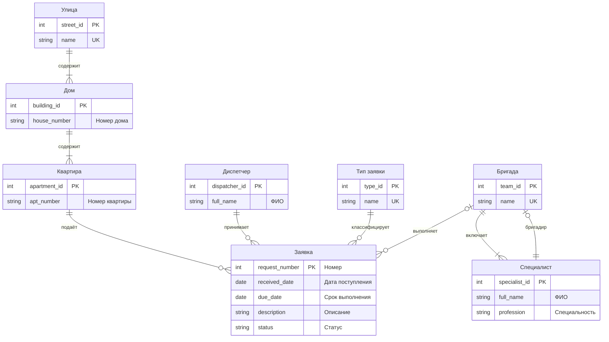

**Логическая схема**
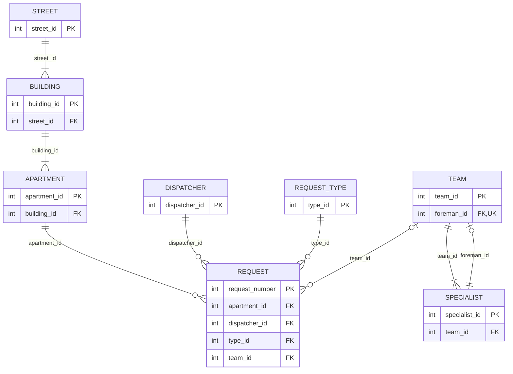

| Таблица / Атрибут | ПК | Обяз. | Уник. | Вн. ключ |
|---|---|---|---|---|
| **STREET** | | | | |
| street_id | + | + | + | |
| name | | + | + | |
| **BUILDING** | | | | |
| building_id | + | + | + | |
| street_id | | + | | STREET(street_id) |
| house_number | | + | | |
| **APARTMENT** | | | | |
| apartment_id | + | + | + | |
| building_id | | + | | BUILDING(building_id) |
| apt_number | | + | | |
| **DISPATCHER** | | | | |
| dispatcher_id | + | + | + | |
| full_name | | + | | |
| **REQUEST_TYPE** | | | | |
| type_id | + | + | + | |
| name | | + | + | |
| **TEAM** | | | | |
| team_id | + | + | + | |
| name | | + | + | |
| foreman_id | | | + | SPECIALIST(specialist_id) |
| **SPECIALIST** | | | | |
| specialist_id | + | + | + | |
| full_name | | + | | |
| profession | | + | | |
| team_id | | + | | TEAM(team_id) |
| **REQUEST** | | | | |
| request_number | + | + | + | |
| received_date | | + | | |
| due_date | | + | | |
| description | | | | |
| status | | + | | |
| apartment_id | | + | | APARTMENT(apartment_id) |
| dispatcher_id | | + | | DISPATCHER(dispatcher_id) |
| type_id | | + | | REQUEST_TYPE(type_id) |
| team_id | | | | TEAM(team_id) |

*Ограничения:* `UNIQUE(street_id, house_number)`, `UNIQUE(building_id, apt_number)`; `due_date >= received_date`; бригадир входит в свою бригаду (триггер).

---

## 30. Парки города

**Допущения**
- Имя парка уникально. Фонтан и павильон расположены ровно в одном парке (0..N на парк).
- Насаждения: вид растения — справочник (тип культуры, наименование, средняя продолжительность жизни); количество каждого вида в парке — ассоциативная сущность «Насаждение парка».
- Фонтан идентифицируется шифром; расход воды: максимальный и нормальный.
- Тип павильона — из набора: кафе, продуктовый, развлекательный, прокат вещей.

**ER-диаграмма**
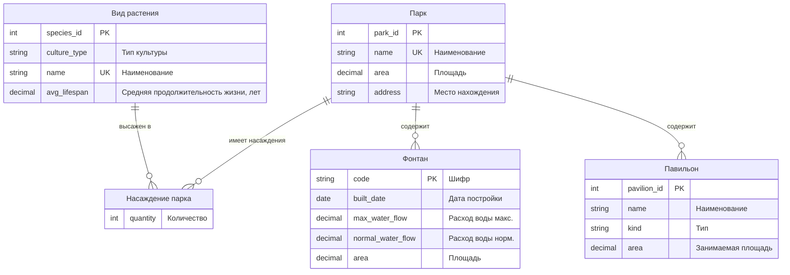

**Логическая схема**
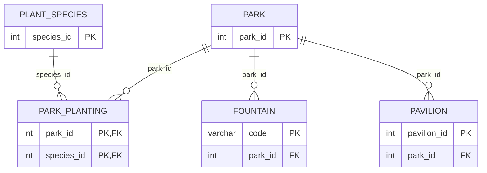

| Таблица / Атрибут | ПК | Обяз. | Уник. | Вн. ключ |
|---|---|---|---|---|
| **PARK** | | | | |
| park_id | + | + | + | |
| name | | + | + | |
| area | | + | | |
| address | | + | | |
| **PLANT_SPECIES** | | | | |
| species_id | + | + | + | |
| culture_type | | + | | |
| name | | + | + | |
| avg_lifespan | | + | | |
| **PARK_PLANTING** | | | | |
| park_id | + | + | | PARK(park_id) |
| species_id | + | + | | PLANT_SPECIES(species_id) |
| quantity | | + | | |
| **FOUNTAIN** | | | | |
| code | + | + | + | |
| park_id | | + | | PARK(park_id) |
| built_date | | + | | |
| max_water_flow | | + | | |
| normal_water_flow | | + | | |
| area | | + | | |
| **PAVILION** | | | | |
| pavilion_id | + | + | + | |
| park_id | | + | | PARK(park_id) |
| name | | + | | |
| kind | | + | | |
| area | | + | | |

*Ограничения:* `kind IN ('кафе','продуктовый','развлекательный','прокат вещей')`; `normal_water_flow <= max_water_flow`; `quantity > 0`; `area > 0`.
