## 1. Парк самолетов авиакомпании

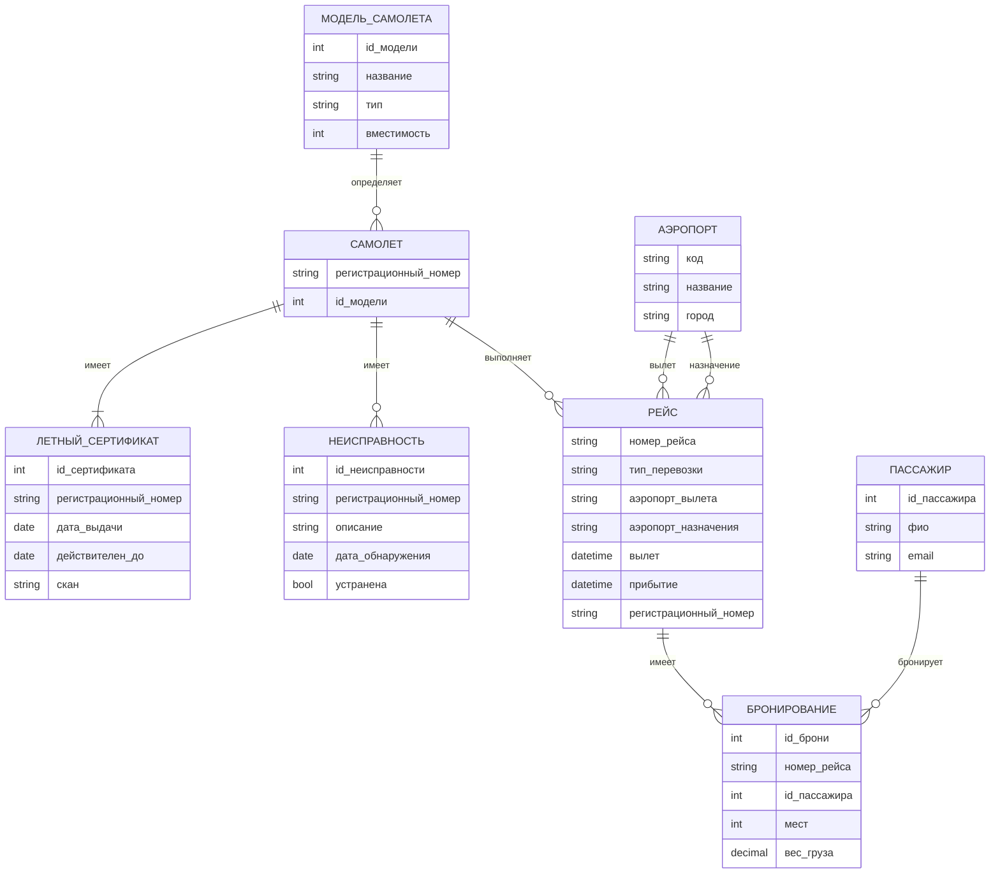

**Модели самолетов**

| Атрибут                     | ПК  | Обяз. | Уник. | Вн. ключ |
| --------------------------- | :-: | :---: | :---: | -------- |
| Id                          |  +  |   +   |   +   |          |
| Название                    |     |   +   |   +   |          |
| Тип (пассажирский/грузовой) |     |   +   |       |          |
| Вместимость                 |     |   +   |       |          |

**Самолеты**

| Атрибут               | ПК  | Обяз. | Уник. | Вн. ключ             |
| --------------------- | :-: | :---: | :---: | -------------------- |
| Регистрационный номер |  +  |   +   |   +   |                      |
| Модель                |     |   +   |       | Модели самолетов(Id) |

**Летные сертификаты**

| Атрибут         | ПК  | Обяз. | Уник. | Вн. ключ                        |
| --------------- | :-: | :---: | :---: | ------------------------------- |
| Id              |  +  |   +   |   +   |                                 |
| Самолет         |     |   +   |       | Самолеты(Регистрационный номер) |
| Дата выдачи     |     |   +   |       |                                 |
| Действителен до |     |   +   |       |                                 |
| Скан            |     |   +   |       |                                 |

**Неисправности**

| Атрибут          | ПК  | Обяз. | Уник. | Вн. ключ                        |
| ---------------- | :-: | :---: | :---: | ------------------------------- |
| Id               |  +  |   +   |   +   |                                 |
| Самолет          |     |   +   |       | Самолеты(Регистрационный номер) |
| Описание         |     |   +   |       |                                 |
| Дата обнаружения |     |   +   |       |                                 |
| Устранена        |     |   +   |       |                                 |

**Аэропорты**

| Атрибут  | ПК  | Обяз. | Уник. | Вн. ключ |
| -------- | :-: | :---: | :---: | -------- |
| Код      |  +  |   +   |   +   |          |
| Название |     |   +   |       |          |
| Город    |     |   +   |       |          |

**Рейсы**

| Атрибут                               | ПК  | Обяз. | Уник. | Вн. ключ                        |
| ------------------------------------- | :-: | :---: | :---: | ------------------------------- |
| Номер рейса                           |  +  |   +   |   +   |                                 |
| Тип перевозки (пассажирская/грузовая) |     |   +   |       |                                 |
| Аэропорт вылета                       |     |   +   |       | Аэропорты(Код)                  |
| Аэропорт назначения                   |     |   +   |       | Аэропорты(Код)                  |
| Вылет                                 |     |   +   |       |                                 |
| Прибытие (ожидаемое)                  |     |   +   |       |                                 |
| Самолет                               |     |   +   |       | Самолеты(Регистрационный номер) |

**Пассажиры**

| Атрибут | ПК  | Обяз. | Уник. | Вн. ключ |
| ------- | :-: | :---: | :---: | -------- |
| Id      |  +  |   +   |   +   |          |
| ФИО     |     |   +   |       |          |
| Email   |     |   +   |   +   |          |

**Бронирования**

| Атрибут   | ПК  | Обяз. | Уник. | Вн. ключ           |
| --------- | :-: | :---: | :---: | ------------------ |
| Id        |  +  |   +   |   +   |                    |
| Рейс      |     |   +   |       | Рейсы(Номер рейса) |
| Пассажир  |     |   +   |       | Пассажиры(Id)      |
| Мест      |     |       |       |                    |
| Вес груза |     |       |       |                    |

## 2. Сеть отелей

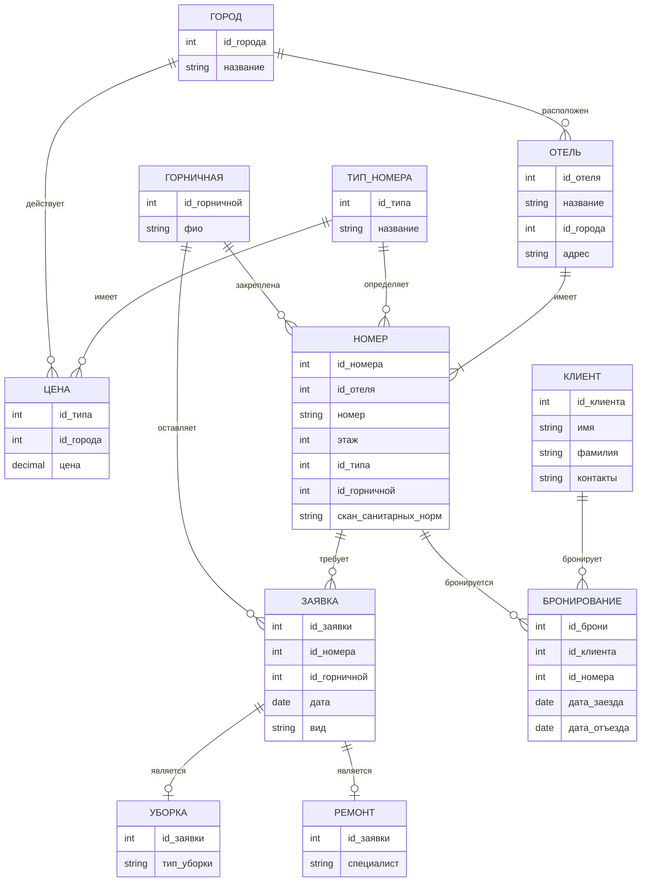

**Города**

| Атрибут  | ПК  | Обяз. | Уник. | Вн. ключ |
| -------- | :-: | :---: | :---: | -------- |
| Id       |  +  |   +   |   +   |          |
| Название |     |   +   |   +   |          |

**Отели**

| Атрибут  | ПК  | Обяз. | Уник. | Вн. ключ   |
| -------- | :-: | :---: | :---: | ---------- |
| Id       |  +  |   +   |   +   |            |
| Название |     |   +   |       |            |
| Город    |     |   +   |       | Города(Id) |
| Адрес    |     |   +   |       |            |

_(уникальна пара Название + Город)_

**Типы номеров**

| Атрибут  | ПК  | Обяз. | Уник. | Вн. ключ |
| -------- | :-: | :---: | :---: | -------- |
| Id       |  +  |   +   |   +   |          |
| Название |     |   +   |   +   |          |

**Цены**

| Атрибут | ПК  | Обяз. | Уник. | Вн. ключ         |
| ------- | :-: | :---: | :---: | ---------------- |
| Тип     |  +  |   +   |       | Типы номеров(Id) |
| Город   |  +  |   +   |       | Города(Id)       |
| Цена    |     |   +   |       |                  |

**Горничные**

| Атрибут | ПК  | Обяз. | Уник. | Вн. ключ |
| ------- | :-: | :---: | :---: | -------- |
| Id      |  +  |   +   |   +   |          |
| ФИО     |     |   +   |       |          |

**Номера**

| Атрибут              | ПК  | Обяз. | Уник. | Вн. ключ         |
| -------------------- | :-: | :---: | :---: | ---------------- |
| Id                   |  +  |   +   |   +   |                  |
| Отель                |     |   +   |       | Отели(Id)        |
| Номер                |     |   +   |       |                  |
| Этаж                 |     |   +   |       |                  |
| Тип                  |     |   +   |       | Типы номеров(Id) |
| Горничная            |     |   +   |       | Горничные(Id)    |
| Скан санитарных норм |     |   +   |       |                  |

**Заявки**

| Атрибут             | ПК  | Обяз. | Уник. | Вн. ключ      |
| ------------------- | :-: | :---: | :---: | ------------- |
| Id                  |  +  |   +   |   +   |               |
| Номер               |     |   +   |       | Номера(Id)    |
| Горничная           |     |   +   |       | Горничные(Id) |
| Дата                |     |   +   |       |               |
| Вид (уборка/ремонт) |     |   +   |       |               |

**Уборки**

| Атрибут                                      | ПК  | Обяз. | Уник. | Вн. ключ   |
| -------------------------------------------- | :-: | :---: | :---: | ---------- |
| Заявка                                       |  +  |   +   |   +   | Заявки(Id) |
| Тип уборки (экспресс, стандарт, генеральная) |     |   +   |       |            |

**Ремонты**

| Атрибут                          | ПК  | Обяз. | Уник. | Вн. ключ   |
| -------------------------------- | :-: | :---: | :---: | ---------- |
| Заявка                           |  +  |   +   |   +   | Заявки(Id) |
| Специалист (электрик, сантехник) |     |   +   |       |            |

**Клиенты**

| Атрибут  | ПК  | Обяз. | Уник. | Вн. ключ |
| -------- | :-: | :---: | :---: | -------- |
| Id       |  +  |   +   |   +   |          |
| Имя      |     |   +   |       |          |
| Фамилия  |     |   +   |       |          |
| Контакты |     |   +   |       |          |

**Бронирования**

| Атрибут      | ПК  | Обяз. | Уник. | Вн. ключ    |
| ------------ | :-: | :---: | :---: | ----------- |
| Id           |  +  |   +   |   +   |             |
| Клиент       |     |   +   |       | Клиенты(Id) |
| Номер        |     |   +   |       | Номера(Id)  |
| Дата заезда  |     |   +   |       |             |
| Дата отъезда |     |   +   |       |             |

## 3. Галерея

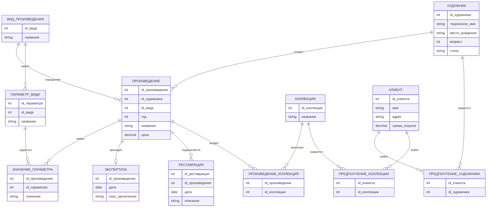

**Художники**

| Атрибут        | ПК  | Обяз. | Уник. | Вн. ключ |
| -------------- | :-: | :---: | :---: | -------- |
| Id             |  +  |   +   |   +   |          |
| Творческое имя |     |   +   |   +   |          |
| Место рождения |     |   +   |       |          |
| Возраст        |     |   +   |       |          |
| Стиль          |     |   +   |       |          |

**Виды произведений**

| Атрибут  | ПК  | Обяз. | Уник. | Вн. ключ |
| -------- | :-: | :---: | :---: | -------- |
| Id       |  +  |   +   |   +   |          |
| Название |     |   +   |   +   |          |

**Параметры видов**

| Атрибут  | ПК  | Обяз. | Уник. | Вн. ключ              |
| -------- | :-: | :---: | :---: | --------------------- |
| Id       |  +  |   +   |   +   |                       |
| Вид      |     |   +   |       | Виды произведений(Id) |
| Название |     |   +   |       |                       |

**Произведения**

| Атрибут  | ПК  | Обяз. | Уник. | Вн. ключ              |
| -------- | :-: | :---: | :---: | --------------------- |
| Id       |  +  |   +   |   +   |                       |
| Художник |     |   +   |       | Художники(Id)         |
| Вид      |     |   +   |       | Виды произведений(Id) |
| Год      |     |   +   |       |                       |
| Название |     |   +   |       |                       |
| Цена     |     |   +   |       |                       |

**Значения параметров**

| Атрибут      | ПК  | Обяз. | Уник. | Вн. ключ            |
| ------------ | :-: | :---: | :---: | ------------------- |
| Произведение |  +  |   +   |       | Произведения(Id)    |
| Параметр     |  +  |   +   |       | Параметры видов(Id) |
| Значение     |     |   +   |       |                     |

**Экспертизы**

| Атрибут         | ПК  | Обяз. | Уник. | Вн. ключ         |
| --------------- | :-: | :---: | :---: | ---------------- |
| Произведение    |  +  |   +   |   +   | Произведения(Id) |
| Дата            |     |   +   |       |                  |
| Скан заключения |     |   +   |       |                  |

**Реставрации**

| Атрибут      | ПК  | Обяз. | Уник. | Вн. ключ         |
| ------------ | :-: | :---: | :---: | ---------------- |
| Id           |  +  |   +   |   +   |                  |
| Произведение |     |   +   |       | Произведения(Id) |
| Дата         |     |   +   |       |                  |
| Описание     |     |   +   |       |                  |

**Коллекции**

| Атрибут  | ПК  | Обяз. | Уник. | Вн. ключ |
| -------- | :-: | :---: | :---: | -------- |
| Id       |  +  |   +   |   +   |          |
| Название |     |   +   |   +   |          |

**Произведения коллекции**

| Атрибут      | ПК  | Обяз. | Уник. | Вн. ключ         |
| ------------ | :-: | :---: | :---: | ---------------- |
| Произведение |  +  |   +   |       | Произведения(Id) |
| Коллекция    |  +  |   +   |       | Коллекции(Id)    |

**Клиенты**

| Атрибут       | ПК  | Обяз. | Уник. | Вн. ключ |
| ------------- | :-: | :---: | :---: | -------- |
| Id            |  +  |   +   |   +   |          |
| Имя           |     |   +   |       |          |
| Адрес         |     |   +   |       |          |
| Сумма покупок |     |   +   |       |          |

**Предпочтения художников**

| Атрибут  | ПК  | Обяз. | Уник. | Вн. ключ      |
| -------- | :-: | :---: | :---: | ------------- |
| Клиент   |  +  |   +   |       | Клиенты(Id)   |
| Художник |  +  |   +   |       | Художники(Id) |

**Предпочтения коллекций**

| Атрибут   | ПК  | Обяз. | Уник. | Вн. ключ      |
| --------- | :-: | :---: | :---: | ------------- |
| Клиент    |  +  |   +   |       | Клиенты(Id)   |
| Коллекция |  +  |   +   |       | Коллекции(Id) |

## 9. Футбольный турнир (РФПЛ)

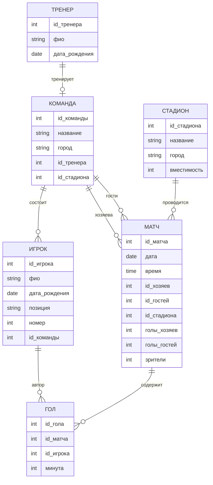

**Команды**

| Атрибут  | ПК  | Обяз. | Уник. | Вн. ключ     |
| -------- | :-: | :---: | :---: | ------------ |
| Id       |  +  |   +   |   +   |              |
| Название |     |   +   |   +   |              |
| Город    |     |   +   |       |              |
| Тренер   |     |   +   |   +   | Тренеры(Id)  |
| Стадион  |     |   +   |       | Стадионы(Id) |

**Тренеры**

| Атрибут       | ПК  | Обяз. | Уник. | Вн. ключ |
| ------------- | :-: | :---: | :---: | -------- |
| Id            |  +  |   +   |   +   |          |
| ФИО           |     |   +   |       |          |
| Дата рождения |     |   +   |       |          |

**Игроки**

| Атрибут       | ПК  | Обяз. | Уник. | Вн. ключ    |
| ------------- | :-: | :---: | :---: | ----------- |
| Id            |  +  |   +   |   +   |             |
| ФИО           |     |   +   |       |             |
| Дата рождения |     |   +   |       |             |
| Позиция       |     |   +   |       |             |
| Номер         |     |   +   |       |             |
| Команда       |     |   +   |       | Команды(Id) |

**Стадионы**

| Атрибут     | ПК  | Обяз. | Уник. | Вн. ключ |
| ----------- | :-: | :---: | :---: | -------- |
| Id          |  +  |   +   |   +   |          |
| Название    |     |   +   |       |          |
| Город       |     |   +   |       |          |
| Вместимость |     |   +   |       |          |

**Матчи**

| Атрибут     | ПК  | Обяз. | Уник. | Вн. ключ     |
| ----------- | :-: | :---: | :---: | ------------ |
| Id          |  +  |   +   |   +   |              |
| Дата        |     |   +   |       |              |
| Время       |     |   +   |       |              |
| Хозяева     |     |   +   |       | Команды(Id)  |
| Гости       |     |   +   |       | Команды(Id)  |
| Стадион     |     |   +   |       | Стадионы(Id) |
| Голы хозяев |     |   +   |       |              |
| Голы гостей |     |   +   |       |              |
| Зрители     |     |   +   |       |              |

**Голы**

| Атрибут | ПК  | Обяз. | Уник. | Вн. ключ   |
| ------- | :-: | :---: | :---: | ---------- |
| Id      |  +  |   +   |   +   |            |
| Матч    |     |   +   |       | Матчи(Id)  |
| Игрок   |     |   +   |       | Игроки(Id) |
| Минута  |     |   +   |       |            |

## 11. Кулинарная книга

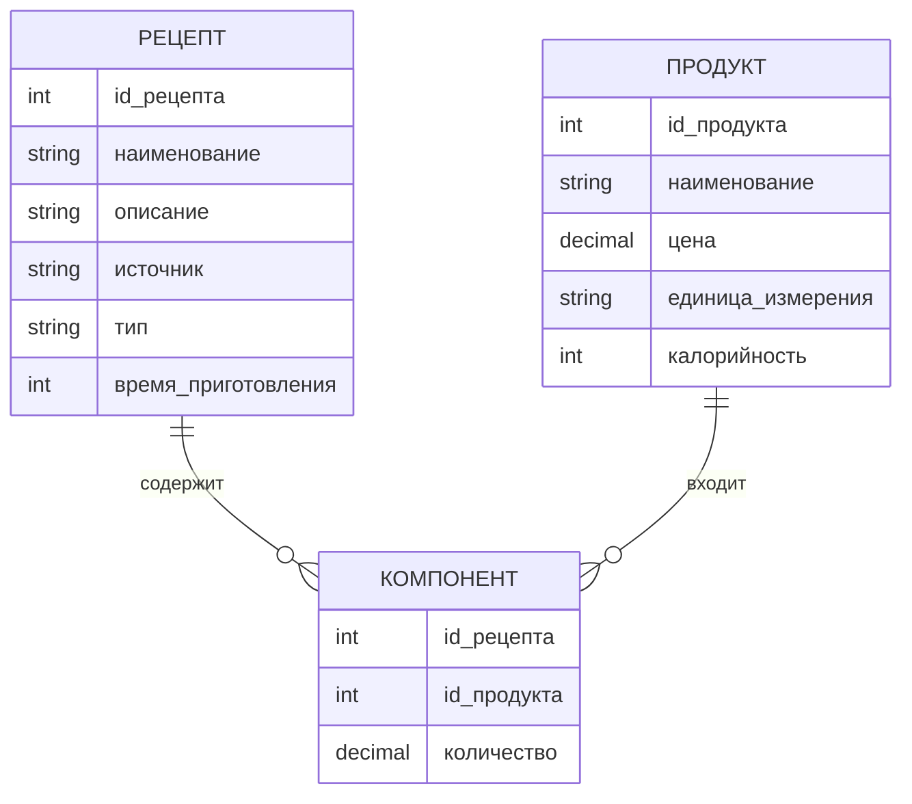

**Рецепты**

| Атрибут             | ПК  | Обяз. | Уник. | Вн. ключ |
| ------------------- | :-: | :---: | :---: | -------- |
| Id                  |  +  |   +   |   +   |          |
| Наименование        |     |   +   |       |          |
| Описание            |     |   +   |       |          |
| Источник            |     |       |       |          |
| Тип                 |     |   +   |       |          |
| Время приготовления |     |   +   |       |          |

**Продукты**

| Атрибут           | ПК  | Обяз. | Уник. | Вн. ключ |
| ----------------- | :-: | :---: | :---: | -------- |
| Id                |  +  |   +   |   +   |          |
| Наименование      |     |   +   |   +   |          |
| Цена              |     |   +   |       |          |
| Единица измерения |     |   +   |       |          |
| Калорийность      |     |   +   |       |          |

**Компоненты рецепта**

| Атрибут    | ПК  | Обяз. | Уник. | Вн. ключ     |
| ---------- | :-: | :---: | :---: | ------------ |
| Рецепт     |  +  |   +   |       | Рецепты(Id)  |
| Продукт    |  +  |   +   |       | Продукты(Id) |
| Количество |     |   +   |       |              |

## 12. Поликлиника

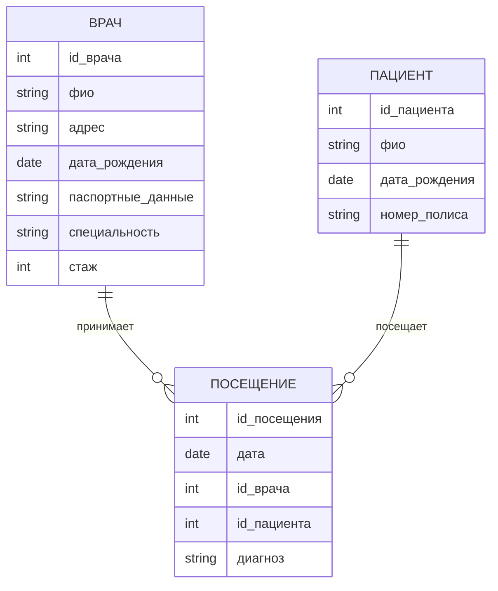

**Врачи**

| Атрибут           | ПК  | Обяз. | Уник. | Вн. ключ |
| ----------------- | :-: | :---: | :---: | -------- |
| Id                |  +  |   +   |   +   |          |
| ФИО               |     |   +   |       |          |
| Адрес             |     |   +   |       |          |
| Дата рождения     |     |   +   |       |          |
| Паспортные данные |     |   +   |   +   |          |
| Специальность     |     |   +   |       |          |
| Стаж              |     |   +   |       |          |

**Пациенты**

| Атрибут       | ПК  | Обяз. | Уник. | Вн. ключ |
| ------------- | :-: | :---: | :---: | -------- |
| Id            |  +  |   +   |   +   |          |
| ФИО           |     |   +   |       |          |
| Дата рождения |     |   +   |       |          |
| Номер полиса  |     |   +   |   +   |          |

**Посещения**

| Атрибут | ПК  | Обяз. | Уник. | Вн. ключ     |
| ------- | :-: | :---: | :---: | ------------ |
| Id      |  +  |   +   |   +   |              |
| Дата    |     |   +   |       |              |
| Врач    |     |   +   |       | Врачи(Id)    |
| Пациент |     |   +   |       | Пациенты(Id) |
| Диагноз |     |   +   |       |              |

## 13. Сессия

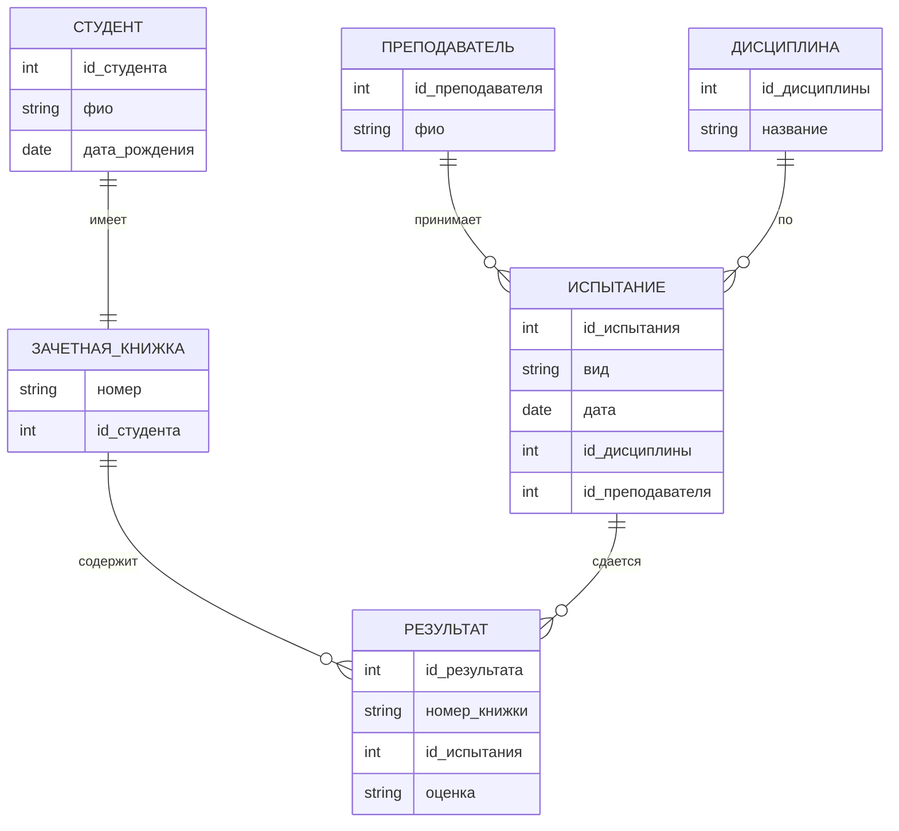

**Студенты**

| Атрибут       | ПК  | Обяз. | Уник. | Вн. ключ |
| ------------- | :-: | :---: | :---: | -------- |
| Id            |  +  |   +   |   +   |          |
| ФИО           |     |   +   |       |          |
| Дата рождения |     |   +   |       |          |

**Зачетные книжки**

| Атрибут | ПК  | Обяз. | Уник. | Вн. ключ     |
| ------- | :-: | :---: | :---: | ------------ |
| Номер   |  +  |   +   |   +   |              |
| Студент |     |   +   |   +   | Студенты(Id) |

**Преподаватели**

| Атрибут | ПК  | Обяз. | Уник. | Вн. ключ |
| ------- | :-: | :---: | :---: | -------- |
| Id      |  +  |   +   |   +   |          |
| ФИО     |     |   +   |       |          |

**Дисциплины**

| Атрибут  | ПК  | Обяз. | Уник. | Вн. ключ |
| -------- | :-: | :---: | :---: | -------- |
| Id       |  +  |   +   |   +   |          |
| Название |     |   +   |   +   |          |

**Испытания**

| Атрибут             | ПК  | Обяз. | Уник. | Вн. ключ          |
| ------------------- | :-: | :---: | :---: | ----------------- |
| Id                  |  +  |   +   |   +   |                   |
| Вид (экзамен/зачет) |     |   +   |       |                   |
| Дата                |     |   +   |       |                   |
| Дисциплина          |     |   +   |       | Дисциплины(Id)    |
| Преподаватель       |     |   +   |       | Преподаватели(Id) |

**Результаты**

| Атрибут   | ПК  | Обяз. | Уник. | Вн. ключ               |
| --------- | :-: | :---: | :---: | ---------------------- |
| Id        |  +  |   +   |   +   |                        |
| Книжка    |     |   +   |       | Зачетные книжки(Номер) |
| Испытание |     |   +   |       | Испытания(Id)          |
| Оценка    |     |   +   |       |                        |

## 14. Расписание занятий

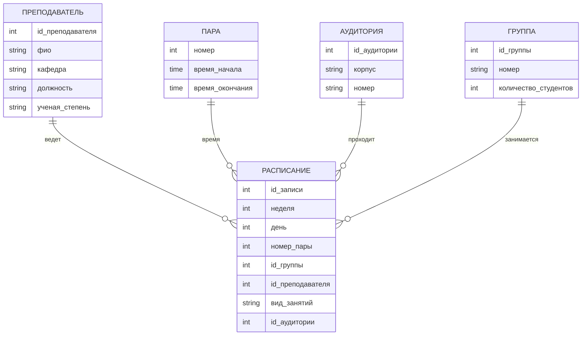

**Расписание**

| Атрибут       | ПК  | Обяз. | Уник. | Вн. ключ          |
| ------------- | :-: | :---: | :---: | ----------------- |
| Id            |  +  |   +   |   +   |                   |
| Неделя        |     |   +   |       |                   |
| День          |     |   +   |       |                   |
| Пара          |     |   +   |       | Пары(Номер)       |
| Группа        |     |   +   |       | Группы(Id)        |
| Преподаватель |     |   +   |       | Преподаватели(Id) |
| Вид занятий   |     |   +   |       |                   |
| Аудитория     |     |   +   |       | Аудитории(Id)     |

**Преподаватели**

| Атрибут        | ПК  | Обяз. | Уник. | Вн. ключ |
| -------------- | :-: | :---: | :---: | -------- |
| Id             |  +  |   +   |   +   |          |
| ФИО            |     |   +   |       |          |
| Кафедра        |     |   +   |       |          |
| Должность      |     |   +   |       |          |
| Ученая степень |     |       |       |          |

**Пары**

| Атрибут         | ПК  | Обяз. | Уник. | Вн. ключ |
| --------------- | :-: | :---: | :---: | -------- |
| Номер           |  +  |   +   |   +   |          |
| Время начала    |     |   +   |       |          |
| Время окончания |     |   +   |       |          |

**Аудитории**

| Атрибут | ПК  | Обяз. | Уник. | Вн. ключ |
| ------- | :-: | :---: | :---: | -------- |
| Id      |  +  |   +   |   +   |          |
| Корпус  |     |   +   |       |          |
| Номер   |     |   +   |       |          |

**Группы**

| Атрибут              | ПК  | Обяз. | Уник. | Вн. ключ |
| -------------------- | :-: | :---: | :---: | -------- |
| Id                   |  +  |   +   |   +   |          |
| Номер                |     |   +   |   +   |          |
| Количество студентов |     |   +   |       |          |

## 15. Социальная сеть (ВКонтакте)

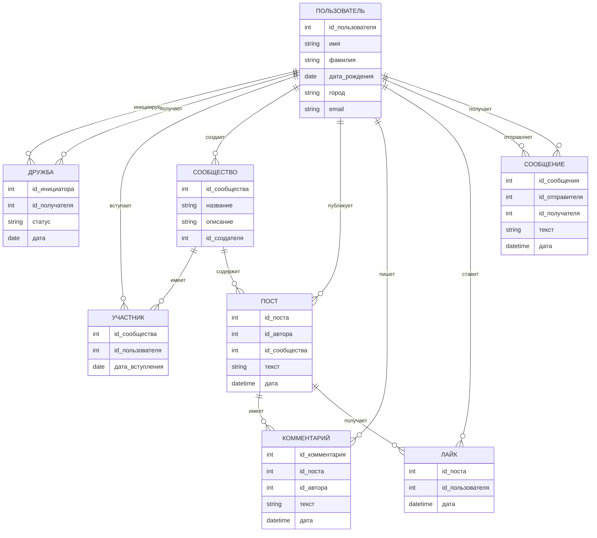

**Пользователи**

| Атрибут       | ПК  | Обяз. | Уник. | Вн. ключ |
| ------------- | :-: | :---: | :---: | -------- |
| Id            |  +  |   +   |   +   |          |
| Имя           |     |   +   |       |          |
| Фамилия       |     |   +   |       |          |
| Дата рождения |     |   +   |       |          |
| Город         |     |       |       |          |
| Email         |     |   +   |   +   |          |

**Дружбы**

| Атрибут    | ПК  | Обяз. | Уник. | Вн. ключ         |
| ---------- | :-: | :---: | :---: | ---------------- |
| Инициатор  |  +  |   +   |       | Пользователи(Id) |
| Получатель |  +  |   +   |       | Пользователи(Id) |
| Статус     |     |   +   |       |                  |
| Дата       |     |   +   |       |                  |

**Сообщества**

| Атрибут   | ПК  | Обяз. | Уник. | Вн. ключ         |
| --------- | :-: | :---: | :---: | ---------------- |
| Id        |  +  |   +   |   +   |                  |
| Название  |     |   +   |       |                  |
| Описание  |     |       |       |                  |
| Создатель |     |   +   |       | Пользователи(Id) |

**Участники**

| Атрибут         | ПК  | Обяз. | Уник. | Вн. ключ         |
| --------------- | :-: | :---: | :---: | ---------------- |
| Сообщество      |  +  |   +   |       | Сообщества(Id)   |
| Пользователь    |  +  |   +   |       | Пользователи(Id) |
| Дата вступления |     |   +   |       |                  |

**Посты**

| Атрибут    | ПК  | Обяз. | Уник. | Вн. ключ         |
| ---------- | :-: | :---: | :---: | ---------------- |
| Id         |  +  |   +   |   +   |                  |
| Автор      |     |   +   |       | Пользователи(Id) |
| Сообщество |     |       |       | Сообщества(Id)   |
| Текст      |     |   +   |       |                  |
| Дата       |     |   +   |       |                  |

**Комментарии**

| Атрибут | ПК  | Обяз. | Уник. | Вн. ключ         |
| ------- | :-: | :---: | :---: | ---------------- |
| Id      |  +  |   +   |   +   |                  |
| Пост    |     |   +   |       | Посты(Id)        |
| Автор   |     |   +   |       | Пользователи(Id) |
| Текст   |     |   +   |       |                  |
| Дата    |     |   +   |       |                  |

**Лайки**

| Атрибут      | ПК  | Обяз. | Уник. | Вн. ключ         |
| ------------ | :-: | :---: | :---: | ---------------- |
| Пост         |  +  |   +   |       | Посты(Id)        |
| Пользователь |  +  |   +   |       | Пользователи(Id) |
| Дата         |     |   +   |       |                  |

**Сообщения**

| Атрибут     | ПК  | Обяз. | Уник. | Вн. ключ         |
| ----------- | :-: | :---: | :---: | ---------------- |
| Id          |  +  |   +   |   +   |                  |
| Отправитель |     |   +   |       | Пользователи(Id) |
| Получатель  |     |   +   |       | Пользователи(Id) |
| Текст       |     |   +   |       |                  |
| Дата        |     |   +   |       |                  |

## 16. Интернет-магазин мебели

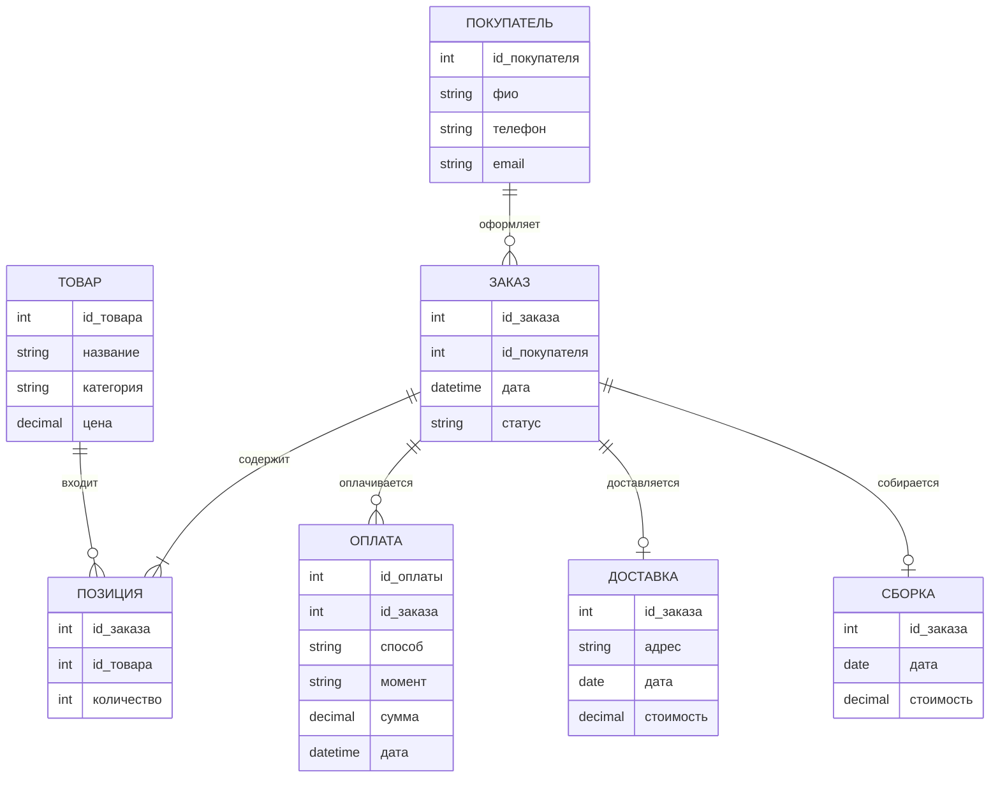

**Покупатели**

| Атрибут | ПК  | Обяз. | Уник. | Вн. ключ |
| ------- | :-: | :---: | :---: | -------- |
| Id      |  +  |   +   |   +   |          |
| ФИО     |     |   +   |       |          |
| Телефон |     |   +   |       |          |
| Email   |     |   +   |   +   |          |

**Товары**

| Атрибут   | ПК  | Обяз. | Уник. | Вн. ключ |
| --------- | :-: | :---: | :---: | -------- |
| Id        |  +  |   +   |   +   |          |
| Название  |     |   +   |       |          |
| Категория |     |   +   |       |          |
| Цена      |     |   +   |       |          |

**Заказы**

| Атрибут    | ПК  | Обяз. | Уник. | Вн. ключ       |
| ---------- | :-: | :---: | :---: | -------------- |
| Id         |  +  |   +   |   +   |                |
| Покупатель |     |   +   |       | Покупатели(Id) |
| Дата       |     |   +   |       |                |
| Статус     |     |   +   |       |                |

**Позиции заказа**

| Атрибут    | ПК  | Обяз. | Уник. | Вн. ключ   |
| ---------- | :-: | :---: | :---: | ---------- |
| Заказ      |  +  |   +   |       | Заказы(Id) |
| Товар      |  +  |   +   |       | Товары(Id) |
| Количество |     |   +   |       |            |

**Оплаты**

| Атрибут                          | ПК  | Обяз. | Уник. | Вн. ключ   |
| -------------------------------- | :-: | :---: | :---: | ---------- |
| Id                               |  +  |   +   |   +   |            |
| Заказ                            |     |   +   |       | Заказы(Id) |
| Способ                           |     |   +   |       |            |
| Момент (на сайте/после доставки) |     |   +   |       |            |
| Сумма                            |     |   +   |       |            |
| Дата                             |     |       |       |            |

**Доставки**

| Атрибут   | ПК  | Обяз. | Уник. | Вн. ключ   |
| --------- | :-: | :---: | :---: | ---------- |
| Заказ     |  +  |   +   |   +   | Заказы(Id) |
| Адрес     |     |   +   |       |            |
| Дата      |     |   +   |       |            |
| Стоимость |     |   +   |       |            |

**Сборки**

| Атрибут   | ПК  | Обяз. | Уник. | Вн. ключ   |
| --------- | :-: | :---: | :---: | ---------- |
| Заказ     |  +  |   +   |   +   | Заказы(Id) |
| Дата      |     |   +   |       |            |
| Стоимость |     |   +   |       |            |

## 17. Онлайн-кинотеатр

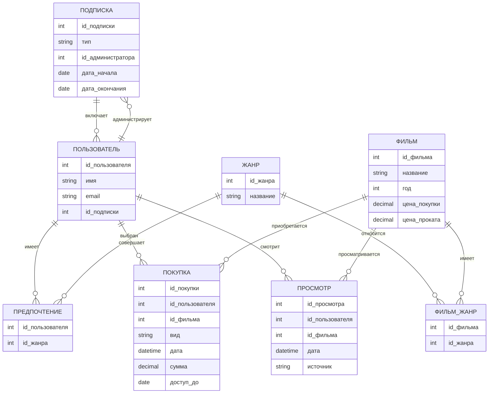

**Подписки**

| Атрибут                       | ПК  | Обяз. | Уник. | Вн. ключ         |
| ----------------------------- | :-: | :---: | :---: | ---------------- |
| Id                            |  +  |   +   |   +   |                  |
| Тип (индивидуальная/семейная) |     |   +   |       |                  |
| Администратор                 |     |   +   |       | Пользователи(Id) |
| Дата начала                   |     |   +   |       |                  |
| Дата окончания                |     |   +   |       |                  |

**Пользователи**

| Атрибут  | ПК  | Обяз. | Уник. | Вн. ключ     |
| -------- | :-: | :---: | :---: | ------------ |
| Id       |  +  |   +   |   +   |              |
| Имя      |     |   +   |       |              |
| Email    |     |   +   |   +   |              |
| Подписка |     |       |       | Подписки(Id) |

**Жанры**

| Атрибут  | ПК  | Обяз. | Уник. | Вн. ключ |
| -------- | :-: | :---: | :---: | -------- |
| Id       |  +  |   +   |   +   |          |
| Название |     |   +   |   +   |          |

**Фильмы**

| Атрибут      | ПК  | Обяз. | Уник. | Вн. ключ |
| ------------ | :-: | :---: | :---: | -------- |
| Id           |  +  |   +   |   +   |          |
| Название     |     |   +   |       |          |
| Год          |     |   +   |       |          |
| Цена покупки |     |   +   |       |          |
| Цена проката |     |   +   |       |          |

**Фильмы жанры**

| Атрибут | ПК  | Обяз. | Уник. | Вн. ключ   |
| ------- | :-: | :---: | :---: | ---------- |
| Фильм   |  +  |   +   |       | Фильмы(Id) |
| Жанр    |  +  |   +   |       | Жанры(Id)  |

**Предпочтения**

| Атрибут      | ПК  | Обяз. | Уник. | Вн. ключ         |
| ------------ | :-: | :---: | :---: | ---------------- |
| Пользователь |  +  |   +   |       | Пользователи(Id) |
| Жанр         |  +  |   +   |       | Жанры(Id)        |

**Покупки**

| Атрибут              | ПК  | Обяз. | Уник. | Вн. ключ         |
| -------------------- | :-: | :---: | :---: | ---------------- |
| Id                   |  +  |   +   |   +   |                  |
| Пользователь         |     |   +   |       | Пользователи(Id) |
| Фильм                |     |   +   |       | Фильмы(Id)       |
| Вид (покупка/прокат) |     |   +   |       |                  |
| Дата                 |     |   +   |       |                  |
| Сумма                |     |   +   |       |                  |
| Доступ до            |     |       |       |                  |

**Просмотры**

| Атрибут                            | ПК  | Обяз. | Уник. | Вн. ключ         |
| ---------------------------------- | :-: | :---: | :---: | ---------------- |
| Id                                 |  +  |   +   |   +   |                  |
| Пользователь                       |     |   +   |       | Пользователи(Id) |
| Фильм                              |     |   +   |       | Фильмы(Id)       |
| Дата                               |     |   +   |       |                  |
| Источник (подписка/покупка/прокат) |     |   +   |       |                  |

## 18. Бронирование авиабилетов (сайт авиакомпании)

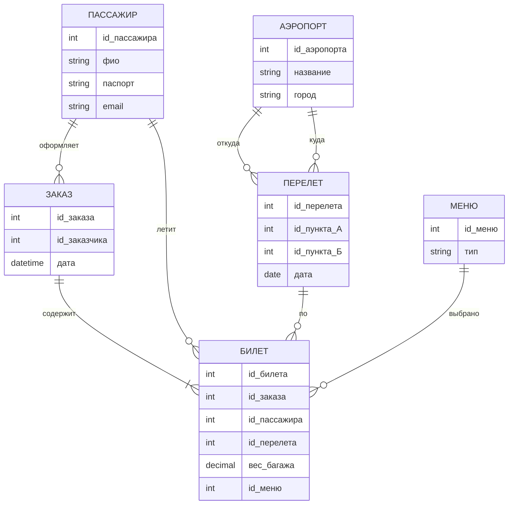

**Пассажиры**

| Атрибут | ПК  | Обяз. | Уник. | Вн. ключ |
| ------- | :-: | :---: | :---: | -------- |
| Id      |  +  |   +   |   +   |          |
| ФИО     |     |   +   |       |          |
| Паспорт |     |   +   |   +   |          |
| Email   |     |       |       |          |

**Заказы**

| Атрибут  | ПК  | Обяз. | Уник. | Вн. ключ      |
| -------- | :-: | :---: | :---: | ------------- |
| Id       |  +  |   +   |   +   |               |
| Заказчик |     |   +   |       | Пассажиры(Id) |
| Дата     |     |   +   |       |               |

**Аэропорты**

| Атрибут  | ПК  | Обяз. | Уник. | Вн. ключ |
| -------- | :-: | :---: | :---: | -------- |
| Id       |  +  |   +   |   +   |          |
| Название |     |   +   |       |          |
| Город    |     |   +   |       |          |

**Перелеты**

| Атрибут | ПК  | Обяз. | Уник. | Вн. ключ      |
| ------- | :-: | :---: | :---: | ------------- |
| Id      |  +  |   +   |   +   |               |
| Пункт А |     |   +   |       | Аэропорты(Id) |
| Пункт Б |     |   +   |       | Аэропорты(Id) |
| Дата    |     |   +   |       |               |

**Меню**

| Атрибут | ПК  | Обяз. | Уник. | Вн. ключ |
| ------- | :-: | :---: | :---: | -------- |
| Id      |  +  |   +   |   +   |          |
| Тип     |     |   +   |   +   |          |

**Билеты**

| Атрибут    | ПК  | Обяз. | Уник. | Вн. ключ      |
| ---------- | :-: | :---: | :---: | ------------- |
| Id         |  +  |   +   |   +   |               |
| Заказ      |     |   +   |       | Заказы(Id)    |
| Пассажир   |     |   +   |       | Пассажиры(Id) |
| Перелет    |     |   +   |       | Перелеты(Id)  |
| Вес багажа |     |   +   |       |               |
| Меню       |     |   +   |       | Меню(Id)      |

## 19. Музыкальные альбомы

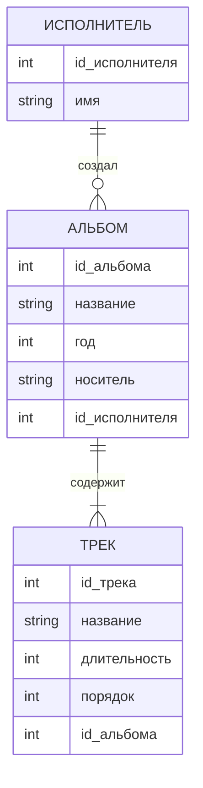

**Исполнители**

| Атрибут | ПК  | Обяз. | Уник. | Вн. ключ |
| ------- | :-: | :---: | :---: | -------- |
| Id      |  +  |   +   |   +   |          |
| Имя     |     |   +   |       |          |

**Альбомы**

| Атрибут                          | ПК  | Обяз. | Уник. | Вн. ключ        |
| -------------------------------- | :-: | :---: | :---: | --------------- |
| Id                               |  +  |   +   |   +   |                 |
| Название                         |     |   +   |       |                 |
| Год                              |     |       |       |                 |
| Носитель (Audio CD/жесткий диск) |     |   +   |       |                 |
| Исполнитель                      |     |   +   |       | Исполнители(Id) |

**Треки**

| Атрибут      | ПК  | Обяз. | Уник. | Вн. ключ    |
| ------------ | :-: | :---: | :---: | ----------- |
| Id           |  +  |   +   |   +   |             |
| Название     |     |   +   |       |             |
| Длительность |     |   +   |       |             |
| Порядок      |     |   +   |       |             |
| Альбом       |     |   +   |       | Альбомы(Id) |

## 20. Бронирование авиабилетов (база рейсов)

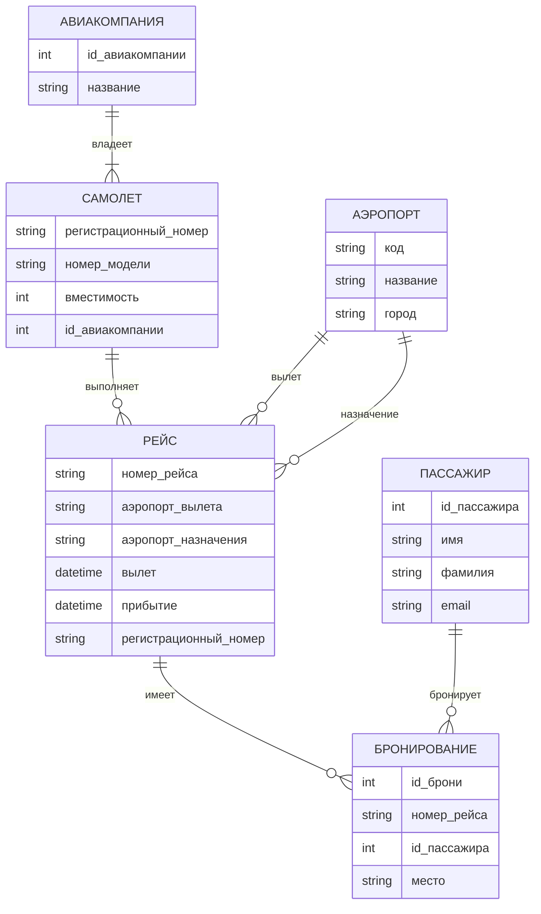

**Авиакомпании**

| Атрибут  | ПК  | Обяз. | Уник. | Вн. ключ |
| -------- | :-: | :---: | :---: | -------- |
| Id       |  +  |   +   |   +   |          |
| Название |     |   +   |   +   |          |

**Самолеты**

| Атрибут               | ПК  | Обяз. | Уник. | Вн. ключ         |
| --------------------- | :-: | :---: | :---: | ---------------- |
| Регистрационный номер |  +  |   +   |   +   |                  |
| Номер модели          |     |   +   |       |                  |
| Вместимость           |     |   +   |       |                  |
| Авиакомпания          |     |   +   |       | Авиакомпании(Id) |

**Аэропорты**

| Атрибут  | ПК  | Обяз. | Уник. | Вн. ключ |
| -------- | :-: | :---: | :---: | -------- |
| Код      |  +  |   +   |   +   |          |
| Название |     |   +   |       |          |
| Город    |     |   +   |       |          |

**Рейсы**

| Атрибут             | ПК  | Обяз. | Уник. | Вн. ключ                        |
| ------------------- | :-: | :---: | :---: | ------------------------------- |
| Номер рейса         |  +  |   +   |   +   |                                 |
| Аэропорт вылета     |     |   +   |       | Аэропорты(Код)                  |
| Аэропорт назначения |     |   +   |       | Аэропорты(Код)                  |
| Вылет               |     |   +   |       |                                 |
| Прибытие            |     |   +   |       |                                 |
| Самолет             |     |   +   |       | Самолеты(Регистрационный номер) |

**Пассажиры**

| Атрибут | ПК  | Обяз. | Уник. | Вн. ключ |
| ------- | :-: | :---: | :---: | -------- |
| Id      |  +  |   +   |   +   |          |
| Имя     |     |   +   |       |          |
| Фамилия |     |   +   |       |          |
| Email   |     |   +   |   +   |          |

**Бронирования**

| Атрибут  | ПК  | Обяз. | Уник. | Вн. ключ           |
| -------- | :-: | :---: | :---: | ------------------ |
| Id       |  +  |   +   |   +   |                    |
| Рейс     |     |   +   |       | Рейсы(Номер рейса) |
| Пассажир |     |   +   |       | Пассажиры(Id)      |
| Место    |     |       |       |                    |

## 21. Курсы и студенты

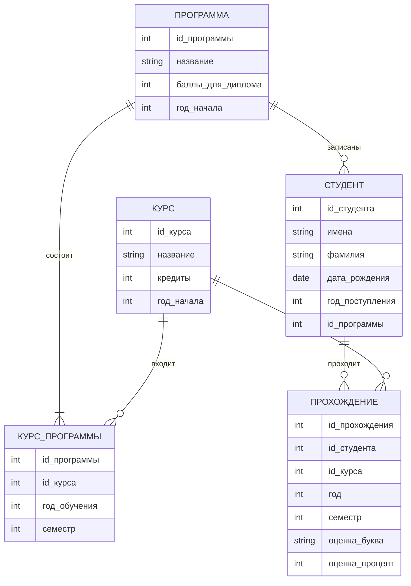

**Программы**

| Атрибут           | ПК  | Обяз. | Уник. | Вн. ключ |
| ----------------- | :-: | :---: | :---: | -------- |
| Id                |  +  |   +   |   +   |          |
| Название          |     |   +   |       |          |
| Баллы для диплома |     |   +   |       |          |
| Год начала        |     |   +   |       |          |

**Курсы**

| Атрибут    | ПК  | Обяз. | Уник. | Вн. ключ |
| ---------- | :-: | :---: | :---: | -------- |
| Id         |  +  |   +   |   +   |          |
| Название   |     |   +   |       |          |
| Кредиты    |     |   +   |       |          |
| Год начала |     |   +   |       |          |

**Курсы программ**

| Атрибут      | ПК  | Обяз. | Уник. | Вн. ключ      |
| ------------ | :-: | :---: | :---: | ------------- |
| Программа    |  +  |   +   |       | Программы(Id) |
| Курс         |  +  |   +   |       | Курсы(Id)     |
| Год обучения |     |   +   |       |               |
| Семестр      |     |   +   |       |               |

**Студенты**

| Атрибут         | ПК  | Обяз. | Уник. | Вн. ключ      |
| --------------- | :-: | :---: | :---: | ------------- |
| Id              |  +  |   +   |   +   |               |
| Имена           |     |   +   |       |               |
| Фамилия         |     |   +   |       |               |
| Дата рождения   |     |   +   |       |               |
| Год поступления |     |   +   |       |               |
| Программа       |     |   +   |       | Программы(Id) |

**Прохождения**

| Атрибут          | ПК  | Обяз. | Уник. | Вн. ключ     |
| ---------------- | :-: | :---: | :---: | ------------ |
| Id               |  +  |   +   |   +   |              |
| Студент          |     |   +   |       | Студенты(Id) |
| Курс             |     |   +   |       | Курсы(Id)    |
| Год              |     |   +   |       |              |
| Семестр          |     |   +   |       |              |
| Оценка (буква)   |     |       |       |              |
| Оценка (процент) |     |       |       |              |

## 22. Компания и сотрудники

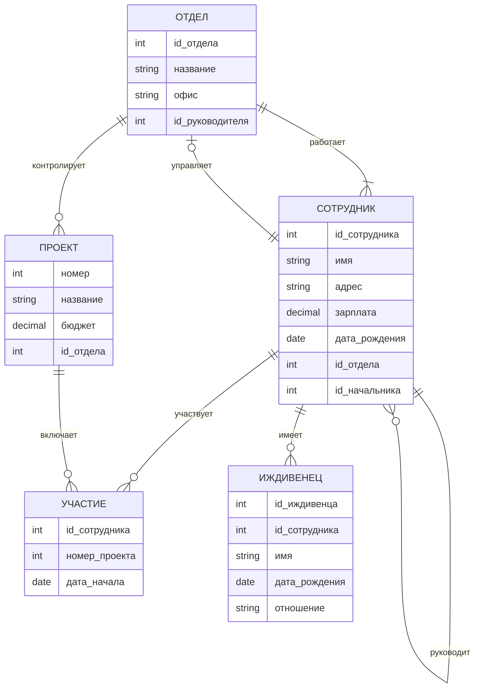

**Отделы**

| Атрибут      | ПК  | Обяз. | Уник. | Вн. ключ       |
| ------------ | :-: | :---: | :---: | -------------- |
| Id           |  +  |   +   |   +   |                |
| Название     |     |   +   |       |                |
| Офис         |     |   +   |       |                |
| Руководитель |     |   +   |   +   | Сотрудники(Id) |

**Проекты**

| Атрибут  | ПК  | Обяз. | Уник. | Вн. ключ   |
| -------- | :-: | :---: | :---: | ---------- |
| Номер    |  +  |   +   |   +   |            |
| Название |     |   +   |   +   |            |
| Бюджет   |     |   +   |       |            |
| Отдел    |     |   +   |       | Отделы(Id) |

**Сотрудники**

| Атрибут       | ПК  | Обяз. | Уник. | Вн. ключ       |
| ------------- | :-: | :---: | :---: | -------------- |
| Id            |  +  |   +   |   +   |                |
| Имя           |     |   +   |       |                |
| Адрес         |     |   +   |       |                |
| Зарплата      |     |   +   |       |                |
| Дата рождения |     |   +   |       |                |
| Отдел         |     |   +   |       | Отделы(Id)     |
| Начальник     |     |       |       | Сотрудники(Id) |

**Участие в проектах**

| Атрибут     | ПК  | Обяз. | Уник. | Вн. ключ       |
| ----------- | :-: | :---: | :---: | -------------- |
| Сотрудник   |  +  |   +   |       | Сотрудники(Id) |
| Проект      |  +  |   +   |       | Проекты(Номер) |
| Дата начала |     |   +   |       |                |

**Иждивенцы**

| Атрибут       | ПК  | Обяз. | Уник. | Вн. ключ       |
| ------------- | :-: | :---: | :---: | -------------- |
| Id            |  +  |   +   |   +   |                |
| Сотрудник     |     |   +   |       | Сотрудники(Id) |
| Имя           |     |   +   |       |                |
| Дата рождения |     |   +   |       |                |
| Отношение     |     |   +   |       |                |

## 23. Галереи

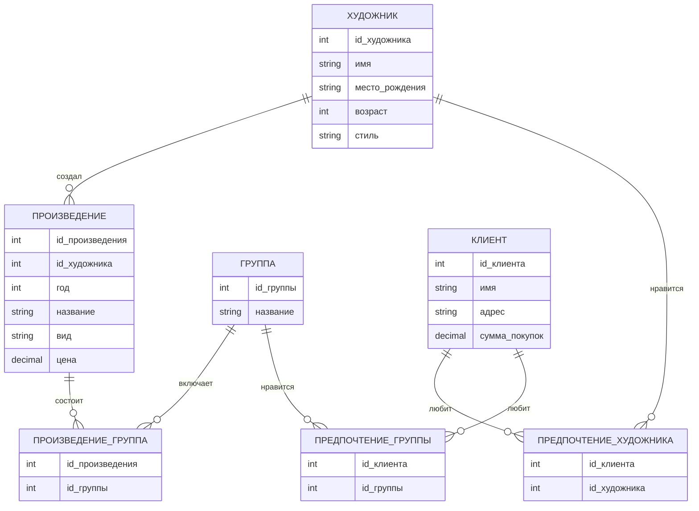

**Художники**

| Атрибут        | ПК  | Обяз. | Уник. | Вн. ключ |
| -------------- | :-: | :---: | :---: | -------- |
| Id             |  +  |   +   |   +   |          |
| Имя            |     |   +   |   +   |          |
| Место рождения |     |   +   |       |          |
| Возраст        |     |   +   |       |          |
| Стиль          |     |   +   |       |          |

**Произведения**

| Атрибут  | ПК  | Обяз. | Уник. | Вн. ключ      |
| -------- | :-: | :---: | :---: | ------------- |
| Id       |  +  |   +   |   +   |               |
| Художник |     |   +   |       | Художники(Id) |
| Год      |     |   +   |       |               |
| Название |     |   +   |       |               |
| Вид      |     |   +   |       |               |
| Цена     |     |   +   |       |               |

**Группы**

| Атрибут  | ПК  | Обяз. | Уник. | Вн. ключ |
| -------- | :-: | :---: | :---: | -------- |
| Id       |  +  |   +   |   +   |          |
| Название |     |   +   |   +   |          |

**Произведения группы**

| Атрибут      | ПК  | Обяз. | Уник. | Вн. ключ         |
| ------------ | :-: | :---: | :---: | ---------------- |
| Произведение |  +  |   +   |       | Произведения(Id) |
| Группа       |  +  |   +   |       | Группы(Id)       |

**Клиенты**

| Атрибут       | ПК  | Обяз. | Уник. | Вн. ключ |
| ------------- | :-: | :---: | :---: | -------- |
| Id            |  +  |   +   |   +   |          |
| Имя           |     |   +   |   +   |          |
| Адрес         |     |   +   |       |          |
| Сумма покупок |     |   +   |       |          |

**Предпочтения художников**

| Атрибут  | ПК  | Обяз. | Уник. | Вн. ключ      |
| -------- | :-: | :---: | :---: | ------------- |
| Клиент   |  +  |   +   |       | Клиенты(Id)   |
| Художник |  +  |   +   |       | Художники(Id) |

**Предпочтения групп**

| Атрибут | ПК  | Обяз. | Уник. | Вн. ключ    |
| ------- | :-: | :---: | :---: | ----------- |
| Клиент  |  +  |   +   |       | Клиенты(Id) |
| Группа  |  +  |   +   |       | Группы(Id)  |

## 24. Сеть отелей

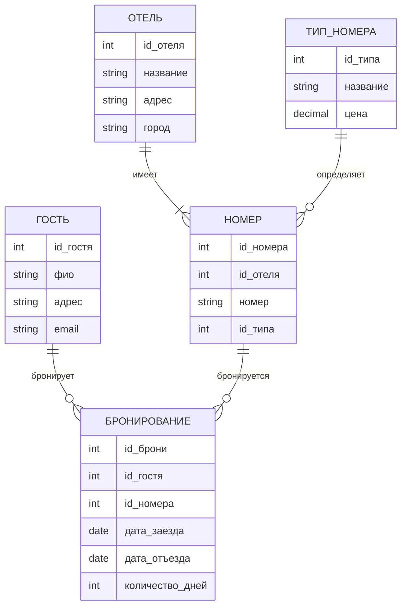

**Отели**

| Атрибут  | ПК  | Обяз. | Уник. | Вн. ключ |
| -------- | :-: | :---: | :---: | -------- |
| Id       |  +  |   +   |   +   |          |
| Название |     |   +   |       |          |
| Адрес    |     |   +   |       |          |
| Город    |     |   +   |       |          |

**Типы номеров**

| Атрибут  | ПК  | Обяз. | Уник. | Вн. ключ |
| -------- | :-: | :---: | :---: | -------- |
| Id       |  +  |   +   |   +   |          |
| Название |     |   +   |   +   |          |
| Цена     |     |   +   |       |          |

**Номера**

| Атрибут | ПК  | Обяз. | Уник. | Вн. ключ         |
| ------- | :-: | :---: | :---: | ---------------- |
| Id      |  +  |   +   |   +   |                  |
| Отель   |     |   +   |       | Отели(Id)        |
| Номер   |     |   +   |       |                  |
| Тип     |     |   +   |       | Типы номеров(Id) |

**Гости**

| Атрибут | ПК  | Обяз. | Уник. | Вн. ключ |
| ------- | :-: | :---: | :---: | -------- |
| Id      |  +  |   +   |   +   |          |
| ФИО     |     |   +   |       |          |
| Адрес   |     |   +   |       |          |
| Email   |     |   +   |       |          |

**Бронирования**

| Атрибут         | ПК  | Обяз. | Уник. | Вн. ключ   |
| --------------- | :-: | :---: | :---: | ---------- |
| Id              |  +  |   +   |   +   |            |
| Гость           |     |   +   |       | Гости(Id)  |
| Номер           |     |   +   |       | Номера(Id) |
| Дата заезда     |     |   +   |       |            |
| Дата отъезда    |     |   +   |       |            |
| Количество дней |     |   +   |       |            |

## 25. Прокат автомобилей

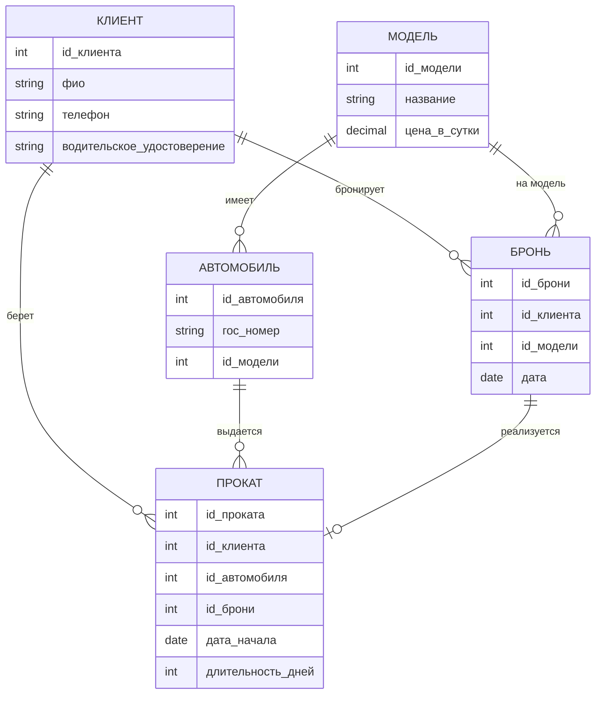

**Модели**

| Атрибут      | ПК  | Обяз. | Уник. | Вн. ключ |
| ------------ | :-: | :---: | :---: | -------- |
| Id           |  +  |   +   |   +   |          |
| Название     |     |   +   |   +   |          |
| Цена в сутки |     |   +   |       |          |

**Автомобили**

| Атрибут    | ПК  | Обяз. | Уник. | Вн. ключ   |
| ---------- | :-: | :---: | :---: | ---------- |
| Id         |  +  |   +   |   +   |            |
| Гос. номер |     |   +   |   +   |            |
| Модель     |     |   +   |       | Модели(Id) |

**Клиенты**

| Атрибут                    | ПК  | Обяз. | Уник. | Вн. ключ |
| -------------------------- | :-: | :---: | :---: | -------- |
| Id                         |  +  |   +   |   +   |          |
| ФИО                        |     |   +   |       |          |
| Телефон                    |     |   +   |       |          |
| Водительское удостоверение |     |   +   |   +   |          |

**Брони**

| Атрибут | ПК  | Обяз. | Уник. | Вн. ключ    |
| ------- | :-: | :---: | :---: | ----------- |
| Id      |  +  |   +   |   +   |             |
| Клиент  |     |   +   |       | Клиенты(Id) |
| Модель  |     |       |       | Модели(Id)  |
| Дата    |     |   +   |       |             |

**Прокаты**

| Атрибут             | ПК  | Обяз. | Уник. | Вн. ключ       |
| ------------------- | :-: | :---: | :---: | -------------- |
| Id                  |  +  |   +   |   +   |                |
| Клиент              |     |   +   |       | Клиенты(Id)    |
| Автомобиль          |     |   +   |       | Автомобили(Id) |
| Бронь               |     |       |   +   | Брони(Id)      |
| Дата начала         |     |   +   |       |                |
| Длительность (дней) |     |   +   |       |                |

## 26. КХЛ

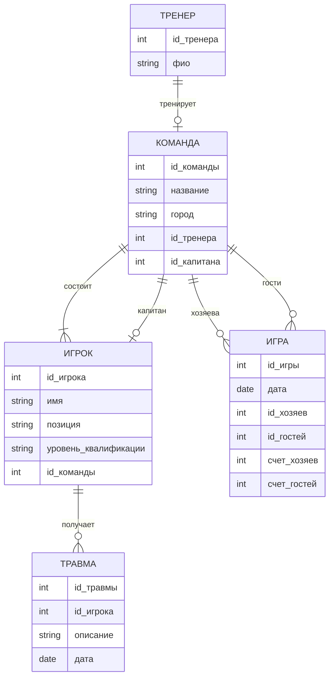

**Команды**

| Атрибут  | ПК  | Обяз. | Уник. | Вн. ключ    |
| -------- | :-: | :---: | :---: | ----------- |
| Id       |  +  |   +   |   +   |             |
| Название |     |   +   |   +   |             |
| Город    |     |   +   |       |             |
| Тренер   |     |   +   |   +   | Тренеры(Id) |
| Капитан  |     |   +   |   +   | Игроки(Id)  |

**Тренеры**

| Атрибут | ПК  | Обяз. | Уник. | Вн. ключ |
| ------- | :-: | :---: | :---: | -------- |
| Id      |  +  |   +   |   +   |          |
| ФИО     |     |   +   |       |          |

**Игроки**

| Атрибут              | ПК  | Обяз. | Уник. | Вн. ключ    |
| -------------------- | :-: | :---: | :---: | ----------- |
| Id                   |  +  |   +   |   +   |             |
| Имя                  |     |   +   |       |             |
| Позиция              |     |   +   |       |             |
| Уровень квалификации |     |   +   |       |             |
| Команда              |     |   +   |       | Команды(Id) |

**Травмы**

| Атрибут  | ПК  | Обяз. | Уник. | Вн. ключ   |
| -------- | :-: | :---: | :---: | ---------- |
| Id       |  +  |   +   |   +   |            |
| Игрок    |     |   +   |       | Игроки(Id) |
| Описание |     |   +   |       |            |
| Дата     |     |   +   |       |            |

**Игры**

| Атрибут     | ПК  | Обяз. | Уник. | Вн. ключ    |
| ----------- | :-: | :---: | :---: | ----------- |
| Id          |  +  |   +   |   +   |             |
| Дата        |     |   +   |       |             |
| Хозяева     |     |   +   |       | Команды(Id) |
| Гости       |     |   +   |       | Команды(Id) |
| Счет хозяев |     |   +   |       |             |
| Счет гостей |     |   +   |       |             |

## 27. Книжный онлайн-магазин

```mermaid
erDiagram
    АВТОР {
        int id_автора
        string фио
    }
    ИЗДАТЕЛЬ {
        int id_издателя
        string название
    }
    КНИГА {
        int id_книги
        string наименование
        int id_издателя
        int количество_страниц
        string тип_обложки
        decimal масса
        bool электронная
        decimal цена
    }
    КНИГА_АВТОР {
        int id_книги
        int id_автора
    }
    ПОКУПАТЕЛЬ {
        int id_покупателя
        string фио
        string email
        string адрес
    }
    ЗАКАЗ {
        int id_заказа
        int id_покупателя
        string адрес_доставки
        datetime время_формирования
        datetime время_оплаты
        datetime время_доставки
    }
    ПОЗИЦИЯ {
        int id_заказа
        int id_книги
        int количество
    }

    АВТОР ||--o{ КНИГА_АВТОР : "пишет"
    КНИГА ||--|{ КНИГА_АВТОР : "имеет"
    ИЗДАТЕЛЬ ||--o{ КНИГА : "выпускает"
    ПОКУПАТЕЛЬ ||--o{ ЗАКАЗ : "оформляет"
    ЗАКАЗ ||--|{ ПОЗИЦИЯ : "содержит"
    КНИГА ||--o{ ПОЗИЦИЯ : "входит"
```

**Авторы**

| Атрибут | ПК  | Обяз. | Уник. | Вн. ключ |
| ------- | :-: | :---: | :---: | -------- |
| Id      |  +  |   +   |   +   |          |
| ФИО     |     |   +   |       |          |

**Издатели**

| Атрибут  | ПК  | Обяз. | Уник. | Вн. ключ |
| -------- | :-: | :---: | :---: | -------- |
| Id       |  +  |   +   |   +   |          |
| Название |     |   +   |   +   |          |

**Книги**

| Атрибут            | ПК  | Обяз. | Уник. | Вн. ключ     |
| ------------------ | :-: | :---: | :---: | ------------ |
| Id                 |  +  |   +   |   +   |              |
| Наименование       |     |   +   |       |              |
| Издатель           |     |   +   |       | Издатели(Id) |
| Количество страниц |     |       |       |              |
| Тип обложки        |     |       |       |              |
| Масса              |     |       |       |              |
| Электронная        |     |   +   |       |              |
| Цена               |     |   +   |       |              |

**Книги авторы**

| Атрибут | ПК  | Обяз. | Уник. | Вн. ключ   |
| ------- | :-: | :---: | :---: | ---------- |
| Книга   |  +  |   +   |       | Книги(Id)  |
| Автор   |  +  |   +   |       | Авторы(Id) |

**Покупатели**

| Атрибут | ПК  | Обяз. | Уник. | Вн. ключ |
| ------- | :-: | :---: | :---: | -------- |
| Id      |  +  |   +   |   +   |          |
| ФИО     |     |   +   |       |          |
| Email   |     |   +   |   +   |          |
| Адрес   |     |       |       |          |

**Заказы**

| Атрибут            | ПК  | Обяз. | Уник. | Вн. ключ       |
| ------------------ | :-: | :---: | :---: | -------------- |
| Id                 |  +  |   +   |   +   |                |
| Покупатель         |     |   +   |       | Покупатели(Id) |
| Адрес доставки     |     |       |       |                |
| Время формирования |     |   +   |       |                |
| Время оплаты       |     |       |       |                |
| Время доставки     |     |       |       |                |

**Позиции заказа**

| Атрибут    | ПК  | Обяз. | Уник. | Вн. ключ   |
| ---------- | :-: | :---: | :---: | ---------- |
| Заказ      |  +  |   +   |       | Заказы(Id) |
| Книга      |  +  |   +   |       | Книги(Id)  |
| Количество |     |   +   |       |            |

## 28. Мастерская

```mermaid
erDiagram
    КЛИЕНТ {
        int id_клиента
        string фио
        string телефон
    }
    ТИП_ТЕХНИКИ {
        int id_типа
        string название
    }
    СОТРУДНИК {
        int id_сотрудника
        string фио
        string должность
    }
    ЗАЯВКА {
        int id_заявки
        int id_клиента
        int id_типа
        string свойства
        date дата_приема
        int id_мастера
        date дата_диагностики
        bool гарантия
        decimal стоимость
        bool согласие
    }
    ЗАПЧАСТЬ {
        int id_запчасти
        string название
        decimal цена
    }
    ДЕЙСТВИЕ {
        int id_действия
        string название
        decimal цена
    }
    ЗАМЕНА {
        int id_заявки
        int id_запчасти
        int количество
    }
    РАБОТА {
        int id_заявки
        int id_действия
    }

    КЛИЕНТ ||--o{ ЗАЯВКА : "сдает"
    ТИП_ТЕХНИКИ ||--o{ ЗАЯВКА : "относится"
    СОТРУДНИК ||--o{ ЗАЯВКА : "диагностирует"
    ЗАЯВКА ||--o{ ЗАМЕНА : "включает"
    ЗАПЧАСТЬ ||--o{ ЗАМЕНА : "используется"
    ЗАЯВКА ||--o{ РАБОТА : "включает"
    ДЕЙСТВИЕ ||--o{ РАБОТА : "выполняется"
```

**Клиенты**

| Атрибут | ПК  | Обяз. | Уник. | Вн. ключ |
| ------- | :-: | :---: | :---: | -------- |
| Id      |  +  |   +   |   +   |          |
| ФИО     |     |   +   |       |          |
| Телефон |     |   +   |       |          |

**Типы техники**

| Атрибут  | ПК  | Обяз. | Уник. | Вн. ключ |
| -------- | :-: | :---: | :---: | -------- |
| Id       |  +  |   +   |   +   |          |
| Название |     |   +   |   +   |          |

**Сотрудники**

| Атрибут   | ПК  | Обяз. | Уник. | Вн. ключ |
| --------- | :-: | :---: | :---: | -------- |
| Id        |  +  |   +   |   +   |          |
| ФИО       |     |   +   |       |          |
| Должность |     |   +   |       |          |

**Заявки**

| Атрибут          | ПК  | Обяз. | Уник. | Вн. ключ         |
| ---------------- | :-: | :---: | :---: | ---------------- |
| Id               |  +  |   +   |   +   |                  |
| Клиент           |     |   +   |       | Клиенты(Id)      |
| Тип техники      |     |   +   |       | Типы техники(Id) |
| Свойства         |     |   +   |       |                  |
| Дата приема      |     |   +   |       |                  |
| Мастер           |     |   +   |       | Сотрудники(Id)   |
| Дата диагностики |     |       |       |                  |
| Гарантия         |     |   +   |       |                  |
| Стоимость        |     |       |       |                  |
| Согласие         |     |       |       |                  |

**Запчасти**

| Атрибут  | ПК  | Обяз. | Уник. | Вн. ключ |
| -------- | :-: | :---: | :---: | -------- |
| Id       |  +  |   +   |   +   |          |
| Название |     |   +   |       |          |
| Цена     |     |   +   |       |          |

**Действия**

| Атрибут  | ПК  | Обяз. | Уник. | Вн. ключ |
| -------- | :-: | :---: | :---: | -------- |
| Id       |  +  |   +   |   +   |          |
| Название |     |   +   |       |          |
| Цена     |     |   +   |       |          |

**Замены**

| Атрибут    | ПК  | Обяз. | Уник. | Вн. ключ     |
| ---------- | :-: | :---: | :---: | ------------ |
| Заявка     |  +  |   +   |       | Заявки(Id)   |
| Запчасть   |  +  |   +   |       | Запчасти(Id) |
| Количество |     |   +   |       |              |

**Работы**

| Атрибут  | ПК  | Обяз. | Уник. | Вн. ключ     |
| -------- | :-: | :---: | :---: | ------------ |
| Заявка   |  +  |   +   |       | Заявки(Id)   |
| Действие |  +  |   +   |       | Действия(Id) |

## 29. ЖЭК

```mermaid
erDiagram
    УЛИЦА {
        int id_улицы
        string название
    }
    ДОМ {
        int id_дома
        int id_улицы
        string номер
    }
    КВАРТИРА {
        int id_квартиры
        int id_дома
        string номер
    }
    ДИСПЕТЧЕР {
        int id_диспетчера
        string фио
    }
    ТИП_ЗАЯВКИ {
        int id_типа
        string название
    }
    БРИГАДА {
        int id_бригады
        string название
        int id_бригадира
    }
    СПЕЦИАЛИСТ {
        int id_специалиста
        string фио
        string специальность
        int id_бригады
    }
    ЗАЯВКА {
        int номер
        date дата_поступления
        int id_квартиры
        int id_диспетчера
        int id_типа
        date срок_выполнения
        int id_бригады
    }

    УЛИЦА ||--|{ ДОМ : "содержит"
    ДОМ ||--|{ КВАРТИРА : "содержит"
    КВАРТИРА ||--o{ ЗАЯВКА : "подает"
    ДИСПЕТЧЕР ||--o{ ЗАЯВКА : "принимает"
    ТИП_ЗАЯВКИ ||--o{ ЗАЯВКА : "определяет"
    БРИГАДА ||--o{ ЗАЯВКА : "выполняет"
    БРИГАДА ||--|{ СПЕЦИАЛИСТ : "состоит"
    СПЕЦИАЛИСТ ||--o| БРИГАДА : "бригадир"
```

**Улицы**

| Атрибут  | ПК  | Обяз. | Уник. | Вн. ключ |
| -------- | :-: | :---: | :---: | -------- |
| Id       |  +  |   +   |   +   |          |
| Название |     |   +   |   +   |          |

**Дома**

| Атрибут | ПК  | Обяз. | Уник. | Вн. ключ  |
| ------- | :-: | :---: | :---: | --------- |
| Id      |  +  |   +   |   +   |           |
| Улица   |     |   +   |       | Улицы(Id) |
| Номер   |     |   +   |       |           |

**Квартиры**

| Атрибут | ПК  | Обяз. | Уник. | Вн. ключ |
| ------- | :-: | :---: | :---: | -------- |
| Id      |  +  |   +   |   +   |          |
| Дом     |     |   +   |       | Дома(Id) |
| Номер   |     |   +   |       |          |

**Диспетчеры**

| Атрибут | ПК  | Обяз. | Уник. | Вн. ключ |
| ------- | :-: | :---: | :---: | -------- |
| Id      |  +  |   +   |   +   |          |
| ФИО     |     |   +   |       |          |

**Типы заявок**

| Атрибут  | ПК  | Обяз. | Уник. | Вн. ключ |
| -------- | :-: | :---: | :---: | -------- |
| Id       |  +  |   +   |   +   |          |
| Название |     |   +   |   +   |          |

**Бригады**

| Атрибут  | ПК  | Обяз. | Уник. | Вн. ключ        |
| -------- | :-: | :---: | :---: | --------------- |
| Id       |  +  |   +   |   +   |                 |
| Название |     |   +   |       |                 |
| Бригадир |     |   +   |   +   | Специалисты(Id) |

**Специалисты**

| Атрибут       | ПК  | Обяз. | Уник. | Вн. ключ    |
| ------------- | :-: | :---: | :---: | ----------- |
| Id            |  +  |   +   |   +   |             |
| ФИО           |     |   +   |       |             |
| Специальность |     |   +   |       |             |
| Бригада       |     |   +   |       | Бригады(Id) |

**Заявки**

| Атрибут          | ПК  | Обяз. | Уник. | Вн. ключ        |
| ---------------- | :-: | :---: | :---: | --------------- |
| Номер            |  +  |   +   |   +   |                 |
| Дата поступления |     |   +   |       |                 |
| Квартира         |     |   +   |       | Квартиры(Id)    |
| Диспетчер        |     |   +   |       | Диспетчеры(Id)  |
| Тип              |     |   +   |       | Типы заявок(Id) |
| Срок выполнения  |     |   +   |       |                 |
| Бригада          |     |       |       | Бригады(Id)     |

## 30. Парки

```mermaid
erDiagram
    ПАРК {
        int id_парка
        string наименование
        decimal площадь
        string адрес
    }
    НАСАЖДЕНИЕ {
        int id_насаждения
        string тип_культуры
        string наименование
        int средняя_продолжительность_жизни
    }
    ПОСАДКА {
        int id_парка
        int id_насаждения
        int количество
    }
    ФОНТАН {
        string шифр
        int id_парка
        date дата_постройки
        decimal расход_максимальный
        decimal расход_нормальный
        decimal площадь
    }
    ПАВИЛЬОН {
        int id_павильона
        int id_парка
        string наименование
        string тип
        decimal площадь
    }

    ПАРК ||--o{ ПОСАДКА : "имеет"
    НАСАЖДЕНИЕ ||--o{ ПОСАДКА : "высажено"
    ПАРК ||--o{ ФОНТАН : "содержит"
    ПАРК ||--o{ ПАВИЛЬОН : "содержит"
```

**Парки**

| Атрибут      | ПК  | Обяз. | Уник. | Вн. ключ |
| ------------ | :-: | :---: | :---: | -------- |
| Id           |  +  |   +   |   +   |          |
| Наименование |     |   +   |   +   |          |
| Площадь      |     |   +   |       |          |
| Адрес        |     |   +   |       |          |

**Насаждения**

| Атрибут                         | ПК  | Обяз. | Уник. | Вн. ключ |
| ------------------------------- | :-: | :---: | :---: | -------- |
| Id                              |  +  |   +   |   +   |          |
| Тип культуры                    |     |   +   |       |          |
| Наименование                    |     |   +   |       |          |
| Средняя продолжительность жизни |     |   +   |       |          |

**Посадки**

| Атрибут    | ПК  | Обяз. | Уник. | Вн. ключ       |
| ---------- | :-: | :---: | :---: | -------------- |
| Парк       |  +  |   +   |       | Парки(Id)      |
| Насаждение |  +  |   +   |       | Насаждения(Id) |
| Количество |     |   +   |       |                |

**Фонтаны**

| Атрибут             | ПК  | Обяз. | Уник. | Вн. ключ  |
| ------------------- | :-: | :---: | :---: | --------- |
| Шифр                |  +  |   +   |   +   |           |
| Парк                |     |   +   |       | Парки(Id) |
| Дата постройки      |     |   +   |       |           |
| Расход максимальный |     |   +   |       |           |
| Расход нормальный   |     |   +   |       |           |
| Площадь             |     |   +   |       |           |

**Павильоны**

| Атрибут                                                | ПК  | Обяз. | Уник. | Вн. ключ  |
| ------------------------------------------------------ | :-: | :---: | :---: | --------- |
| Id                                                     |  +  |   +   |   +   |           |
| Парк                                                   |     |   +   |       | Парки(Id) |
| Наименование                                           |     |   +   |       |           |
| Тип (кафе, продуктовый, развлекательный, прокат вещей) |     |   +   |       |           |
| Площадь                                                |     |   +   |       |           |
